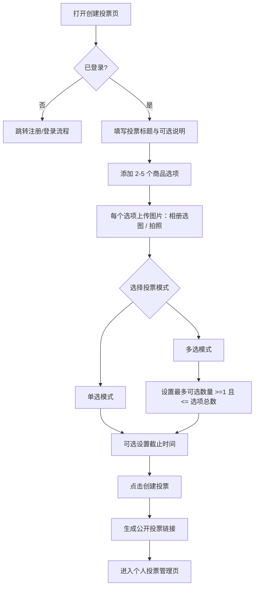
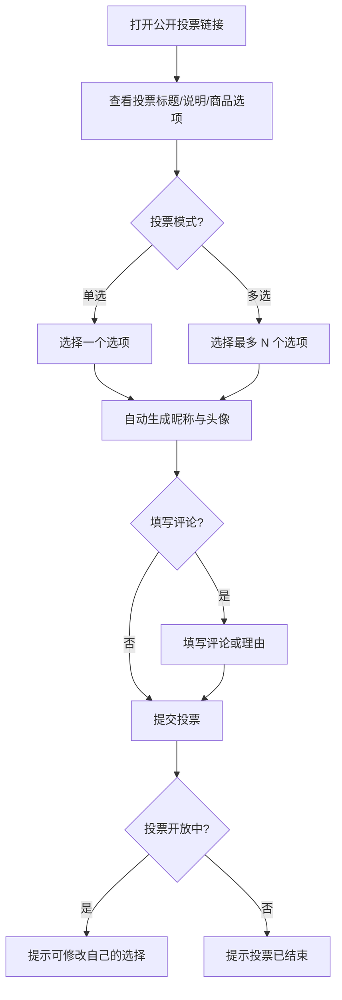
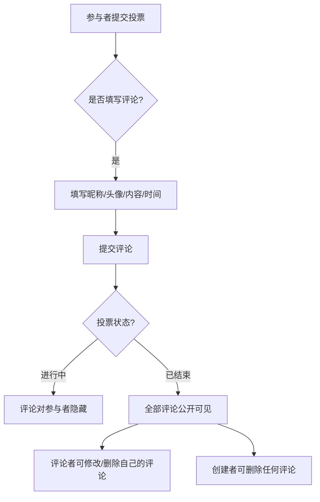
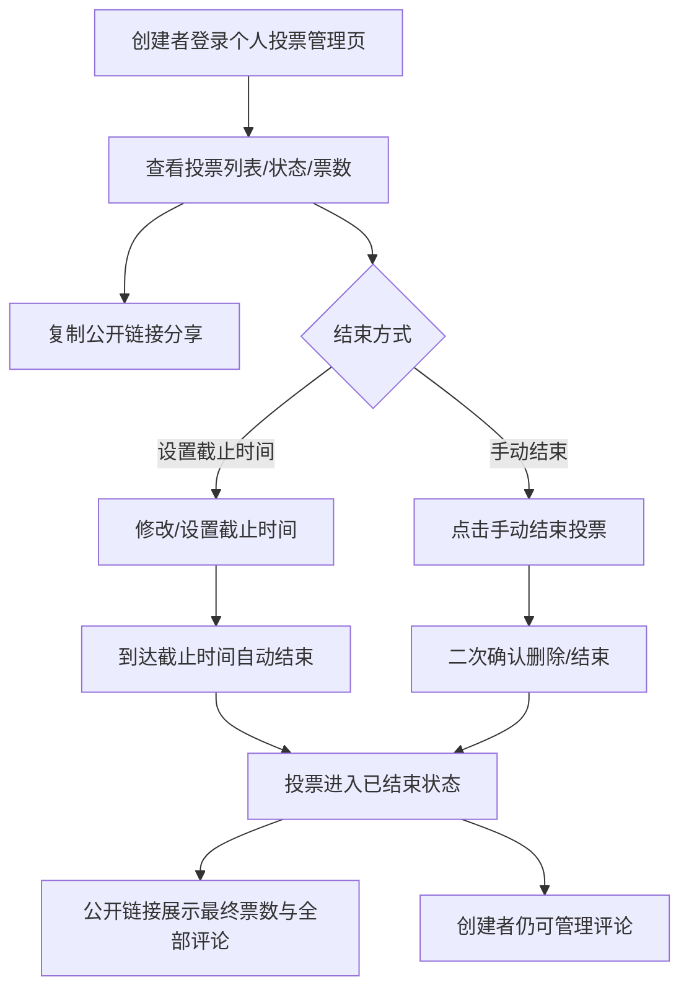
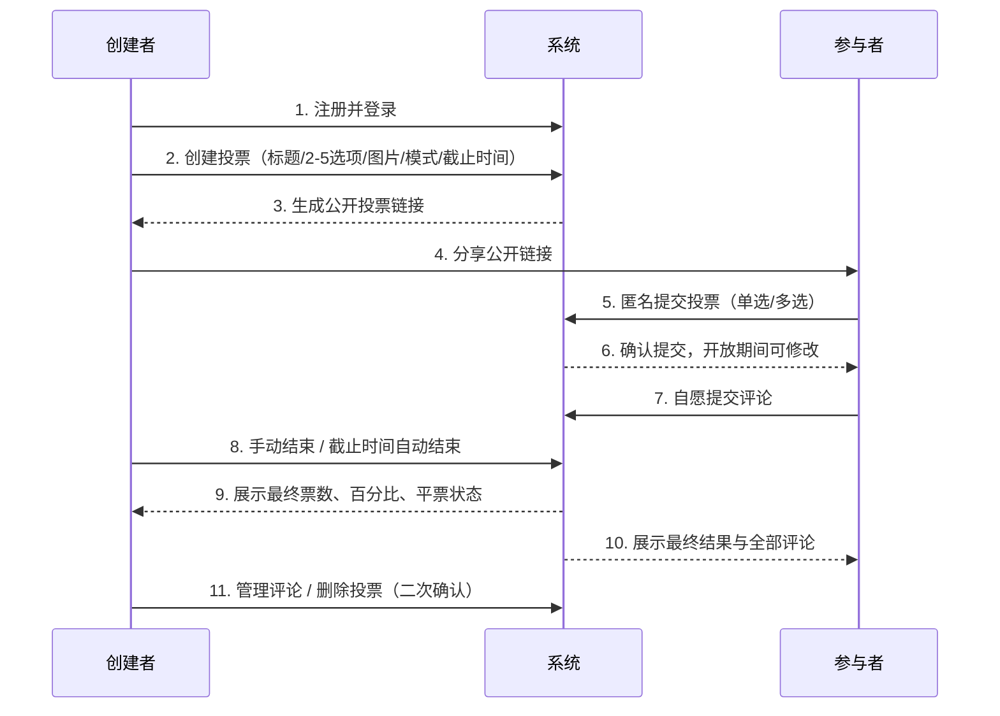

<aside>
🧭

当前版本：**v1.1（最新版）**，按标准 PRD 模板整理。历史版本：PRDv1 ｜ BothPls PRDv2。

</aside>

# [BothPls] 产品需求文档 (PRD)

💡 新手提示：这是一份标准的 PRD 模板。在敏捷工作流中，这份文档是逐步生成的。在原型设计完成前，只需要关注前四部分（基本信息、背景、目标、场景）。原型确定后，再由 AI 补充详细的交互说明。

(页面右上角组件预留：版本切换下拉菜单 [v1.1 最新版 ▼] | [v1.0 历史版])

## 📋 项目信息

| 字段 | 内容 |
| --- | --- |
| 产品名称 | BothPls（朋友帮选） |
| 版本定义 | v1.1 MVP（最小可行性产品） |
| 文档负责人 | YITIAN XIAO |
| 核心目标 | 解决选择困难用户在购物时难以决策的问题，通过朋友投票与评论辅助决策 |
| 全局原型 | Figma 原型 |

## 📝 版本记录

| 日期 | 版本号 | 修改内容 | 修改人 |
| --- | --- | --- | --- |
| 2026-11-01 | v1.1 | 按标准 PRD 模板重新整理，合并 PRDv1 / PRDv2 确认规则 | All |
| 2026-10-31 | v1.0 | 需求方案定稿：确认投票模式、评论权限、删除规则、技术栈 | All |
| 2026-10-29 | v0.5 | 初稿，确立核心功能模块（创建投票 / 参与投票 / 评论） | All |

## 📑 目录

- 需求背景
- 需求目标
- 用户与使用场景 (User Journey)
- 需求功能清单
- 详细方案 (带原型切片)
- 业务流程图 (Mermaid)
- 异常与边界处理
- 数据追踪与埋点 (可选)
- 未来演进规划 (Roadmap)
- 附件 (数据字典/标准库)

---

## 一、需求背景

### 1.1 现状问题

💡 新手提示：描述当前遇到的问题或痛点，最好能用数据说话，或者描述一个具体的糟糕场景。

BothPls 针对的是购物决策场景中的常见痛点：

- 面对多个有吸引力或难以区分的商品选项时，用户难以做出决定。
- 购物预算有限，需要反复比较商品的外观、款式和个人偏好。
- 想参考朋友意见，却需要在聊天软件中反复发送图片、询问和整理回复，信息分散、难以统计。
- 不同朋友的选择各不相同，手动汇总效率低，容易漏掉关键反馈。
- 做决定时容易反复纠结，需要外部意见获得更多参考。

典型糟糕场景：发起者在微信群逐张发商品图，朋友各说各话，最后还要自己数票、翻聊天记录整理理由，过程漫长且容易出错。

### 1.2 为什么现在做？

描述做这个需求的紧迫性。

- SD5913 Group Project 需要在学期内交付可演示的完整产品，开发窗口有限，需要尽快锁定 MVP 范围。
- 核心规则已经过多轮讨论确认（投票模式、评论权限、删除规则、技术栈），产品边界清晰，具备进入开发的条件。
- Figma 原型已搭建，五个核心页面与动效方向已确定，团队可并行推进前端与数据方案验证。

## 二、需求目标

| 目标类型 | 描述 | 衡量指标 | 目标值 |
| --- | --- | --- | --- |
| 核心业务目标 | 解决多商品选择困难、意见收集效率低的问题 | 创建投票 → 分享 → 参与全流程完成率 | 核心流程可完整跑通（演示可用） |
| 用户体验目标 | 参与投票轻松有趣、结果一目了然 | 参与者投票操作耗时 | 无需注册，投票耗时 < 1 分钟 |
| 规则正确性目标 | 票数统计、评论权限、结束与删除规则正确 | 验收标准通过率 | 13 项验收标准全部通过 |
| 演示目标 | Android 手机上完整运行核心投票流程 | Android Chrome 全流程测试 | 5 个核心页面全部可用 |
| 页面适配目标 | 产品仅面向手机端，页面采用固定尺寸，不做 PC 端适配 | 固定视口渲染 | 393 × 873 px（Android 手机） |

## 三、用户与使用场景与旅程图 (User Journey Map)

💡 新手提示：在画原型前，必须理清用户在各个阶段的触点和痛点，避免陷入“为了做功能而做功能”的陷阱。

### 3.1 典型用户画像

**典型用户 1：发起者（选择困难用户）** —— 购物时在多个商品、颜色、款式之间犹豫，预算有限，希望快速收集朋友意见辅助决策。核心诉求：创建投票流程简单，能直观看到票数与理由。

**典型用户 2：参与者（朋友）** —— 收到公开链接，希望无需注册登录即可投票，操作越简单越好，偶尔愿意留下评论说明理由。

### 3.2 核心用户旅程图

| 阶段 | 用户触点 | 用户行为 | 痛点 / 情绪 | 我们的机会点 / 功能转化 |
| --- | --- | --- | --- | --- |
| 1. 创建投票 | BothPls 首页 / 创建页 | 注册登录、填写标题、上传商品图、选投票模式 | 表单繁琐、图片上传麻烦 | 极简创建表单：标题 + 2–5 个选项卡片 + 相册选图/拍照 + 明确模式说明 |
| 2. 分享 | 聊天软件 | 复制公开投票链接发给朋友 | 链接易丢、不知道谁投了 | 一键复制链接；管理页查看投票进度 |
| 3. 参与投票 | 公开投票页 | 查看商品、单选/多选、可选留评论 | 要注册很烦、不清楚最多选几个 | 匿名参与（自动昵称+头像）、明确显示“最多选择 N 项” |
| 4. 查看结果 | 结果与评论页 | 看票数、百分比、朋友评论 | 数据不直观、评论可能影响判断 | 可爱动效结果展示（票数+百分比+平票）；投票结束后统一公开全部评论 |
| 5. 管理投票 | 个人投票管理页 | 查看状态、改截止时间、手动结束、删评论 | 管理入口不明显 | 账号登录直接管理，复制链接、结束投票、删除投票一次到位 |

## 四、需求功能清单

💡 新手提示：先列骨架，不写细节。确认骨架没问题了，再去画原型。

### 4.1 账号与身份模块

| 功能点 | 描述 | 优先级 |
| --- | --- | --- |
| 创建者注册与登录 | 创建者必须先注册并登录才能创建和管理投票 | P0 |
| 匿名参与者身份 | 参与者无需注册，系统生成随机昵称与头像，支持修改展示昵称 | P0 |

### 4.2 创建投票模块

| 功能点 | 描述 | 优先级 |
| --- | --- | --- |
| 创建投票 | 填写标题、可选说明、2–5 个商品选项，每项可上传图片 | P0 |
| 投票模式选择 | 创建者选择单选或多选模式 | P0 |
| 多选数量上限 | 多选模式下创建者设定最多可选数量（≥1 且 ≤ 选项总数） | P0 |
| 截止时间 | 可选设置截止时间，不设置则持续开放至手动结束 | P0 |

### 4.3 投票与结果模块

| 功能点 | 描述 | 优先级 |
| --- | --- | --- |
| 参与投票 | 参与者通过公开链接匿名投票 | P0 |
| 修改投票 | 投票开放期间可修改自己的选择，只统计最新有效选择 | P0 |
| 结果展示 | 展示每个选项的有效票数、百分比、领先状态与平票状态 | P0 |

### 4.4 评论模块

| 功能点 | 描述 | 优先级 |
| --- | --- | --- |
| 评论提交 / 修改 / 删除 | 评论者管理自己的评论；创建者可删除任何评论 | P0 |
| 评论可见性控制 | 投票期间评论隐藏，结束后向所有参与者公开 | P0 |

### 4.5 投票管理模块

| 功能点 | 描述 | 优先级 |
| --- | --- | --- |
| 投票列表与管理 | 查看自己创建的投票、状态、票数、截止时间 | P0 |
| 链接分享 | 复制公开投票链接 | P0 |
| 结束投票 | 设置/修改截止时间、手动结束 | P0 |
| 删除投票 | 创建者删除自己的投票（二次确认，后端验证权限） | P0 |

## 五、详细方案设计 (独立功能模块化展示)

💡 新手提示：这里是 PRD 的核心。采用“流程图 + 规则 + 原型”的组合结构，让原型仅能交互当前描述的功能点，做到“所见即所得”。

### 5.1 创建投票 - 创建者流程

1. 交互流程图

1. 功能描述与原型演示

**触发条件：** 创建者登录后进入创建投票页。

**交互与反馈：**

- 选项数量限制在 2–5 个，少于 2 个时“创建”按钮禁用并提示。
- 图片支持相册选择与拍照上传，可预览与移除。
- 多选模式下需明确填写最多可选数量，页面展示“最多选择 N 项”。
- 创建成功后自动生成公开投票链接。

**异常处理：**

- 未登录点击创建：跳转注册/登录。
- 图片上传失败：Toast 提示“图片上传失败，请重试”。

原型演示（专注模式）：Figma - SD5913Teamwork

### 5.2 参与投票 - 参与者流程

1. 交互流程图

1. 功能描述与原型演示

**触发条件：** 参与者打开公开投票链接。

**交互与反馈：**

- 无需注册登录，使用自动生成的昵称和头像参与。
- 单选模式只能选一个；多选模式不能超过创建者设定的数量。
- 投票开放期间可修改自己的选择，提交后有明确的成功反馈。

**异常处理：**

- 多选超限：Toast 提示“最多选择 N 项”。
- 投票已结束：展示最终结果，禁止投票与修改。

原型演示（专注模式）：Figma - SD5913Teamwork

### 5.3 评论与可见性

1. 交互流程图

1. 功能描述与原型演示

**触发条件：** 参与者提交投票后可自愿填写评论。

**交互与反馈：**

- 评论包含昵称、头像、内容、时间。
- 投票进行期间，尚未投票或已完成投票的参与者均无法查看评论。
- 投票结束后，所有参与者均可查看全部评论；评论仍可按权限修改或删除。
- 评论修改或删除不影响投票统计结果。

**异常处理：**

- 投票期间访问评论区：隐藏并提示“评论将在投票结束后公开”。
- 无权限删除：不显示删除入口。

原型演示（专注模式）：Figma - SD5913Teamwork

### 5.4 投票管理与结束

1. 交互流程图

1. 功能描述与原型演示

**触发条件：** 创建者登录后进入个人投票管理页。

**交互与反馈：**

- 管理功能：查看列表、状态、票数；复制链接；设置/修改截止时间；手动结束；管理评论；删除投票。
- 删除投票前必须二次确认，提示删除后无法继续访问。
- 投票结束后禁止新增和修改投票；公开链接继续展示最终结果与全部评论。

**异常处理：**

- 截止时间到达时正在提交：以后端时间与状态规则为准，拒绝提交。
- 非创建者访问管理功能：无权限提示。

原型演示（专注模式）：Figma - SD5913Teamwork

## 六、业务流程图 (Mermaid)

💡 新手提示：在原型跑通后，用流程图把核心逻辑串起来。

## 七、异常与边界处理

💡 新手提示：产品经理的价值往往体现在对异常情况的考虑上。

| 异常场景 | 系统如何处理 / 提示文案 |
| --- | --- |
| 网络断开 | 提示“当前网络不佳，已为您保存草稿，请恢复网络后重试。” |
| 未登录创建投票 | 跳转注册/登录流程 |
| 选项不足 2 个 | “创建”按钮禁用，提示“至少添加 2 个商品选项” |
| 选项超过 5 个 | 禁止继续添加，提示“最多添加 5 个选项” |
| 多选数量超限 | Toast 提示“最多选择 N 项” |
| 图片上传失败 | Toast 提示“图片上传失败，请重试” |
| 投票进行中查看评论 | 评论区域隐藏，提示“评论将在投票结束后公开” |
| 投票结束后访问 | 展示最终结果与全部评论，禁止投票与修改 |
| 截止时间到达时提交 | 以后端时间为准拒绝提交，提示“投票已结束” |
| 无权限删除评论 | 不显示删除入口；直接请求时提示“您没有删除该评论的权限” |
| 数据为空 (Empty State) | 管理页无投票时展示插画与文案“还没有创建的投票，快去发起一个吧～” + [创建投票] 按钮 |
| 匿名身份丢失 | 更换设备或清除浏览器数据后身份不可恢复，提示“当前身份与设备绑定” |

## 八、数据追踪与埋点 (可选)

| 埋点位置 | 触发时机 | 追踪指标 | 目的 |
| --- | --- | --- | --- |
| 创建投票页 | 点击“创建投票”按钮 | 创建成功率、平均停留时长 | 评估创建流程是否足够简单 |
| 公开投票页 | 提交投票 | 投票完成率、平均停留时长 | 评估参与投票是否流畅 |
| 评论区 | 提交评论 | 评论率 | 评估评论功能参与度 |
| 结果页 | 查看结果 | 结果页访问次数 | 评估结果展示对决策的辅助作用 |
| 管理页 | 手动结束投票 / 删除投票 | 手动结束占比、删除率 | 评估截止时间使用与删除行为 |

## 九、未来演进规划 (Roadmap)

💡 新手提示：不要试图在一个版本里做完所有事。把那些“以后可以做，但现在不急”的想法放在这里。

- **v1.1（当前）：** 跑通核心闭环：创建投票 → 分享 → 匿名参与 → 统计结果 → 评论 → 管理/结束投票，适配 Android Chrome。
- **v1.5：** 跨设备身份同步；投票动态与提醒；商品价格/购买链接等字段；简单数据看板。
- **v2.0：** 好友系统与公开发现；AI 推荐辅助决策；数据分析、导出与排行榜；评论回复与举报系统。

## 十、附件

- 业务数据字典（投票 / 选项 / 评论 / 用户）
- Figma 全局原型
- github link & commit 提交格式
- 视觉规范（莫兰迪配色与动效）见 BothPls PRD 完整版v1 历史版本