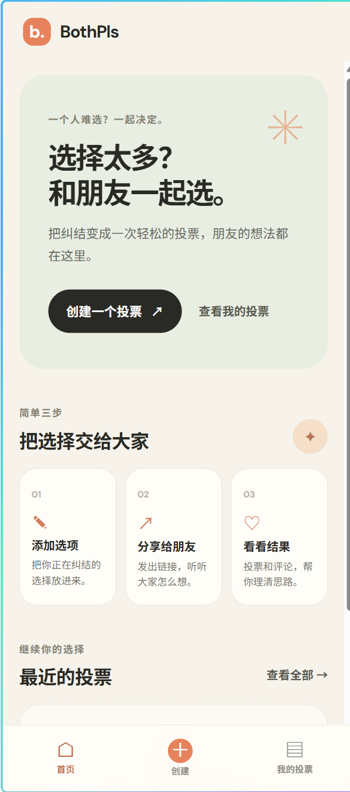

# BothPls

**BothPls — A Social Shopping Decision App**

BothPls is an interactive project designed to help people who struggle to make decisions, especially when choosing between different products, styles, or colours while shopping.

Instead of making a decision alone, users can share their options with friends and collect votes and opinions. BothPls aims to make everyday decisions easier, more interactive, and more enjoyable.

| Main Page | Create poll | My Page |
| --- | --- | --- |
|  |  |  |

&nbsp;
> **Project status:** In Development&nbsp;
> **Project type:** Interactive Web App&nbsp;
> **Course:** Group Project — Build Something Together&nbsp;
> **Final Deadline:** 6 December 2026, 23:59 HKT

---

## Table of Contents

- [1. Project Overview](#1-project-overview)
- [2. Problem Statement](#2-problem-statement)
- [3. Target Users](#3-target-users)
- [4. Core Features](#4-core-features)
- [5. User Journey](#5-user-journey)
- [6. Technology Stack](#6-technology-stack)
- [7. Getting Started](#7-getting-started)
- [8. Platforms and Limitations](#8-platforms-and-limitations)
- [9. Project Progress](#9-project-progress)
- [10. Team Contributions](#10-team-contributions)
- [11. Testing](#11-testing)
- [12. Credits and Acknowledgements](#12-credits-and-acknowledgements)
- [13. Future Improvements](#13-future-improvements)

---

## 1. Project Overview

BothPls is a social decision-making app that allows users to ask friends for help when they cannot decide between multiple options.

For example, a user might be unsure which jacket to buy, which colour suits them better, or which of two products is the better choice. They can create a decision post, share it with friends, and use the feedback to help make their final decision.

**Our goal is to turn an individual decision-making problem into a simple, shared, and interactive experience.**

### Project Information

- **Project name:** BothPls
- **Project category:** Social Shopping Decision App
- **Primary platform:** Mobile Web App (Android Chrome)
- **Target audience:** People who need help choosing between multiple options
- **Development team:** The Aliien (2 members)
- **Live demo:** [TODO: Add URL]
- **Design prototype:** [Figma](https://www.figma.com/design/dWtx6LBsB3EmKM5ElXQaR4/SD5913Teamwork)

## 2. Problem Statement

People often struggle to choose between similar products, styles, or colours. Too many options can make decisions difficult, and users may want a second opinion before making a choice.

Asking friends individually can be inconvenient, and collecting different opinions through separate conversations can make comparisons harder.

BothPls addresses this problem by providing a shared space where users can present their options and gather friends' opinions in one place.

## 3. Target Users

BothPls is designed for people who:

- Feel uncertain when choosing between multiple products or options.
- Want to hear friends' opinions before making a decision.
- Prefer a quick and convenient way to compare alternatives.
- Enjoy sharing choices and interacting with friends.

Although shopping is the primary use case, the broader concept may also support other everyday decisions in the future.

## 4. Core Features

The following features describe the confirmed MVP scope. Their implementation will be updated as development progresses.

| Feature | Description | Status |
|---|---|---|
| Create a decision post | Add a question, 2–5 options with images, and choose single or multiple choice mode. | Confirmed (MVP) |
| Share with friends | Generate a public link that allows friends to access the decision post. | Confirmed (MVP) |
| Vote on options | Allow friends to vote anonymously and modify their vote while the poll is open. | Confirmed (MVP) |
| View voting results | Display valid votes, percentages, and leading or tie status. | Confirmed (MVP) |
| Optional comments | Let friends explain their choices or leave feedback; comments are revealed after the poll ends. | Confirmed (MVP) |
| Manage a decision post | Allow the creator to manage polls, set deadlines, end voting, and delete a poll. | Confirmed (MVP) |

**MVP priority:** Focus on the core loop of creating a poll, sharing it, collecting votes, viewing results, and managing or ending the poll.

Additional features will be considered based on the team's development progress and testing results.

## 5. User Journey

The intended core interaction is:

1. **Create:** The user creates a decision post and adds the options they want to compare.
2. **Share:** The user shares the post with friends through a link.
3. **Vote:** Friends open the link and select their preferred option.
4. **Review:** The user views the voting results and optional comments.
5. **Decide:** The user considers the feedback and makes their own final decision.

The first interaction to validate is whether users can easily create a choice, share it, and collect votes from friends.

## 6. Technology Stack

The frontend stack is confirmed; backend and deployment choices are still being finalised.

| Component | Technology |
|---|---|
| Frontend | React + Vite |
| Backend | [TODO: not yet finalised (Supabase under evaluation)] |
| Database | [TODO: not yet finalised] |
| UI/UX Design | Figma |
| Deployment | [TODO: Vercel under evaluation] |
| Development Tools | VS Code, GitHub |

The final backend stack will be documented here once the implementation decisions have been confirmed.

## 7. Getting Started

### Prerequisites

Before running the project, make sure the following tools are installed:

- [TODO: Runtime or programming language and version]
- [TODO: Package manager]
- [TODO: Other dependencies]

### Installation

Clone the repository:

```bash
git clone https://github.com/sd5913/The-Aliien-Repo.git
cd The-Aliien-Repo
```

Install dependencies:

```bash
npm install
```

### Run Locally

Start the development server:

```bash
npm run dev
```

Open the local URL shown in the terminal:

```text
http://localhost:5173
```

### Online Demo

- **Live demo:** [TODO: Deployment URL]
- **Instructions:** [TODO: Any additional access instructions]

> Setup and execution instructions will be updated to match the final implementation.

## 8. Platforms and Limitations

### Supported Platforms

- **Primary platform:** Mobile Web App (Android Chrome)
- **Supported browsers:** Chrome (Android)
- **Mobile compatibility:** Primary target; designed for a fixed viewport (393 × 873 px reference, also tested at 360 px and 412 px)
- **Desktop compatibility:** Not adapted (mobile-only design)

### Current Limitations

- [TODO: Features that are not yet implemented]
- Anonymous participant identity is device-bound: clearing browser data or switching devices may lose it.
- [TODO: Login, data storage, or sharing limitations]
- [TODO: Other known issues]

Known limitations will be documented as they are identified during development and testing.

## 9. Project Progress

The team will develop BothPls through small, incremental steps and document progress throughout the project.

| Week / Date | Work Completed | Challenges / Next Steps |
|---|---|---|
| 2026-10-29 | PRD v0.5 draft: core modules (create poll / vote / comments) defined | [TODO] |
| 2026-10-31 | PRD v1.0: voting modes, comment permissions, deletion rules and tech stack confirmed | [TODO] |
| 2026-11-01 | PRD v1.1: re-organised into the standard PRD template | [TODO] |
| [TODO] | UI/UX design and prototype | [TODO] |
| [TODO] | Core feature implementation | [TODO] |
| [TODO] | Integration and testing | [TODO] |
| [TODO] | Final improvements and submission | [TODO] |

This table will be updated regularly. Relevant Git commits and pull requests will also document implementation progress.

## 10. Team Contributions

Each team member's responsibilities and contributions will be documented to make the development process transparent.

| Team Member | Role / Responsibilities | Contributions |
|---|---|---|
| Member 1 | [TODO] | [TODO] |
| Member 2 | [TODO] | [TODO] |

Contributions may include planning, UI/UX design, frontend development, backend development, testing, documentation, and integration.

## 11. Testing

BothPls will be tested through actual interactions with users, rather than relying only on whether the project builds successfully.

### Testing Goals

- Check whether users understand how to create a decision post.
- Check whether friends can access a shared post and submit a vote.
- Check whether voting results are displayed correctly.
- Identify confusing interactions and usability issues.
- Verify the experience on supported mobile devices and browsers.

**Testing method:** Run the project locally with Node.js/npm and open the local page in the browser to test the interactions. Teammates can also view the same page by configuring the Live Share extension in VS Code.

**Test participants:** [TODO]

**Key findings and improvements:** [TODO]

## 12. Credits and Acknowledgements

This project may use third-party libraries, design resources, images, icons, fonts, sound effects, or AI-assisted development tools.

All external resources will be credited here, including their sources, licences, and relevant usage details.

| Resource / Tool | Purpose | Source / Licence |
|---|---|---|
| [TODO] | [TODO] | [TODO] |
| [TODO] | [TODO] | [TODO] |
| [TODO: AI tool] | [TODO: e.g. coding assistance or design exploration] | [TODO: How it was used] |

AI tools may be used to assist with development, debugging, design exploration, or documentation. Their use will be described transparently, and the team will review and test the resulting work.

All third-party materials must be original or appropriately licensed for their intended use.

## 13. Future Improvements

Potential improvements will be evaluated based on the MVP's performance, user feedback, and available development time.

- [TODO: Additional voting options]
- [TODO: Improved sharing and participation]
- [TODO: Enhanced mobile experience]
- [TODO: Additional decision-making scenarios]

These ideas are possibilities rather than confirmed commitments.

---

## Repository and Security Notes

- Do not commit passwords, API tokens, signing keys, or private personal information.
- Store required secrets in environment variables or the appropriate secure configuration system.
- Document the required environment variables in an example configuration file, without including real secret values.
- Keep the repository accessible to the instructor for assessment.
- Update this README as the project evolves.

---

**Final Submission Deadline:** Sunday, 6 December 2026, 23:59 Hong Kong time.

BothPls will be submitted through its shared GitHub repository ([The-Aliien-Repo](https://github.com/sd5913/The-Aliien-Repo.git)), including the completed project, source code, an up-to-date README, and relevant development records.
