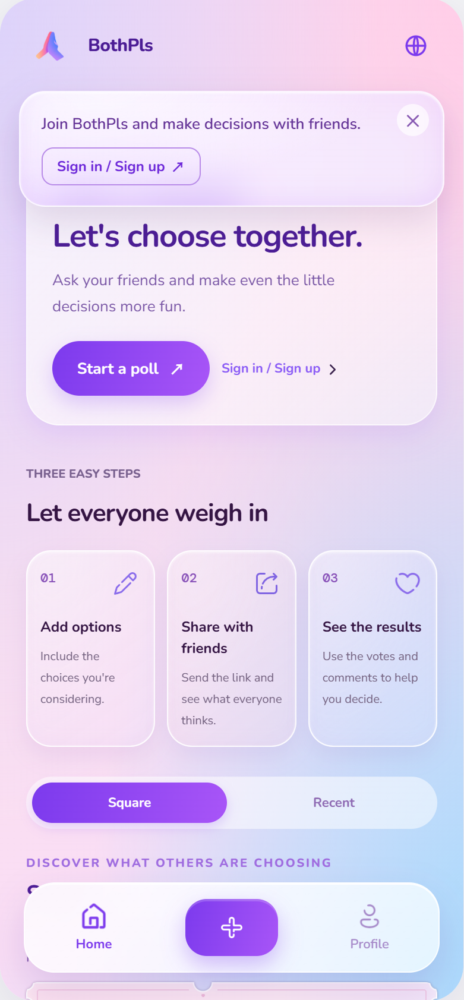
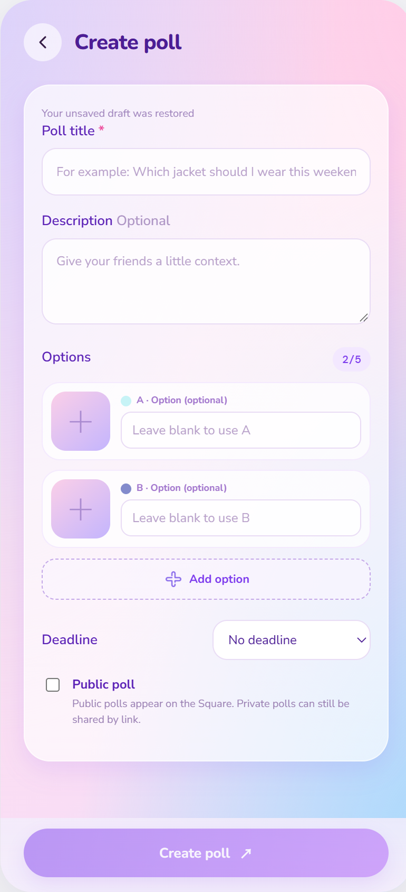
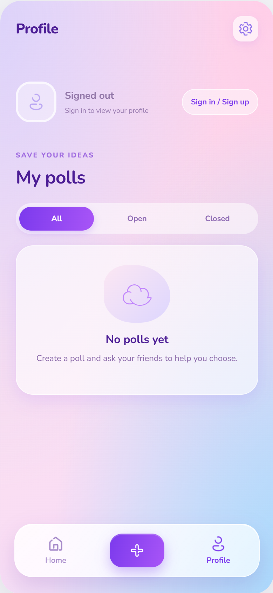
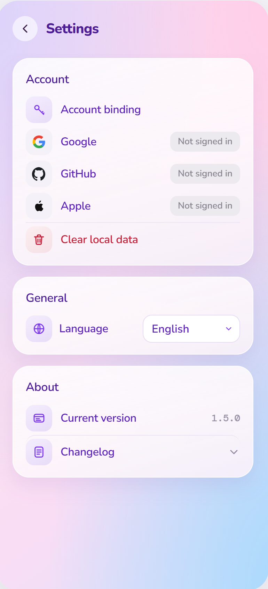

# BothPls

**Turn “I can't decide” into a decision shared with friends.**

BothPls is an interactive web app that helps people choose between products, styles, or colours. Users create a single-choice poll, share it with friends, and collect votes and opinions in one place.

Built by **The Aliien**, a two-person team, for **SD5913 Creative Programming**.

- **Status:** Core functionality implemented; iteration and user testing ongoing
- **Application version:** 1.5.0
- **Requirements baseline:** PRD v1.6, corrected baseline and pending requirements
- **Primary platform:** Mobile web
- **Final deadline:** 6 December 2026, 23:59 Hong Kong time

## Contents

- [1. Links and Screenshots](#1-links-and-screenshots)
- [2. The Problem](#2-the-problem)
- [3. Users and Permissions](#3-users-and-permissions)
- [4. Implemented Features](#4-implemented-features)
- [5. How It Works](#5-how-it-works)
- [6. Languages](#6-languages)
- [7. Technology](#7-technology)
- [8. Run Locally](#8-run-locally)
- [9. Timeline and Progress](#9-timeline-and-progress)
- [10. Team Contributions](#10-team-contributions)
- [11. Testing and Feedback](#11-testing-and-feedback)
- [12. Current Limitations and Next Steps](#12-current-limitations-and-next-steps)
- [13. Credits and AI Usage](#13-credits-and-ai-usage)
- [14. Repository and Submission](#14-repository-and-submission)

## 1. Links and Screenshots

- [Live demo](https://the-aliien-repo-bothpls-pages.pages.dev/)
- [Vercel test deployment](https://the-aliien-repo-oqpi.vercel.app/)
- [GitHub repository](https://github.com/sd5913/The-Aliien-Repo)
- [Figma prototype](https://www.figma.com/design/dWtx6LBsB3EmKM5ElXQaR4/SD5913Teamwork)
- [PRD collection](docs/PRD.md)
- [Current PRD v1.6](docs/BothPls%20PRD%20v1.6.md)

The application version identifies the current code release; the PRD version identifies the requirements baseline. Some v1.6 requirements remain pending.

<table>
  <tr>
    <th width="25%">Main Page</th>
    <th width="25%">Create Poll</th>
    <th width="25%">My Page</th>
    <th width="25%">Settings</th>
  </tr>
  <tr>
    <td align="center" valign="top"></td>
    <td align="center" valign="top"></td>
    <td align="center" valign="top"></td>
    <td align="center" valign="top"></td>
  </tr>
</table>

## 2. The Problem

Choosing between similar products can be difficult. Asking friends through separate messages means sending the same pictures repeatedly, collecting scattered replies, and counting opinions manually.

BothPls brings the options and feedback into one poll. Voting is **single-choice**: each participant chooses one option and can change that choice while the poll is open. The final decision stays with the creator.

## 3. Users and Permissions

| Role | Available actions |
| --- | --- |
| Guest | Browse the public square and accessible shared polls; sign in when prompted to participate |
| Signed-in participant | Vote on other people's polls, change a vote while open, comment, manage their own comments, and view results |
| Poll creator | Create and manage their own polls, share links, view results, end or delete polls, and delete comments |

**Creating, voting, and commenting require an account.** Creators cannot vote or comment on their own polls.

## 4. Implemented Features

The following describes the current code. Deployment settings and ongoing testing are tracked separately.

| Feature | Current behaviour |
| --- | --- |
| Email verification codes | Separate registration and login tabs; registration requires an email and nickname, followed by code verification |
| Third-party sign-in | Google, GitHub, and Apple OAuth flows |
| Public square | Public, open polls that guests can browse |
| Recent activity | Polls the signed-in user has created or participated in |
| Poll creation | Required title, optional description, 2–5 options with optional images, and an optional deadline |
| Public visibility | Choose whether a poll appears in the square; disabled by default, with link sharing still available |
| Sharing | A share dialog after publishing, with a link and share-ticket visual |
| Voting and changing votes | Selection triggers a liquid-fill effect; confirmation saves the vote; choices can change while open |
| Results | Participant counts, option vote counts and percentages, with periodic refresh |
| Comments | Stored in the backend; participants can edit or delete their own comments, and creators can delete comments |
| Poll management | Owners can edit open polls, share, end, or delete them; ending and deletion require confirmation |
| Profile | Account details and the user's created polls, filtered by All, Open, and Closed |
| Profile editing | Avatar, nickname, and biography |
| Settings | Language, version and changelog, sign-out, and account deletion; guests can clear local data |
| Local drafts | Browser recovery for creation, editing, and participation drafts, separated by account or poll |

While a poll is open, other participants' comments are not publicly shown. Creators can view comments for moderation, and participants can retrieve their own comment for editing. Public comments appear after the poll ends.

Once a poll closes or reaches its deadline, new votes, vote changes, and poll edits are rejected. The backend enforces deadlines and permissions.

## 5. How It Works

1. **Browse or sign in.** Explore the square first; sign in to create a poll or participate.
2. **Create.** Add a title, description, options and optional images. Set a deadline and choose whether to list the poll publicly.
3. **Share.** Send friends the poll link or a share ticket.
4. **Vote.** Friends open the link, sign in, select one option, optionally add a comment, and confirm submission.
5. **Review.** View the current counts and percentages; participants can change their choice while the poll is open.
6. **Decide.** End the poll manually or wait for its deadline, then use the final results and comments to make a decision.

## 6. Languages

The interface supports **Simplified Chinese** (default), **English**, and **Korean**.

Change the language using the **globe icon on the home page**, or through **Profile → Settings → Language**. The selection is saved in the current browser.

Language changes apply to interface text. Poll titles, descriptions, options, comments, and nicknames remain in the language entered by the user.

## 7. Technology

| Area | Technology |
| --- | --- |
| Frontend | React 18, TypeScript, React Router 7 |
| Build tooling | Vite 7 |
| Authentication | Supabase Auth |
| Database | Supabase Postgres |
| Image storage | Supabase Storage |
| Backend permissions | PostgreSQL functions, RPC, and row-level security (RLS) |
| Deployment | Cloudflare Pages and GitHub Actions; Vercel configuration retained |
| Design and collaboration | Figma, Notion, GitHub |
| Automated tests | Node.js tests, Playwright, SQL database tests |

Polls, options, votes, and comments are stored in the backend. Account profiles use authentication metadata and profile-table logic.

Language preferences and unfinished drafts are stored locally in the browser. **Drafts are separated by account but do not sync across devices.**

## 8. Run Locally

### Prerequisites

- Node.js 22.x
- npm 10.x
- A configured Supabase project

### Installation

```bash
git clone https://github.com/sd5913/The-Aliien-Repo.git
cd The-Aliien-Repo
npm install
```

Copy `.env.example` to `.env` and fill in your own Supabase project URL and publishable or anon key. The example file contains placeholders only. Never use a service-role key in the frontend.

For database setup, migrations, storage, authentication providers, email templates, and redirect URLs, follow the relevant setup documents:

- [Backend permissions and setup](docs/BACKEND_PERMISSIONS.md)
- [Cloudflare Pages + Supabase](docs/DEPLOYMENT_CLOUDFLARE_PAGES.md)
- [Vercel + Supabase](docs/DEPLOYMENT_VERCEL_SUPABASE.md)

### Development and build

```bash
npm run dev
```

The default development address is `http://localhost:5173`; use the address printed in the terminal.

```bash
npm run build
npm run preview
```

`build` runs TypeScript checks and generates the production build. `preview` serves that build locally.

## 9. Timeline and Progress

Historical milestones below come from the [Notion project record](https://app.notion.com/p/420804a7ab24800eb436ea7c0e4db959). Earlier milestones describe the development process; the implemented features above describe the current application.

| Date | Work |
| --- | --- |
| 29 October 2026 | PRD v0.5: defined the create, vote, and comment modules |
| 31 October 2026 | PRD v1.0: organised comment permissions, deletion rules, and technology choices |
| 1 November 2026 | PRD v1.1: restructured the requirements document |
| 9 November 2026 | PRD v1.2: fixed voting to single choice and revised creator and participant flows |
| 14 November 2026 | Supabase backend launch stage recorded |
| 15 November 2026 | Cloudflare Pages and GitHub Actions deployment stage recorded |
| 18–22 November 2026 | Iteration on languages, share tickets, voting, and results |
| 26 November 2026 | Updated authentication documentation and organised the corrected v1.6 PRD and version collection |

The [Notion task board](https://app.notion.com/p/ebf804a7ab24836f98fa819ae8c1068e) records the project scaffold, core interactions, cloud deployment, voting-page changes, and data-loading fixes as complete. Login security, sharing, results, debugging, and documentation have ongoing tasks.

The schedule below uses task dates rather than verified completion dates. Status and schedule corrections supplied by the team on 26 November 2026 are included.

| Scheduled date | Task | Status |
| --- | --- | --- |
| 22 November 2026 | Sound-effect revisions and bubble-sound research | Completed |
| 24 November 2026 | User-testing questionnaire preparation | Completed |
| 26–30 November 2026 | Invite users to try the app and collect feedback | In progress |
| 3 December 2026 | Consolidate real-user feedback | In progress |
| 3 December 2026 | Update the public Notion project page | Not started |

## 10. Team Contributions

Responsibilities are based on the [Notion project page](https://app.notion.com/p/3b3804a7ab248302b3d2014a32b9e1bc) and [task assignments](https://app.notion.com/p/ebf804a7ab24836f98fa819ae8c1068e).

| Member | Main responsibilities | Shared work |
| --- | --- | --- |
| **YITIAN XIAO** | Repository and project scaffold; core interactions and implementation; cloud services, Cloudflare and Supabase deployment; authentication, voting, sharing and data-loading improvements; README and requirements maintenance | Prototypes, other pages and multimedia, results-page iteration, feedback review |
| **SONGLING HAN** | Product goals, users and interaction planning; scope, page sketches, visual style and assets; debugging, questionnaires and user testing; sound effects and public project-page preparation | Prototypes, other pages and multimedia, results-page iteration, README and asset documentation, feedback review |

Shared tasks include prototypes, additional pages and multimedia, results-page improvements, user-feedback review, and documentation of assets and AI usage. Assignments describe responsibility; they do not imply that every assigned task is complete.

## 11. Testing and Feedback

The project combines automated checks with real-user feedback.

Existing test suites cover:

- **Module logic:** account and participant identity, navigation, sharing, poll services, and localisation.
- **Browser flows:** authentication entry points, voting, poll management, images, layouts, and profile synchronisation.
- **Database permissions:** account and ownership checks, comment permissions, and rejection of invalid operations.

User testing focuses on whether people can understand the create–share–vote–review flow, complete sign-in and resume their action, understand vote changes and comment visibility, and comfortably use the mobile layout and sharing features.

The questionnaires are complete, and user testing is scheduled for **26–30 November 2026**:

- [Chinese feedback questionnaire](https://wj.qq.com/s2/28781438/zg2n/)
- [English feedback questionnaire](https://wj.qq.com/s2/28781528/op3v/)

Participant counts, aggregated findings, and final conclusions will be added after feedback is reviewed. The presence of test suites does not indicate that every deployment or device has passed acceptance testing.

## 12. Current Limitations and Next Steps

- Voting supports single choice only.
- Third-party sign-in is implemented; explicit account linking and unlinking remain pending.
- Email codes do not yet have a client-side resend countdown or automatic verification after six digits.
- Creation, editing, and participation drafts remain in the current browser.
- Immediate comment publication and creator-controlled comment hiding are not implemented.
- Poll details continue polling after closure and need further optimisation.
- Desktop uses a centred mobile layout rather than a separate desktop interface.
- The default language is Simplified Chinese; system-language detection is not implemented.
- Deletion is not implemented as soft deletion.
- Real devices, email delivery, OAuth, and production deployments require continued regression checks.

Priorities are improving authentication, comment controls, account linking, and issues found in user testing. Later work may include draft synchronisation, richer sharing, product details, and additional platforms.

See the [corrected PRD v1.6](docs/BothPls%20PRD%20v1.6.md) for the full requirements and acceptance criteria.

## 13. Credits and AI Usage

| Tool or resource | Use |
| --- | --- |
| React, Vite, React Router, TypeScript | UI, routing, type checking, and builds |
| Supabase | Authentication, database, and image storage |
| Cloudflare Pages, GitHub Actions, Vercel | Hosting and deployment |
| Figma | Prototypes and visual design |
| Notion | Requirements, assignments, schedules, and feedback |
| AI assistance | Coding support, design exploration, troubleshooting, and documentation drafting |

The team uses AI assistance and is responsible for deciding which suggestions to adopt and validating changes through code review, testing, and user feedback.

The source and licence inventory for images, icons, fonts, and sounds is being completed before final submission. Assets with unconfirmed origins are not claimed as original work.

## 14. Repository and Submission

Code, the README, requirements, deployment notes, and tests are maintained in the shared GitHub repository.

`.env.example` documents the required frontend configuration. Actual credentials are configured locally or through deployment settings. Repository access, sensitive information, asset credits, and documentation consistency remain part of the final submission review.

**Final deadline: 6 December 2026, 23:59 Hong Kong time.**
