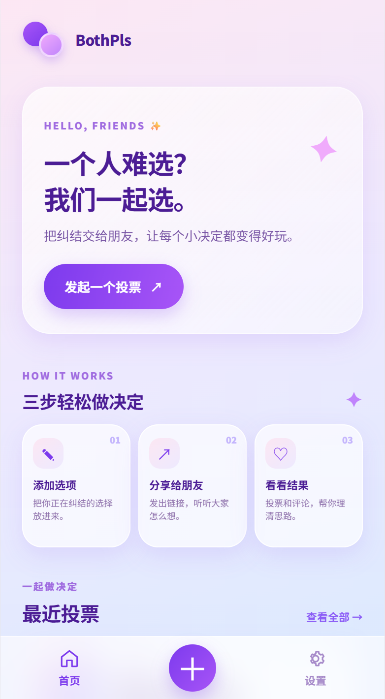
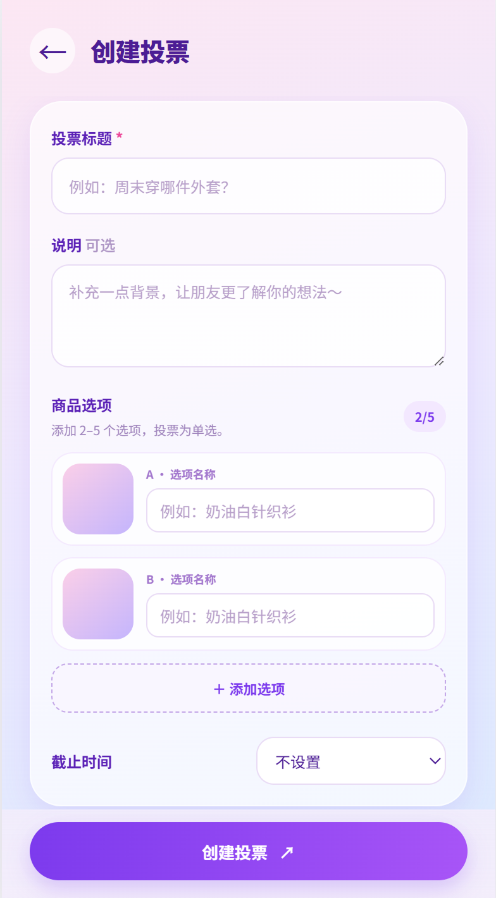
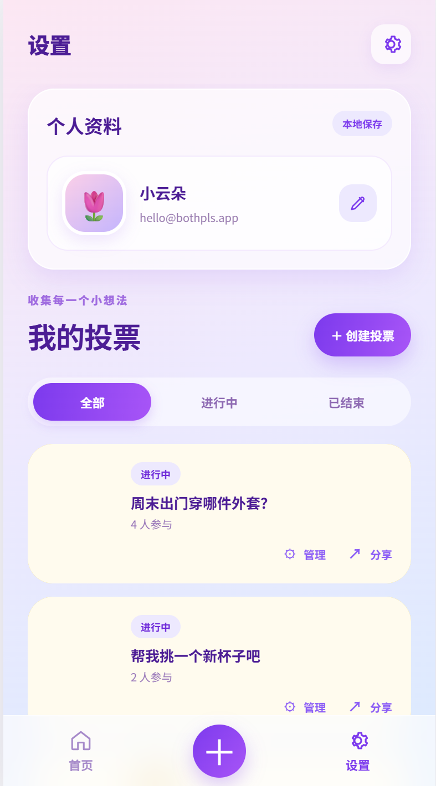

# BothPls

**BothPls — A Social Shopping Decision App**

BothPls is an interactive project designed to help people who struggle to make decisions, especially when choosing between different products, styles, or colours while shopping.

Instead of making a decision alone, users can share their options with friends and collect votes and opinions. BothPls aims to make everyday decisions easier, more interactive, and more enjoyable.

| Main Page | Create poll | My Page |
| --- | --- | --- |
|  |  |  |

&nbsp;
> **Project status:** In Development&nbsp;
> **Project type:** Interactive Web App&nbsp;
> **Course:** Group Project — Build Something Together&nbsp;
> **Current PRD version:** v1.2 MVP (see [`docs\PRD.md`](docs/PRD.md))&nbsp;
> **Final Deadline:** 6 December 2026, 23:59 HKT

---

## Table of Contents

- [1. Project Overview](#1-project-overview)
- [2. Problem Statement](#2-problem-statement)
- [3. Target Users](#3-target-users)
- [4. Core Features](#4-core-features)
- [5. User Journey](#5-user-journey)
- [6. Technology Stack](#6-technology-stack)
- [7. Getting Started](#7-getting-started)
- [8. Platforms and Limitations](#8-platforms-and-limitations)
- [9. Project Progress](#9-project-progress)
- [10. Team Contributions](#10-team-contributions)
- [11. Testing](#11-testing)
- [12. Credits and Acknowledgements](#12-credits-and-acknowledgements)
- [13. Future Improvements](#13-future-improvements)

---

## 1. Project Overview

BothPls is a social decision-making app that allows users to ask friends for help when they cannot decide between multiple options.

For example, a user might be unsure which jacket to buy, which colour suits them better, or which of two products is the better choice. They can create a single-choice poll, share it with friends, and use the feedback to help make their final decision.

**Our goal is to turn an individual decision-making problem into a simple, shared, and interactive experience.**

### Project Information

- **Project name:** BothPls
- **Project category:** Social Shopping Decision App
- **Primary platform:** Mobile Web App (Android Chrome)
- **Target audience:** People who need help choosing between multiple options
- **Development team:** The Aliien (2 members)
- **Product requirements document (PRD):** [`docs\PRD.md`](docs/PRD.md) — the full v1.2 PRD (requirements, user flows, rules, edge cases, analytics and roadmap). The PRD is the source of truth for product scope and rules; this README summarises it.
- **Live demo:** [TODO: Add URL]
- **Design prototype:** [Figma](https://www.figma.com/design/dWtx6LBsB3EmKM5ElXQaR4/SD5913Teamwork)

## 2. Problem Statement

People often struggle to choose between similar products, styles, or colours. Too many options can make decisions difficult, and users may want a second opinion before making a choice.

Asking friends individually can be inconvenient: users have to send images repeatedly in chat apps, collect different opinions across separate conversations, and manually count votes and summarise reasons.

BothPls addresses this problem by providing a shared space where users can present their options and gather friends' opinions in one place. Since most shopping decisions come down to picking one item, the poll is **single-choice by design**, so creators do not need to decide on a voting format.

## 3. Target Users

**Creators** (poll initiators) are shoppers who find it hard to decide, often on a limited budget. They register or log in, create single-choice polls, share them, view live results, and edit or delete their polls.

**Participants** are the creators' friends. They open a public link with an automatically generated random username, with **no registration or login required**, pick one option, optionally leave a comment, and then view the results.

BothPls is designed for people who:

- Feel uncertain when choosing between multiple products or options.
- Want to hear friends' opinions before making a decision.
- Prefer a quick and convenient way to compare alternatives.
- Enjoy sharing choices and interacting with friends.

Although shopping is the primary use case, the broader concept may also support other everyday decisions in the future.

## 4. Core Features

The following features describe the confirmed MVP scope (PRD v1.2). Their implementation will be updated as development progresses. See [`docs\PRD.md`](docs/PRD.md) for the full feature list and priorities.

| Feature | Description | Status |
|---|---|---|
| Creator account | Register with a valid email and a nickname (custom or randomly generated), or log in with email + nickname. Email verification codes are deferred to a later version. | Confirmed (MVP) |
| Create / edit a poll | Add a poll name (required), optional background, 2–5 options (2 by default) with images, and an optional deadline. Editing reuses the creation page. | Confirmed (MVP) |
| Share with friends | Publishing generates a public link that friends can open without an account. | Confirmed (MVP) |
| Vote on options | **Fixed single-choice**: each participant selects exactly one option. Participants join anonymously with a random username and can change their choice while the poll is open (only the latest valid choice counts). | Confirmed (MVP) |
| View voting results | Display the total number of voters, votes and percentages per option. Ties are shown as ties (no random tie-break). | Confirmed (MVP) |
| Optional comments | Participants may leave a comment with their vote. Comments are hidden while the poll is open and revealed to everyone after it ends. Commenters can edit or delete their own comments; the creator can delete any comment. Comment actions never affect vote counts. | Confirmed (MVP) |
| Manage polls (My Polls) | View all polls (newest edit first), poll info (participants, optional closing time, comments, number of options), live results, edit, share, and delete (with a confirmation dialog; creator only). | Confirmed (MVP) |
| Settings | User settings and system settings. | Planned (P1) |

**MVP priority:** Focus on the core loop of creating a poll, sharing it, collecting single-choice votes, viewing results, and managing or ending the poll.

**Ending a poll:** the creator ends it manually, or it ends automatically when the optional deadline is reached (the backend time is authoritative). After a poll ends, the public link shows final results and comments, and new votes or changes are rejected.

Additional features will be considered based on the team's development progress and testing results.

## 5. User Journey

The intended core interaction is:

1. **Sign in (creator):** The creator registers or logs in with email and nickname. Participants skip this step entirely.
2. **Create:** The creator builds a poll with a name, optional background, 2–5 options with images, and an optional deadline, then publishes it.
3. **Share:** The creator copies the public link and sends it to friends.
4. **Vote:** Friends open the link (anonymously, with a random username), select one option, optionally add a comment, and submit.
5. **Review:** After submitting, participants see the number of voters, result percentages, and (once the poll has ended) comments. The creator can check live results at any time.
6. **Manage and decide:** The creator can edit, share, or delete the poll, then considers the feedback and makes their own final decision.

The first interaction to validate is whether users can easily create a poll, share it, and collect votes from friends in under a minute per participant.

For the finalised creator and participant flow charts, see Section 5 of [`docs\PRD.md`](docs/PRD.md).

## 6. Technology Stack

The frontend stack is confirmed; backend and deployment choices are still being finalised.

| Component | Technology |
|---|---|
| Frontend | React + Vite |
| Backend | [TODO: not yet finalised (Supabase under evaluation)] |
| Database | [TODO: not yet finalised] |
| UI/UX Design | Figma |
| Deployment | [TODO: Vercel under evaluation] |
| Development Tools | VS Code, GitHub |

The final backend stack will be documented here once the implementation decisions have been confirmed.

## 7. Getting Started

### Prerequisites

Before running the project, make sure the following tools are installed:

- [TODO: Runtime or programming language and version]
- [TODO: Package manager]
- [TODO: Other dependencies]

### Installation

Clone the repository:

```bash
git clone https://github.com/sd5913/The-Aliien-Repo.git
cd The-Aliien-Repo
```

Install dependencies:

```bash
npm install
```

### Run Locally

Start the development server:

```bash
npm run dev
```

Open the local URL shown in the terminal:

```text
http://localhost:5173
```

### Online Demo

- **Live demo:** [TODO: Deployment URL]
- **Instructions:** [TODO: Any additional access instructions]

> Setup and execution instructions will be updated to match the final implementation.

## 8. Platforms and Limitations

### Supported Platforms

- **Primary platform:** Mobile Web App (Android Chrome)
- **Supported browsers:** Chrome (Android)
- **Mobile compatibility:** Primary target; designed for a fixed viewport (393 × 873 px reference, also tested at 360 px and 412 px)
- **Desktop compatibility:** Not adapted (mobile-only design)

### Current Limitations

- Voting is **single-choice only**. Multiple-choice mode is not available in the MVP (planned for v1.5).
- Email verification codes are not implemented yet: creators log in with email + nickname only (planned for a later version).
- Anonymous participant identity (random username) is device/browser-bound: clearing browser data or switching devices may lose it, and it cannot be recovered.
- [TODO: Features that are not yet implemented]
- [TODO: Login, data storage, or sharing limitations]
- [TODO: Other known issues]

Known limitations will be documented as they are identified during development and testing.

## 9. Project Progress

The team will develop BothPls through small, incremental steps and document progress throughout the project.

| Week / Date | Work Completed | Challenges / Next Steps |
|---|---|---|
| 2026-10-29 | PRD v0.5 draft: core modules (create poll / vote / comments) defined | [TODO] |
| 2026-10-31 | PRD v1.0: comment permissions, deletion rules and tech stack confirmed | [TODO] |
| 2026-11-01 | PRD v1.1: re-organised into the standard PRD template | [TODO] |
| 2026-11-09 | PRD v1.2: removed the single/multiple-choice mode selection (voting is now fixed single-choice); restructured creator and participant flows based on the two finalised flow charts | [TODO] |
| [TODO] | UI/UX design and prototype | [TODO] |
| [TODO] | Core feature implementation | [TODO] |
| [TODO] | Integration and testing | [TODO] |
| [TODO] | Final improvements and submission | [TODO] |

This table will be updated regularly. Relevant Git commits and pull requests will also document implementation progress. The full revision history of the requirements is kept in [`docs\PRD.md`](docs/PRD.md).

## 10. Team Contributions

Each team member's responsibilities and contributions will be documented to make the development process transparent.

| Team Member | Role / Responsibilities | Contributions |
|---|---|---|
| Member 1 | [TODO] | [TODO] |
| Member 2 | [TODO] | [TODO] |

Contributions may include planning, UI/UX design, frontend development, backend development, testing, documentation, and integration.

## 11. Testing

BothPls will be tested through actual interactions with users, rather than relying only on whether the project builds successfully.

### Testing Goals

- Check whether users understand how to create a poll.
- Check whether friends can access a shared link without an account and submit a single-choice vote in under a minute.
- Check whether voting results (vote counts, percentages, ties) are displayed correctly.
- Check comment rules: hidden while the poll is open, revealed after it ends, and correct edit/delete permissions.
- Check ending and deletion rules: manual end, automatic end at the deadline, and delete with confirmation (creator only).
- Identify confusing interactions and usability issues.
- Verify the experience on supported mobile devices and browsers.

Acceptance criteria and edge cases are listed in [`docs\PRD.md`](docs/PRD.md) (Section 7).

**Testing method:** Run the project locally with Node.js/npm and open the local page in the browser to test the interactions. Teammates can also view the same page by configuring the Live Share extension in VS Code.

**Test participants:** [TODO]

**Key findings and improvements:** [TODO]

## 12. Credits and Acknowledgements

This project may use third-party libraries, design resources, images, icons, fonts, sound effects, or AI-assisted development tools.

All external resources will be credited here, including their sources, licences, and relevant usage details.

| Resource / Tool | Purpose | Source / Licence |
|---|---|---|
| [TODO] | [TODO] | [TODO] |
| [TODO] | [TODO] | [TODO] |
| [TODO: AI tool] | [TODO: e.g. coding assistance or design exploration] | [TODO: How it was used] |

AI tools may be used to assist with development, debugging, design exploration, or documentation. Their use will be described transparently, and the team will review and test the resulting work.

All third-party materials must be original or appropriately licensed for their intended use.

## 13. Future Improvements

Potential improvements will be evaluated based on the MVP's performance, user feedback, and available development time. The roadmap below follows [`docs\PRD.md`](docs/PRD.md).

**v1.5 (planned):**

- Multiple-choice voting mode
- Cross-device identity sync
- Voting notifications and reminders
- Product price and purchase-link fields
- A simple data dashboard

**v2.0 (exploratory):**

- Friend system and public discovery
- AI-assisted recommendations for decision making
- Comment replies and reporting
- Data analytics export
- Native app exploration

These ideas are possibilities rather than confirmed commitments.

---

## Repository and Security Notes

- Do not commit passwords, API tokens, signing keys, or private personal information.
- Store required secrets in environment variables or the appropriate secure configuration system.
- Document the required environment variables in an example configuration file, without including real secret values.
- Keep the repository accessible to the instructor for assessment.
- Update this README as the project evolves, and keep it consistent with [`docs\PRD.md`](docs/PRD.md).

---

**Final Submission Deadline:** Sunday, 6 December 2026, 23:59 Hong Kong time.

BothPls will be submitted through its shared GitHub repository ([The-Aliien-Repo](https://github.com/sd5913/The-Aliien-Repo.git)), including the completed project, source code, an up-to-date README, and relevant development records.