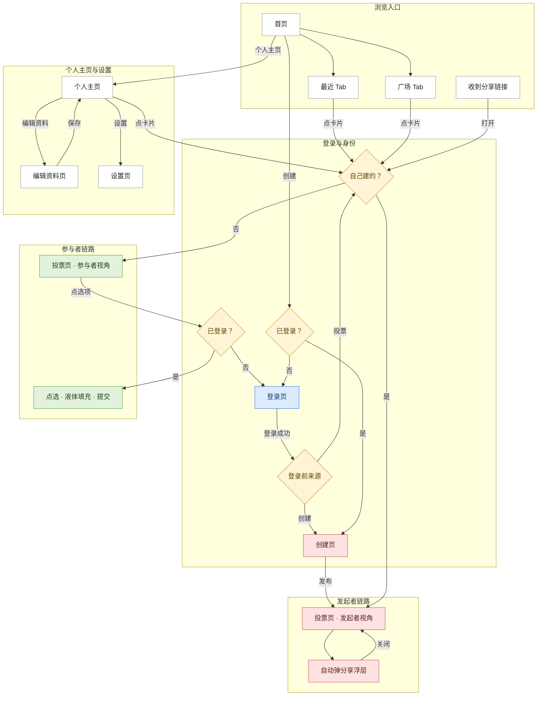
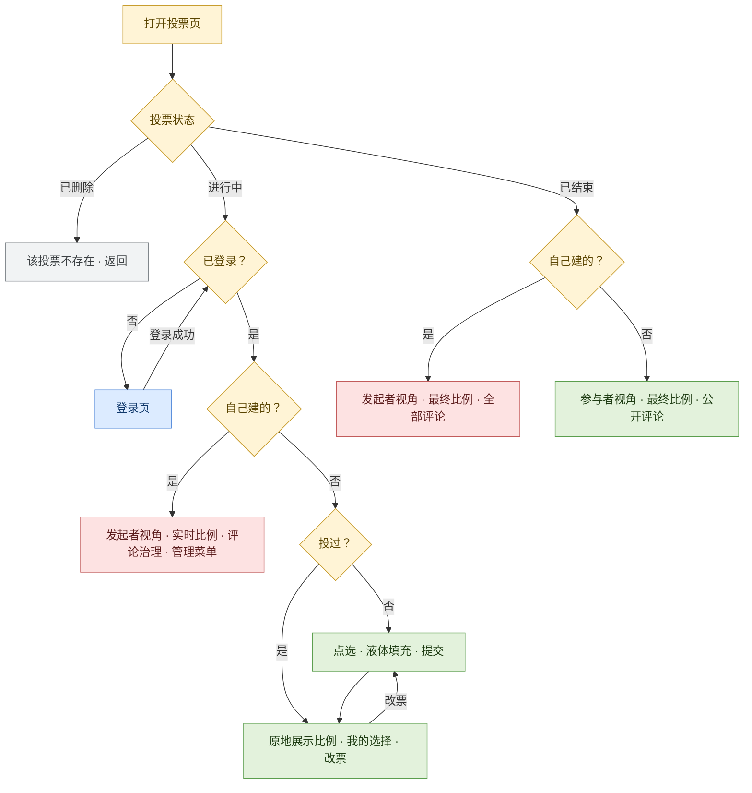
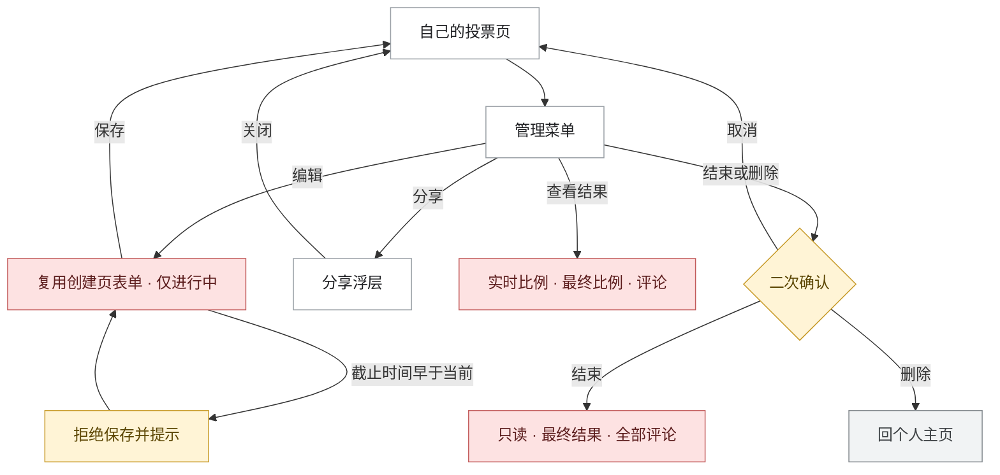
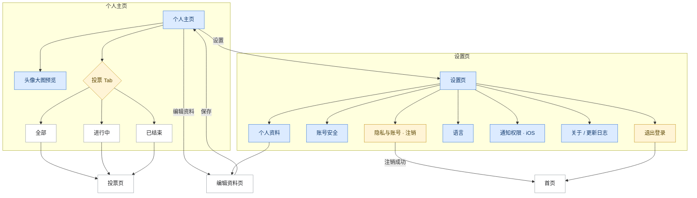
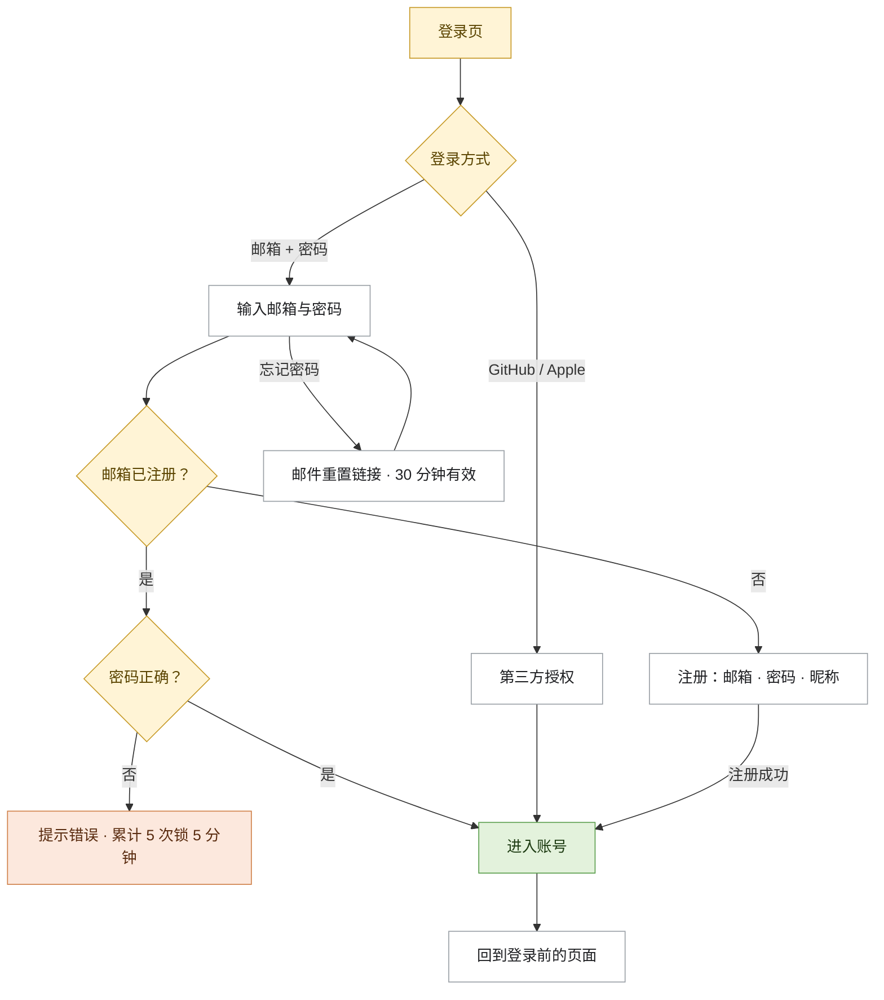

# BothPls 产品需求文档（PRD）v1.5

对齐当前实现与 UserFlow。本文只写定稿规则，不保留待确认项。

v1.5 的核心变更：取消软登录，身份收敛为游客与账号两级；投票、评论、创建一律要求登录。

## 目录

- 1 项目信息
- 2 需求范围
- 3 身份模型
- 4 需求背景
- 5 目标
- 6 功能清单
- 7 关键规则
- 8 用户流程
- 9 异常与边界
- 10 埋点
- 11 演进

## 版本记录

| 版本 | 变更 |
|---|---|
| v1.5 | 取消软登录链路，身份收敛为游客与账号两级；新增独立登录页与邮箱注册 / 密码登录；投票、评论、创建前置登录；登录态跨设备；草稿与记录全部绑定账号；设置页把账号绑定改为账号安全（绑定与修改密码）；发起者不参与投票，与参与者权限完全分离 |
| v1.4 | 结构重写：三层身份、首页双 Tab、发布链路合并、参与与结果合一、评论三权分离；登录确定为 GitHub / Apple 已实现、邮箱密码在下一版；液体填充动画定名；结束后禁止编辑；个人主页拆出编辑资料页与设置页 |

## 1. 项目信息

| 字段 | 内容 |
|---|---|
| 产品 | BothPls（朋友帮选） |
| 版本 | v1.5 MVP |
| 目标 | 发起者用单选投票收集朋友意见，辅助购物决策 |
| 适配 | 393 × 873 px，Android Chrome |
| 页面数 | 7：首页 / 个人主页 / 创建 / 投票 / 编辑资料 / 设置 / 登录（「我的评论」为投票页内区块，不单独成页） |
| 原型 | Figma（附件） |

## 2. 需求范围

**本期做**

- 两级身份：游客只读、账号全能力。
- 独立登录页：GitHub、Apple、邮箱 + 密码，含注册与找回密码。
- 账号可绑定多种登录方式，任一方式登入同一账号。
- 登录态跨设备，投票记录、评论、草稿、资料随账号走。
- 首页双 Tab：最近、广场。
- 创建、编辑、分享、结束、删除五类投票操作。
- 创建时设定评论可见性与是否公开到广场。
- 单选投票、液体填充动画、两步提交、进行中改票。
- 发起者不参与自己投票的投票与评论，只做管理与查看结果。
- 参与者只能投票与查看结果，不提供分享入口。
- 评论三权分离：所有权、治理权、可见性；改删入口「我的评论」。
- 结果页 10 秒轮询，页面重新可见与网络恢复即时刷新。
- 个人主页：只读资料、投票按全部 / 进行中 / 已结束分组。
- 编辑资料页：头像、昵称、简介。
- 设置页：账号、通用、关于、退出登录。
- 多语言切换。
- 更新日志。

**本期不做**

- 软登录或匿名投票。
- 手机号登录。
- 发起者备注或补充说明区。
- 复制投票。
- 多选模式。
- PC 端适配。
- 评论回复与举报。
- AI 推荐。
- 独立投票 info 页。
- 投票提醒通知。
- 账号数据导出。
- 应用权限管理（iOS 版上线后再做）。
- 内容敏感词检测。
- 头像与图片的 CDN 转码。

## 3. 身份模型

| 身份 | 获得方式 | 能力 | 持久范围 |
|---|---|---|---|
| 游客 | 未登录直接打开 | 浏览首页广场、打开分享链接、查看进行中投票页、查看已结束结果 | 无，不产生任何记录 |
| 账号 | GitHub / Apple 授权，或邮箱 + 密码注册 | 创建、编辑、分享、结束、删除自己的投票；投票与改票他人的投票；评论他人的投票；个人主页与设置全部功能 | 账号，跨设备 |

**判定**：能创建 = 已登录；能投票 = 已登录且不是该投票的发起者；其余为游客只读。

**为什么不做软登录**：投票必须归属唯一账号，才能保证一票一改、跨设备可查、评论可追溯。软登录只在单个浏览器有效，换设备或清缓存后记录丢失，且与账号合并时会产生重复计票。本版直接砍掉这条链路。

**登录方式**

| 方式 | 状态 | 规则 |
|---|---|---|
| GitHub 授权 | 已实现 | 授权成功即进入或创建账号 |
| Apple 授权 | 已实现 | 同上，Apple 隐藏邮箱不影响建号 |
| 邮箱 + 密码 | v1.5 新增 | 邮箱注册即建号，密码 8–32 位且必须同时包含字母与数字 |

**账号与登录态**

- 一个邮箱只对应一个账号，一个账号可绑定多种登录方式。
- 至少保留一种登录方式，最后一种不可解绑。
- 同一账号可在多设备同时登录，记录实时一致。
- 手动退出或修改密码后，其他设备需重新登录。
- 退出登录即回到游客，本地不保留身份信息。
- 同一账号对同一投票只计一票；在不同设备改票，以最后一次提交为准。

**资料来源**

- 第三方授权带回昵称与头像，直接作为初始资料，可在编辑资料页修改。
- 邮箱注册时必须填昵称，头像可选，不填用默认头像。

## 4. 需求背景

- 面对差异不大的商品难决定，预算有限又要反复比较。
- 在聊天里刷图、追问、手工数票，信息分散。
- 多数决策是二选一，直接单选最直观。
- 之前的匿名参与方式换设备后就找不到自己的投票，发起者也追溯不到谁投了什么。

## 5. 目标

| 目标 | 衡量 | 目标值 |
|---|---|---|
| 闭环 | 创建 → 分享 → 参与 → 结果 → 结束 | 全流程跑通 |
| 参与 | 投票耗时（含登录） | 小于 1 分钟 |
| 登录 | 触发登录到登录成功的成功率 | 大于 80% |
| 规则 | 单选统计、评论权属、结束与删除 | 验收项全部通过 |
| 环境 | Android Chrome | 全页面可用 |

## 6. 功能清单（按页面组织，规则唯一出处）

### 6.1 首页

- 双 Tab：`最近` / `广场`，共用同一套投票卡片组件。
- **最近**：当前账号创建或参与过的投票，按最近活动时间倒序；卡片带「我建的」「我投的」角标与进行中 / 已结束状态。
- **广场**：公开到广场且进行中的投票，按最新发布倒序，卡片显示参与人数。
- 广场卡片只提供「去投票」入口，不提供分享入口。
- 自己创建的投票出现在广场时，卡片改显示「我建的」与「查看结果」入口，不做投票引导。
- 快捷创建：游客点创建跳登录页，登录成功回到创建页。
- 游客的最近 Tab 展示空态与登录入口。
- 广场无进行中投票时展示空态。

### 6.2 个人主页

**页面结构**

- 顶部为只读资料：头像、昵称、账号标识（邮箱或第三方来源）。
- 资料文字不可点击，头像可点开查看大图。
- 右上角两个入口：编辑资料、设置。
- 投票区三个 Tab：`全部` / `进行中` / `已结束`，按投票创建时间倒序，最新创建的在前。

**投票区规则**

- 全部 = 自己创建的与参与过的投票合集。
- 进行中 = 未到截止时间且未手动结束；已结束 = 已手动结束或已到截止时间。
- 软删除的投票不出现在任何 Tab。
- 游客进入时展示空态与登录入口。

**编辑资料页（独立页，个人主页与设置页共用）**

- 字段：头像、昵称、简介（可选）。
- 昵称必填，上限 20 字，全站唯一性不校验。
- 保存成功后回到个人主页；返回不保存则丢弃改动。
- 头像上传失败提示重试，其余已填字段保留。

### 6.3 创建页

- 名称必填；背景可选；商品 2–5 个，可上传图片；截止时间可选。
- 评论可见性：默认「结束后公开」，可选「立即公开」。
- 公开到广场：默认开启，可关闭。
- 草稿绑定账号，换设备登录后可继续编辑；发布成功即清除。
- 编辑态复用本页表单，不产生草稿。

### 6.4 投票页（参与与结果合一）

| 状态 | 表现 |
|---|---|
| 进行中 · 参与者未投 | 展示选项与投票信息，点选触发液体填充动画，再单独提交 |
| 进行中 · 参与者已投 | 原地展示比例、我的选择、改票入口 |
| 进行中 · 发起者 | 只展示当前比例、进行中评论治理、管理菜单；不出现选项交互、提交按钮与评论输入 |
| 已结束 · 参与者 | 最终人数与比例、公开评论、禁止投票 |
| 已结束 · 发起者 | 最终人数与比例、全部评论、管理菜单只剩分享与删除 |
| 已删除 | 显示「该投票不存在」并提供返回入口 |

- 顶部展示名称、背景、参与人数、截止时间、选项个数。
- 参与人数只统计参与者提交的票，发起者不计入。
- 游客可浏览本页但不能投票；点选项跳登录页，登录成功回到本页并保留刚才的点选，需再次确认提交。
- 发起者不能给自己的投票投票，也不能评论自己的投票；进入自己的投票一律渲染发起者视角。
- 发起者视角只有三块：结果、进行中评论治理、管理菜单。参与者视角只有投票与结果，不出现管理菜单与分享入口。
- 不设发起者备注：发起者没有说明输入口，页面上不出现发起者发言区；补充信息只能写进投票名称、背景或选项里。
- 评论区块「我的评论」：参与者在此修改、删除自己提交的评论，不单独成页。
- 进行中且设为「立即公开」时，已投用户可见评论；设为「结束后公开」时，进行中统一显示「评论将在投票结束后公开」，发起者始终可见。
- 结果每 10 秒轮询；页面重新可见或网络恢复时立即刷新；进入已结束或已删除后停止轮询。

### 6.5 管理菜单（仅所有者，仅自己的投票）

- 入口：投票页右上角，仅所有者可见，参与者永远看不到。
- 发起者权限共五项：编辑、分享、结束、删除、查看结果。没有投票、没有评论。
- 编辑：仅进行中显示，进入编辑态，规则见 7.8。
- 分享：唤起分享浮层，复制链接。分享是发起者独有，参与者没有。
- 结束：二次确认。
- 删除：二次确认。
- 查看结果：进行中展示实时比例，结束后展示最终比例与全部评论。
- 投票结束后菜单只剩分享与删除，编辑与结束消失。

### 6.6 设置页

| 分组 | 条目 | 行为 |
|---|---|---|
| 账号 | 个人资料 | 跳编辑资料页，与个人主页入口同一页 |
| 账号 | 账号安全 | 绑定或解绑登录方式；邮箱账号可修改密码；至少保留一种登录方式 |
| 账号 | 隐私与账号 | 注销账号，二次确认并输入昵称 |
| 通用 | 语言 | 显示当前语言，切换后立即重载界面 |
| 通用 | 通知权限 | iOS 版上线后提供，Web 版不出现 |
| 关于 | 版本号 + 更新日志 | 展示当前版本与迭代记录，只含版本号与说明 |
| 底部 | 退出登录 | 退出后回到游客 |

- 设置页游客可进，但只显示登录入口、通用与关于。

### 6.7 登录页

- 三种入口并列：GitHub、Apple、邮箱 + 密码。
- 邮箱注册字段：邮箱、密码、昵称（必填，20 字内），头像可选。
- 登录或注册成功后回到触发登录前的页面；被中断的创建表单与已点选项保留，需再次确认提交。
- 邮箱未注册时提示「该邮箱未注册」并给出注册入口。
- 忘记密码走邮件重置链接，链接 30 分钟内有效、仅可用一次，重置后其他设备需重新登录。
- 登录页不展示广场与个人主页内容，只有返回入口。

## 7. 关键规则

1. **单选**：一票一选项，不设模式选择；改票只保留最新一次有效选择。
2. **两步提交**：点选触发液体填充动画，点提交才写入；评论可选，随投票一并提交。
3. **液体填充动画**：点选后选项块内的液体自下向上填充至满，表示「待提交」；未提交不落库，改选时液体回落。
4. **发布**：发布后直接进投票页（发起者视角），自动弹一次分享浮层；关闭浮层留在本页。
5. **广场收录**：创建页默认公开到广场，关闭后不出现在广场；无论开关状态，链接都可访问。投票结束、删除或转为只读后自动从广场移除。
6. **截止时间**：可选；不设则持续开放至手动结束；到达即自动结束，以后端时间为准。
7. **结束**：手动或到期；结束后禁止新增投票、禁止改选、禁止编辑投票内容，仍可分享与删除。
8. **编辑范围**：仅进行中可编辑；可改名称、背景、选项图片、截止时间；不可增删选项，不可修改选项文案与顺序，避免与已投记录错位。保存后立即生效，已有投票记录保留。
9. **删除**：仅所有者，进行中与已结束均可删，二次确认，软删除；删除后个人主页、最近、广场、原链接全部不再出现。
10. **评论所有权**：评论者可修改、删除自己的评论，入口在投票页「我的评论」区块。
11. **评论治理权**：发起者可隐藏或删除任意评论，不可编辑他人内容。
12. **评论可见性**：由发起者在创建时设定，默认「结束后公开」，可选「立即公开」；设为结束后公开时，进行中的评论对普通参与者隐藏，发起者始终可见。
13. **广场隐私**：在广场列表内打开的投票，评论只显示昵称，不显示头像。
14. **草稿**：创建页草稿绑定账号，跨设备可继续；发布或提交成功后清除；编辑态不产生草稿。
15. **权限**：游客可浏览与查看结果，不可投票、评论、创建、编辑、结束、删除。投票、评论、创建一律要求登录。
16. **列表排序**：个人主页投票区按投票创建时间倒序；首页最近 Tab 按最近活动时间倒序。两处独立取值，不共用排序字段。
17. **多语言**：默认跟随系统；设置页手动切换后立即重载；只翻译界面文案，投票名称、选项与评论原文不翻译；切换不影响草稿。
18. **注销账号**：二次确认并输入昵称验证；成功后账号与其创建的数据软删除，退出登录回到游客。
19. **更新日志**：只展示版本号与迭代说明，不含接口地址、环境变量、后台配置名。
20. **登录态**：一次登录长期有效；多设备可同时在线；手动退出或修改密码后其他设备需重新登录；退出即游客，本地不留身份信息。
21. **一票一账号**：同一账号对同一投票只计一票，跨设备改票以最后一次提交为准。
22. **实时刷新**：进行中轮询 10 秒一次；页面重新可见、网络恢复时立即刷新；已结束与已删除不再轮询。
23. **发起者不投票**：对自己创建的投票，发起者不能投票、不能发表评论，也不计入参与人数；直接请求提交由后端拒绝。从广场、最近、分享链接、个人主页任一入口进入，表现一致。
24. **权限边界**：发起者 = 编辑、分享、结束、删除、查看结果；参与者 = 投票、改票、查看结果、评论。参与者没有分享入口，管理菜单仅所有者可见。

## 8. 用户流程

### 8.1 主流程

### 8.2 投票页状态

### 8.3 管理流程

### 8.4 个人主页与设置

### 8.5 登录与注册

## 9. 异常与边界

| 场景 | 处理 |
|---|---|
| 游客点选项 | 跳登录页，登录成功回本页并保留点选，需再确认提交 |
| 游客点创建 | 跳登录页，成功后回到创建页 |
| 游客点评论输入 | 跳登录页，成功后回到本页，评论草稿保留 |
| 游客进个人主页 / 设置 | 只读空态与登录入口，设置只显示通用与关于 |
| 发起者点选项 | 不展示选项交互与提交按钮，只显示结果、评论治理与管理菜单 |
| 发起者直接请求提交或评论自己的投票 | 拒绝，提示「发起者不能投票」 |
| 参与者请求分享入口 | 不展示，分享与管理菜单仅所有者可见 |
| 取消第三方授权 | 留在登录页，提示「已取消授权」 |
| 第三方授权失败 | 留在登录页，提示重试，不创建账号 |
| 第三方未返回昵称 | 用默认昵称，可在编辑资料页修改 |
| 邮箱格式非法 | 阻止提交，提示「请输入有效邮箱」 |
| 密码不合规 | 阻止提交，提示「密码需 8–32 位且同时包含字母与数字」 |
| 邮箱已注册 | 提示「该邮箱已注册，请直接登录」 |
| 邮箱未注册 | 提示「该邮箱未注册」并给注册入口 |
| 密码错误 | 提示「密码错误」；连续 5 次锁定 5 分钟 |
| 第三方邮箱已被其他账号使用 | 提示该邮箱已绑定其他账号，引导用邮箱登录后在同一账号内绑定方式 |
| 解绑最后一种登录方式 | 禁止，提示「至少保留一种登录方式」 |
| 昵称留空（注册） | 阻止提交，提示「请填写昵称」 |
| 昵称超 20 字 | 禁止继续输入 |
| 头像超过 5 MB 或格式不支持 | 提示重新选择，其他已填字段保留 |
| 头像上传失败 | 提示重试，保留其他已填字段 |
| 名称为空 / 选项少于 2 / 选项多于 5 | 禁止发布 |
| 图片上传失败 | 提示重试，保留已填内容 |
| 网络断开 | 提示「网络异常，请重试」 |
| 登录中网络中断 | 停留登录页，提示重试；已输入的邮箱保留 |
| 会话过期 | 跳登录页，登录成功回原页 |
| 修改密码后其他设备 | 需重新登录，未提交表单不保留 |
| 截止时间设为过去 | 拒绝保存，提示「截止时间不能早于现在」 |
| 编辑时投票已结束 | 保存失败，提示「投票已结束」，退回只读 |
| 结束后点编辑 | 菜单不显示编辑入口；直接请求返回「投票已结束」 |
| 进行中看评论（普通参与者 · 结束后公开） | 显示「评论将在投票结束后公开」 |
| 进行中看评论（普通参与者 · 立即公开） | 已投用户可见，未投用户不可见 |
| 到期或结束后提交 | 按后端状态拒绝，提示「投票已结束」 |
| 重复点击提交 | 幂等处理，只记一票，按钮提交中禁用 |
| 提交超时 | 提示重试，重试后不重复计票 |
| 删除后访问链接 | 显示「该投票不存在」并返回 |
| 加载失败 | 统一提示「投票加载失败，请稍后重试」，不暴露后台配置错误；最近与广场提供重试 |
| 切换语言 | 立即重载界面，草稿与投票内容保持原文 |
| 语言包缺失 | 回落到中文 |
| 注销账号 | 二次确认并输入昵称；成功后退出登录回到游客 |
| 更新日志加载失败 | 只显示当前版本号 |
| 分享浮层内关闭标签被浏览器拦截 | 提示手动关闭 |
| 无权限操作 | 提示无权限并返回 |
| 个人主页投票列表为空 | 空态；给创建入口与去广场入口 |
| 广场无进行中投票 | 空态文案，不展示加载失败 |

## 10. 埋点

| 位置 | 时机 | 指标 |
|---|---|---|
| 登录页 | 打开 / 提交 | 打开转化率、各方式占比、登录成功率、放弃率 |
| 邮箱注册 | 提交 | 注册成功率、填错环节分布 |
| 找回密码 | 提交 | 发送成功率、重置完成率 |
| 登录拦截 | 游客触发投票或创建 | 拦截次数、拦截后登录率 |
| 创建页 | 发布 | 创建成功率、选项数分布、停留时长、评论可见性选择分布、广场开关关闭率 |
| 投票页 | 提交 / 改票 | 投票完成率、评论提交率、改票率 |
| 分享浮层 | 打开 / 复制 | 自动弹出关闭率、复制率（仅发起者可触发） |
| 管理菜单 | 编辑 / 结束 / 删除 / 查看结果 | 操作分布、删除率 |
| 发起者视角 | 进入自己的投票 | 发起者进入占比、结果查看率 |
| 广场 | 卡片点击 | 曝光转点击率 |
| 个人主页 | Tab 切换 | 全部 / 进行中 / 已结束的查看占比 |
| 编辑资料 | 保存 | 保存成功率、改昵称率 |
| 设置页 | 语言切换 / 退出 / 注销 | 语言分布、退出率、注销率 |

## 11. 演进

**版本规则**：主版本号对应投放形态，次版本号在同一形态内迭代。不做跳号。

| 版本 | 形态 | 内容 |
|---|---|---|
| 1.5 | Web | 当前版本：两级身份、独立登录页、邮箱 + 密码、登录前置、跨设备登录态、发起者不投票且与参与者权限分离 |
| 1.6 | Web | 动效扩展（液体填充延伸到提交、改票、结果三处）、商品价格与购买链接、分享增强 |
| 1.7 | Web | 多选模式、投票提醒 |
| 2.0 | iOS App | 功能对齐 1.7，原生端首发；Apple 登录已就位；应用权限管理并入 |
| 2.1 | 微信小程序 | 裁剪版 + 微信登录 |
| 2.2 | 多端 | 好友与公开发现、AI 推荐、评论回复与举报 |

**上线前置依赖**

- iOS：评论举报、屏蔽、拉黑必须在 2.0 交付，App Store 对 UGC 的硬要求。
- 小程序：账号支持多渠道绑定（GitHub / Apple / 微信 / 邮箱，按 unionid 合并）；分享链接改为转发卡片或小程序码；广场与评论接入内容安全检测；结果轮询改为 onShow 刷新。
- 更新日志：只展示版本号与更新说明，不放接口地址、环境变量、后台配置名。