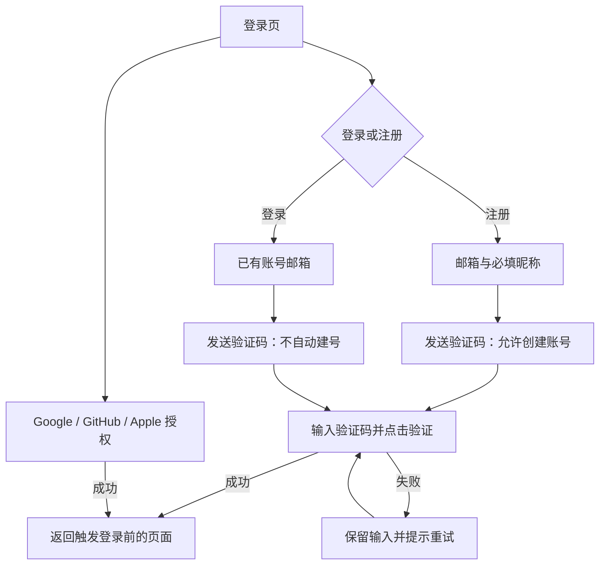
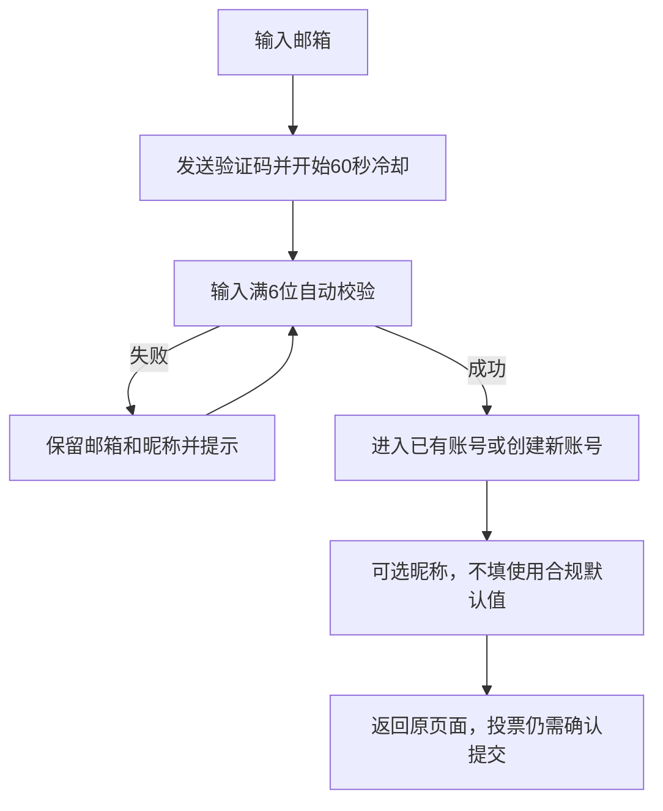

# BothPls 产品需求文档（PRD）v1.6

修订日期：2026-11-26。本文是当前需求基准，明确区分源码已实现能力与尚待实现的目标；PRD 版本不等于应用发布版本，当前 package.json 为 1.5.0。

来源：[Notion v1.6](https://app.notion.com/p/421804a7ab24813388d8f7e818f82159)，原文最后编辑于 2026-11-23。[原文快照](archive/PRD-v1.6-notion-original.md)保留完整需求、流程和历史口径；有冲突时，以本修订版的状态判定为准。

核对范围：本地前端源码、配置与数据库迁移。**已实现**表示存在代码实现，不表示已通过本次运行测试或已部署到生产；线上 OAuth、邮件、数据库迁移及权限配置仍需部署验收。

## 1. 项目信息与版本

- 产品：BothPls，帮助用户通过朋友的单选投票作出选择。
- 形态：Web，移动端优先；桌面已有居中的手机式容器，不等于完整桌面版。
- 当前布局：主要容器 390 × 844，手机按实际视口调整。原文 393 × 873 为设计参考，不作为代码尺寸事实。
- 主要页面：首页、个人主页、创建 / 编辑、投票、结果、编辑资料、设置、登录；投票与结果有独立路由，另有法律页面。
- 需求版本：v1.6（本修订版）；应用版本：1.5.0。
- 历史版本与集合入口：[PRD.md](PRD.md)。

## 2. 现有功能基线

| 能力 | 当前实现与边界 | 代码依据 |
| --- | --- | --- |
| 身份 | 游客可浏览；创建、投票、评论要求非匿名账号；发起者不能自投、自评 | [participant.ts](../src/features/auth/utils/participant.ts)、[账号参与迁移](../supabase/migrations/20261122105148_account_only_participation.sql)、[禁止自投](../supabase/migrations/20261122213000_prevent_poll_owner_voting.sql) |
| 邮箱认证 | 登录 / 注册两个 Tab；注册昵称必填 2–20 个码点；发送后输入验证码并点击验证；注册允许建号，登录不自动建号 | [AuthPage.tsx](../src/features/auth/pages/AuthPage.tsx)、[auth.ts](../src/features/auth/services/auth.ts) |
| 第三方登录 | Google、GitHub、Apple OAuth 入口已实现；不等同于主动绑定已有账号 | [auth.ts](../src/features/auth/services/auth.ts) |
| 会话 | 邮箱流程按“记住我”选择 localStorage 或 sessionStorage；同一账号可分别在多设备登录，记录以账号 uid 关联 | [client.ts](../src/lib/supabase/client.ts) |
| 首页 | 默认广场；最近与广场两个 Tab；最近按 10 条一页显示，上一页／下一页替换列表；参与过的投票结束后仍保留，点击查看结果；广场仅展示公开且进行中的投票；游客无需首屏登录；提示条约 2 秒后出现，手动关闭后 7 天冷却 | [HomePage.tsx](../src/features/home/pages/HomePage.tsx)、[最近投票保留规则](RecentPolls.md) |
| 提示条条件 | 是否出现由登录状态及有效关闭时间决定；仅存在语言或草稿记录不会触发 7 天免打扰 | [HomePage.tsx](../src/features/home/pages/HomePage.tsx) |
| 创建 | 标题、说明、2–5 个选项及可选图片、截止时间、公开开关；公开开关默认关闭；没有独立背景上传控件 | [CreatePollPage.tsx](../src/features/polls/pages/CreatePollPage.tsx) |
| 管理与分享 | 所有者可编辑进行中投票、分享、结束、删除；发布后进入结果页并触发分享；结束与删除需确认 | [OwnerPollActions.tsx](../src/features/polls/components/OwnerPollActions.tsx)、[CreatePollPage.tsx](../src/features/polls/pages/CreatePollPage.tsx) |
| 投票 | 固定单选，点选与提交分离，进行中可改票；游客触发操作先保存本地现场再引导登录 | [VotingPage.tsx](../src/features/polls/pages/VotingPage.tsx) |
| 评论 | 后端持久化；本人可改删，发起者可删除；普通用户查看公开评论受结束状态限制，发起者可在进行中治理；本人评论可回填 | [polls.ts](../src/features/polls/services/polls.ts)、[评论管理迁移](../supabase/migrations/20261118045439_authorize_comment_management.sql) |
| 刷新 | 详情每 10 秒检查；页面可见、focus、online 时刷新；当前定时器没有按投票结束状态停止 | [usePolls.ts](../src/features/polls/hooks/usePolls.ts) |
| 草稿 | localStorage 保存，7 天有效；按账号 / 投票等 key 隔离；创建和编辑均可保存草稿；不跨设备同步 | [drafts.ts](../src/features/polls/utils/drafts.ts)、[CreatePollPage.tsx](../src/features/polls/pages/CreatePollPage.tsx) |
| 个人资料与设置 | 有个人主页、编辑资料、语言、版本与日志、退出、注销；资料区域可点击编辑，右上角为设置入口；游客设置页还显示登录方式状态与清除本地数据 | [SettingsPage.tsx](../src/features/settings/pages/SettingsPage.tsx)、[SettingsPreferencesPage.tsx](../src/features/settings/pages/SettingsPreferencesPage.tsx) |
| 语言 | 中文、英文、韩文；默认简体中文，手动选择保存在本地；界面响应语言状态更新，不要求整页刷新 | [locale.ts](../src/i18n/locale.ts)、[LocaleProvider.tsx](../src/i18n/LocaleProvider.tsx) |
| 版本展示 | 设置页从 changelog.json 首条取版本，失败回退 package.json；两份文件尚非自动生成的唯一来源 | [SettingsPreferencesPage.tsx](../src/features/settings/pages/SettingsPreferencesPage.tsx) |
| 删除 | 投票与账号的数据库迁移使用直接删除，不是软删除；界面有确认流程 | [投票权限迁移](../supabase/migrations/20261118035831_enforce_poll_permissions.sql)、[注销迁移](../supabase/migrations/20261121000003_delete_account.sql) |

## 3. 待实现需求与验收

以下是需求，不能写入“已完成”列表。除原文列出的三个重点外，其他差异也必须跟踪，不再声称只剩三项。

### 3.1 本期三个重点

| 编号 | 目标 | 当前缺口 | 验收 |
| --- | --- | --- | --- |
| AUTH-01 | 彻底移除应用密码流程 | 仍有 reset 模式、恢复邮件、设置新密码函数及文案；密码登录服务函数已不在当前 auth.ts 中，不应列为仍存在 | reset 链接回落正常验证码表单；移除实际存在的密码服务、页面和文案；回归三种 OAuth 与邮箱流程 |
| AUTH-02 | 简化验证码流程 | 尚无 60 秒冷却、满 6 位自动校验；昵称必填，登录模式不自动建号 | 客户端冷却禁用并倒计时；满 6 位仅提交一次；新邮箱可通过统一验证码流程建号；昵称可跳过 |
| AUTH-03 | 验证码与默认昵称规则 | 10 分钟有效、重发行为需服务端配置验收；默认昵称尚非原文完整规则 | 服务端与文案一致；昵称留空用邮箱前缀，按码点截断、替换非法字符，并处理不足 2 字的结果 |
| COMMENT-01 | 评论三权补全 | 缺独立“我的评论”入口、发起者隐藏评论、创建时可见性选择 | 本人改删不改票数；隐藏后发起者仍可治理；立即公开 / 结束后公开落库且服务端实施权限 |
| ACCOUNT-01 | GitHub / Google 主动绑定与解绑 | Google 状态行已存在；没有 linkIdentity / unlinkIdentity；未登录的 OAuth 操作不是绑定 | 已登录绑定后身份增加；身份冲突不切换账号；最后一种不可解绑；线上 Manual Linking 验收 |

邮箱注册 / 登录可保留同页 Tab，但目标流程不因 Tab 阻止新邮箱建号；昵称为可选注册补充信息。当前两个 Tab 的不同建号行为属于待改项。

移除前端密码入口不等于服务端旧密码自动失效；历史密码凭据的禁用策略须单独验证，不能仅凭前端删除代码宣称已完成。

### 3.2 原文中其他未完成或冲突的要求

| 编号 | 原文目标 | 当前状态 / 后续验收 |
| --- | --- | --- |
| DRAFT-01 | 创建草稿跨设备续写 | 当前只有本地存储；需账号级服务端存储、权限和冲突策略 |
| DRAFT-02 | 编辑态不产生草稿 | 当前编辑也保存草稿；需调整保存、恢复与清理行为 |
| POLL-01 | 创建默认公开到广场 | 当前默认不公开；需同步创建默认值、恢复逻辑及相关测试 |
| POLL-02 | 编辑时禁止增删选项及修改文案、顺序 | 当前表单仍提供选项编辑，后端仅有部分保护；需前后端统一约束，不可只隐藏按钮 |
| DELETE-01 | 投票与账号软删除 | 当前直接删除；需软删除字段、查询与权限、级联策略及旧链接验收 |
| REFRESH-01 | 已结束 / 已删除停止轮询 | 当前详情定时器持续存在；需按状态停止并验证卸载清理 |
| PROFILE-01 | 个人资料文字不可点击、右上两个独立入口 | 当前资料区域可点击编辑；需按目标交互调整 |
| SETTINGS-01 | 游客设置只显示登录入口、通用、关于 | 当前还显示 provider 状态与清除本地数据；目标需与现有界面协调 |
| LOCALE-01 | 默认跟随系统语言 | 当前固定中文默认；需系统语言映射与回退策略，保留手动选择优先级 |
| VERSION-01 | 版本号单点维护、package.json 自动同步 | 当前有日志版本与 package.json 回退；需自动生成或一致性检查流程 |
| PRIVACY-01 | 广场来源只显示昵称、不显示头像 | 需来源传递和评论渲染专项验收，不因存在评论组件就标为完成 |
| UI-01 | 名称之外的“背景”字段 | 当前有 description 说明，无独立背景媒体字段；原文“背景”需明确为文字背景说明，独立媒体能力不计已实现 |
| COPY-01 | 本期不做复制投票 | 当前存在 copyId / copySource 路径；是否移除需明确，不将现有代码说成不存在 |
| METRICS-01 | 原文 §10 埋点指标 | 作为指标需求保留，未验证完整采集、上报及报表，不标为已接入 |

## 4. 身份、权限与状态规则

### 已实现基线

- 游客浏览首页和分享内容；创建、投票、评论前置登录。
- 发起者不参与自己的投票或评论；所有者负责管理与分享，参与者负责投票与自己的评论。
- 服务端校验账号、所有权、选项归属、单选与截止时间；不能依赖前端按钮作为权限边界。
- 投票与评论落后端；本地偏好和草稿不等同于云端记录。
- 关闭或到期后不得新增投票、改选或编辑投票；评论管理权限与投票提交权限分开。
- 公开开关影响广场收录；非广场链接访问走现有后端链接读取路径。
- 一账号一票，改票以最后一次有效提交为准。

### 目标规则

- 评论可见性与隐藏规则以 COMMENT-01 为验收项，不能把 commentsPublic 类型字段当作服务端功能已落地。
- 软删除、编辑选项限制、默认公开、跨设备草稿以 §3.2 为准。
- Apple 绑定、隐藏邮箱隔离、身份合并属于 v1.7；不得在 v1.6 写成已实现的邮箱规则。
- “长期登录”不代表永不过期；实际有效性由 Supabase 会话控制。
- 码点计数不等于所有视觉 emoji 都占一个字符；复合 emoji 可能由多个码点组成。

## 5. 用户流程

### 5.1 当前邮箱流程

### 5.2 v1.6 目标邮箱流程（待实现）

首页、投票和管理的完整原始流程见[Notion 原文快照 §8](archive/PRD-v1.6-notion-original.md)。其中目标行为按本文件 §2–§4 的状态解释；游客浏览投票页不应被流程图误解为打开页面立即强制登录。

## 6. 异常与验收边界

| 场景 | 当前 / 目标 |
| --- | --- |
| 游客触发投票、评论、创建 | 已有登录引导；回跳现场保留需在对应入口验收 |
| 验证码错误、过期、发送失败 | 已有错误反馈；固定时效、自动提交和倒计时是待实现 / 部署验收项 |
| 注册昵称为空 | 当前阻止发送；目标允许跳过 |
| 登录模式输入新邮箱 | 当前不自动建号；目标统一验证码建号 |
| 第三方授权取消或失败 | 必须可重试；跨站跳转后的表单保留不能未经测试就承诺 |
| 绑定冲突、解绑最后一种 | 待 ACCOUNT-01 实现后验收 |
| 发起者自投 / 自评、越权编辑删除 | 前后端均须拒绝；数据库迁移有权限实现，生产应用状态另验 |
| 结束后编辑、投票 | 服务端拒绝；停止轮询另属 REFRESH-01 |
| 删除后访问链接 | 不可继续访问；当前实际删除，软删除为目标 |
| 清除本地数据或换设备 | 当前本地草稿不可恢复；云端账号投票记录与之分开 |
| 注销账号 | 已有确认及昵称核对；当前删除账号，软删除待实现 |
| 更新日志加载失败 | 当前回退 package.json 版本；自动同步尚待实现 |

## 7. 演进与部署验收

- **v1.6：** 以 §2 为已实现源码基线，完成 §3 的差异项与部署验收后才能称为本版交付；不因整理文档而将应用版本改成 1.6.0。
- **v1.7：** Apple 绑定、隐藏邮箱隔离、身份合并和账号不统一提醒。
- **v1.8：** 动效扩展、商品价格与链接、分享增强、多选与投票提醒。
- **v2.0 / v2.1：** iOS / 微信小程序探索。平台审核与内容治理要求在实际发布时另行核验。

部署验收包括：OAuth provider 与回跳地址；验证码邮件模板与有效期；服务端限流；Manual Linking；数据库迁移及 RLS；跨账号、跨设备和真实邮箱场景。本次文档核对未执行线上验收。

## 8. 修订与历史追溯

- 本版纠正“草稿跨设备已完成”“只剩三项”“Google 状态行不存在”“版本单点维护已完成”等误标。
- 将公开默认值、软删除、结束停轮询、默认系统语言、个人主页交互等分离为现状与目标。
- 保留原始 Notion 快照，不覆盖远端原文；本文件为本地校正版。
- [v1.4 历史归档](BothPls%20PRD%20v1.4.md)、[v1.5 登录修订版](BothPls%20PRD%20v1.5.md)、[PRD 集合](PRD.md)。
