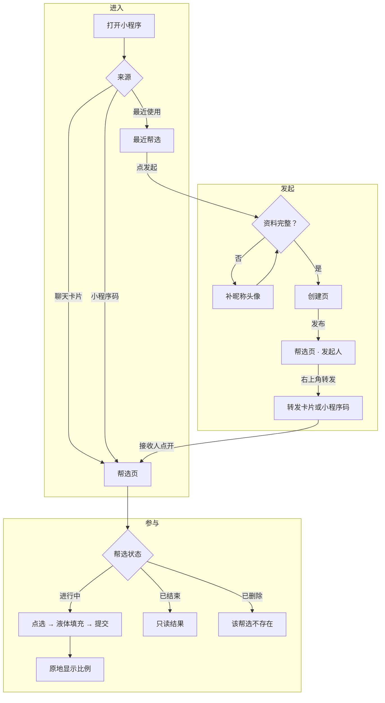
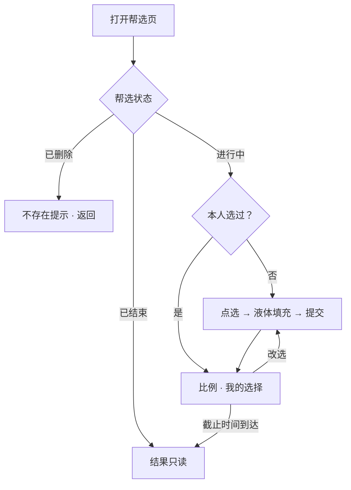
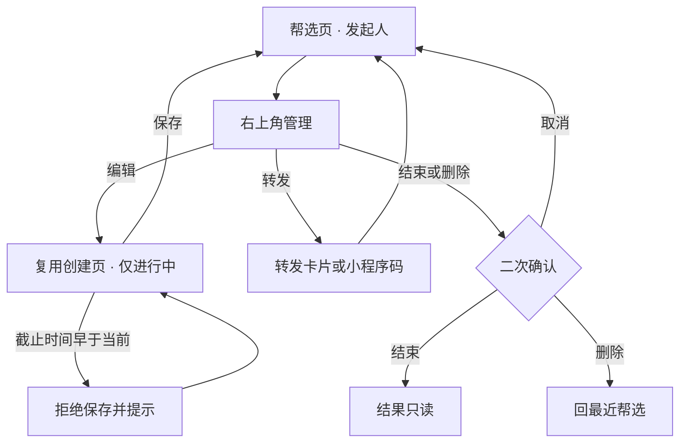
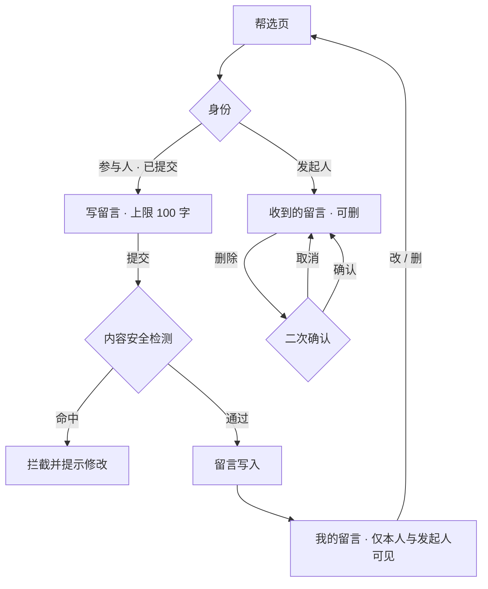

# BothPls 微信小程序版 产品需求文档 v2.1

由 Web 版 v1.4 改写。面向微信小程序投放，功能裁剪、全中文、不含任何引流机制。

## 目录

- 1 项目信息
- 2 需求范围（保留 / 裁剪 / 替换）
- 3 身份与授权
- 4 使用场景
- 5 目标
- 6 功能清单
- 7 关键规则与合规红线
- 8 用户流程
- 9 异常与边界
- 10 埋点
- 11 演进
- 附录 提审自检清单

## 用语规范（全文唯一口径）

| 用词 | 含义 |
| --- | --- |
| 帮选题 | 一次选择活动的完整单元，含名称、选项、截止时间 |
| 选项 | 被比较的商品或方案，2–5 个 |
| 发起人 | 创建帮选题的人，拥有编辑、结束、删除权限 |
| 参与人 | 打开卡片并提交过选择的人 |
| 最近帮选 | 我发起的帮选题 + 我提交过选择的帮选题，两类混排 |
| 结果 | 各选项的选择占比与总参与人数 |
| 留言 | 提交选择时附带的文字说明，仅发起人与留言者本人可见 |
| 转发 | 使用微信原生能力把卡片发给指定的人 |

**硬性要求**：页面文案、按钮、空态、提示语、卡片标题、小程序名称与简介、截图、代码注释、埋点事件名，一律不得出现表决类词根（toupiao、piao），也不得以其量词形式计数。统一表述为「选择」与「参与人」。

## 1. 项目信息

| 字段 | 内容 |
| --- | --- |
| 产品 | BothPls 朋友帮选（微信小程序版） |
| 版本 | 2.1 |
| 定位 | 发起工具。只服务想发起的人，主战场在网页版；小程序不做留存、不做发现、不做运营 |
| 形态 | 微信小程序，单端单包 |
| 类目 | 工具 > 效率。留言仅双方可见，不构成公开社区，不申请社交与社区类目 |
| 设计基准 | 750 rpx，适配 375–430 pt 宽 |
| 包体积 | 主包 ≤ 1.5 MB，图片走 CDN，不内置大图 |
| 基础库 | ≥ 2.30.0 |
| 身份 | 微信静默登录，openid 建档 |
| 后端 | 沿用现有 Supabase，新增 openid 与 unionid 字段 |
| 语言 | 纯中文，不做多语言 |
| 页面数 | 5：最近帮选 / 创建 / 帮选页 / 编辑资料 / 设置 |

## 2. 需求范围

**保留**

- 发起、参与、改选、查看结果、编辑、结束、删除。
- 单选，液体填充动画，两步提交。
- 最近帮选：只收我发起的与我参与过的，三分组。
- 留言：单向，仅发起人与留言者可见，长度与入口都受控。
- 编辑资料：头像、昵称、简介。
- 设置页。
- 微信原生转发与小程序码。
- 微信静默登录。

**裁剪**

| 原能力 | 小程序处置 | 原因 |
| --- | --- | --- |
| 公开内容流 | 不做 | 需要社交或社区类目与内容治理资质，个人主体无法承担 |
| 公开评论与三权分离 | 降级为仅双方可见的单向留言 | 公开评论是向不特定用户传播内容，需社区类目与治理能力；收窄可见范围后不再构成公开社区 |
| 多语言 | 不做 | 纯中文投放 |
| GitHub / Apple 登录 | 不做 | 小程序内不可用网页授权 |
| 三层身份（游客 / 软登录 / 正式账号） | 合并为一层 | 微信进入即有 openid，无游客态 |
| 分享浮层与复制链接 | 替换为转发卡片 + 小程序码 | 小程序内链接不可直接粘贴使用 |
| 10 秒轮询 | 改为进入拉取 + onShow 刷新 + 前台 10 秒轮询 | 小程序切后台即挂起 |
| 编辑资料的独立入口 | 并入设置页 | 减少一级页面 |

**不做**

- 复制帮选、多选模式与任何提醒推送。
- 好友关系、公开发现、AI 推荐、留言回复与公开评论。
- 手机号采集、地理位置、通讯录、剪贴板读取。
- 第三方统计 SDK。
- 任何转发奖励与解锁机制。
- 首页运营位、新手引导弹窗、签到、召回推送、订阅消息。

## 3. 身份与授权

| 状态 | 如何获得 | 能做什么 |
| --- | --- | --- |
| 未完善资料 | 首次打开小程序，wx.login 静默建立 openid | 打开收到的卡片、查看已结束结果、查看自己的列表 |
| 已完善资料 | 首次发起时补充昵称与头像 | 发起、参与、改选、留言、编辑、结束、删除 |

- 无登录按钮，不弹授权框，进入即建档。openid 稳定，换设备或重装仍为同一账号。
- 昵称头像走微信「头像昵称填写能力」：头像用 `button open-type="chooseAvatar"`，昵称用 `input type="nickname"`。不调用 getUserProfile。
- 昵称上限 20 字，可改；头像可换，也可用默认头像。
- 参与不需要昵称头像，发起才需要，降低参与门槛也少收个人信息。
- 账号合并：已在 Web 版用过账号的用户，通过开放平台 unionid 合并为同一账号，数据以最近活跃一端为准；合并不可逆，操作前明确提示。
- 隐私协议明确列出收集项：openid、昵称、头像、用户上传的图片，写明用途与保存期限。
- 不提供退出登录，也不做切换账号。openid 由当前登录的微信账号决定，小程序内部无法换成另一个人的身份；要换微信账号只能在微信里切换后重新进入。
- 设置页提供「重置本机资料」：清空昵称头像、草稿与缓存，回到未完善资料状态，服务端账号与已发布内容不受影响。这是唯一能表达退出的动作。

## 4. 使用场景

- 面对差异不大的商品难决定，预算有限又要反复比较。
- 小程序的优势在接收端：在聊天窗口点开即看即选，不用下载、不用注册、不用填手机号。
- 发起端在小程序里完成，接收端也在小程序里完成，链路不跨端。

## 5. 目标

| 目标 | 衡量 | 目标值 |
| --- | --- | --- |
| 闭环 | 发起 → 转发 → 参与 → 结果 → 结束 | 全流程跑通 |
| 参与 | 从点开卡片到提交选择 | ≤ 30 秒 |
| 审核 | 首次提审 | 无驳回项 |
| 体验 | 结果与提交的一致性 | 无重复计数、无脏数据 |
| 工具属性 | 从进入到发出卡片 | 三步以内完成，不出现引导页 |
| 环境 | iOS 与 Android 微信 | 全页面可用 |

## 6. 功能清单

### 6.1 最近帮选（首页）

- 顶部资料条：头像、昵称、右上角设置入口。点头像或昵称进入编辑资料页。
- 列表范围只有两类：我发起的帮选题、我提交过选择的帮选题。两类混排，按最近活动时间倒序，最新在前。
- 卡片角标区分「我发起的」「我参与的」，并显示进行中 / 已结束状态。
- 卡片信息：名称、首图、选项数、参与人数、截止时间。
- 三个 Tab：`全部` / `进行中` / `已结束`。进行中 = 未到截止且未手动结束；已结束 = 手动结束或已到截止；已删除的不出现在任何 Tab。
- 底部悬浮按钮「发起帮选」。
- 空态：无记录时展示说明文案与发起按钮。
- 不展示与我无关的帮选题，站内没有公开列表、搜索、推荐与热门。
- 首页为空是常态，不是异常。空态只放一句说明与发起按钮，不放运营位、教程、新手弹窗、推荐内容。

### 6.2 创建页

- 名称必填，上限 24 字。
- 背景：可选纯色或图片。
- 选项 2–5 个，每个可上传一张图，选项文案必填。
- 截止时间：可选，不设则持续开放至手动结束。
- 草稿本地保存 7 天，发布成功后立即清除。
- 发布后直接进入帮选页，身份为发起人。
- 编辑态复用本页表单，不产生草稿。

### 6.3 帮选页

| 状态 | 表现 |
| --- | --- |
| 进行中 · 未选 | 展示名称、背景、参与人数、截止时间、选项；点选触发液体填充动画，再单独提交 |
| 进行中 · 已选 | 原地展示各选项比例、我的选择、改选入口 |
| 已结束 | 只读展示最终比例与参与人数，提交与改选全部禁用 |
| 已删除 | 显示「该帮选不存在」并提供返回入口 |

- 点选后液体自下向上填充至满表示待提交，未提交不落库，改选时回落。
- 发起人视角额外显示右上角管理菜单，其他参与人不显示。
- 数据刷新：进入页面拉取一次；从后台回到前台立即刷新；停留前台时每 10 秒轮询一次，切后台停止；已结束或已删除停止轮询。
- 截止时间到达后按后端状态直接渲染为已结束。
- 留言区只有两类人可见：该帮选题的发起人，以及写下这条留言的本人。其他参与人、用同一卡片打开的人、转发链上下游、站内任何入口，都看不到。
- 无回复：留言下方没有回复入口，发起人不能回话，留言者也不能追问，不做任何形式的对话与互发通知。
- 参与人提交时可附留言，上限 100 字；留言者在页内改、删自己的留言；发起人在页内查看并删除收到的留言。发起人的留言列表不随卡片转发带出。
- 已结束时留言区只读，不可新增，已有留言仍对双方可见。

### 6.4 编辑资料页

- 头像：微信头像选择能力，或默认头像。
- 昵称：微信昵称填写能力，必填，上限 20 字。
- 简介：可选，上限 60 字。
- 保存后回到上一页；返回不保存则丢弃改动。

### 6.5 设置页

| 分组 | 条目 | 行为 |
| --- | --- | --- |
| 账号 | 个人资料 | 跳编辑资料页 |
| 账号 | 账号合并 | 用 unionid 合并 Web 版已有账号，二次确认 |
| 通用 | 重置本机资料 | 清空昵称头像、草稿与缓存，回到未完善资料状态；服务端账号与已发布内容不受影响 |
| 关于 | 版本号 + 更新日志 | 展示当前版本与迭代记录 |
| 关于 | 意见反馈 | 唤起微信客服会话 |

- 无语言切换，界面纯中文。
- 无退出登录与切换账号。openid 由当前微信账号决定，小程序内无法切换身份，见第 3 章。
- 无通知权限项。

## 7. 关键规则与合规红线

**功能规则**

1. 一人一选择：同一 openid 只保留最新一次有效选择，改选覆盖旧值，只计一次。
2. 两步提交：先点选，再提交；点选不落库，提交才写入。
3. 发布：发布后立即进入帮选页，不设成功页。
4. 截止时间：可选；不设则不自动结束；到达即自动结束，以后端时间为准。
5. 结束：手动或到期；结束后禁止新增选择、禁止改选、禁止新增留言、禁止编辑内容，仍可转发与删除。
6. 编辑：仅进行中可编辑；可改名称、背景、选项图片、截止时间；不可增删选项，不可修改选项文案与顺序，避免与已有记录错位。
7. 删除：仅发起人，进行中与已结束均可删，二次确认，软删除；删除后最近帮选、原卡片与小程序码全部失效。
8. 访问权限：只有持有转发卡片或小程序码的人能进入该帮选题。进入后可查看、参与、改选，不能编辑、结束、删除。
9. 参与人数按 openid 去重统计，发起人自己的选择也计入。
10. 草稿按 openid 存本地，7 天过期，发布或提交成功后清除。
11. 结果一致性：提交与改选均以后端返回为准，前端不做本地计数。
12. 分享形态只保留两种：右上角转发卡片、生成小程序码。
13. 留言单向：参与人提交时可附一段留言，上限 100 字；不提供回复，不做对话，避免落进即时通讯类功能。
14. 留言可见范围：只有两类人可见，一是该帮选题的发起人，二是写下这条留言的本人。其他参与人、用同一卡片打开的人、转发链上下游、站内任何入口都不可见。
15. 留言权限：留言者可随时改删自己的留言；发起人可删除任何留言，不可编辑他人内容。任一方删除后，双方都不再可见。
16. 留言位置：只在帮选页内，不进入任何列表，不随卡片转发带出，不被任何检索收录。
17. 隐私：所有帮选题默认私密。站内不存在公开列表、公开主页、搜索、推荐与热门；任何列表与接口只返回请求者自己发起或参与过的帮选题，不返回与其无关的任何数据。
18. 标识不可枚举：帮选题对外标识使用随机串，禁用自增数字 id 暴露在卡片参数、接口返回与小程序码里，防止按序猜中他人内容。
19. 不做留存设计：无签到、无积分、无消息推送、无首页运营位、无新手引导。单次任务结束即离开，回访不做设计。

**合规红线**

1. 全文不出现表决类词根（toupiao、piao），包括页面标题、按钮、提示、卡片标题、名称与简介、截图、代码注释、埋点名。提审前按拼音全文搜索确认。
2. 不出现引流表述：邀请、助力、拉新、裂变、集赞、排行榜、关注公众号、加入群、奖励、红包、抽奖、返现、砍价。
3. 不设任何转发门槛：查看结果、查看占比、结束帮选都不需要转发；不做「转发 N 人解锁」。
4. 转发标题固定模板：「帮我选一下：{名称}」，上限 40 字，不含导流动词。
5. 小程序名称与简介不做表决与决策语义，简介写「一个帮你收集朋友意见的小工具」。
6. 不申请社交与社区类目。全站不存在公开内容流，唯一涉及他人文字的部分是留言，且仅发起人与留言者可见，不向不特定用户传播。
7. 用户输入的名称、选项文案、简介全部过内容安全接口 `security.msgSecCheck`，上传图片过 `mediaCheckAsync`，命中即拦截并提示修改。
8. 不采集手机号、地理位置、通讯录、剪贴板，不调用 getUserProfile。
9. 埋点只用 `wx.reportEvent` 与自建上报，不接第三方统计 SDK，不上报昵称、头像与文本内容。
10. 意见反馈走微信客服，不在小程序内公开展示投诉内容。
11. 留言必须过 `msgSecCheck`；读权限由服务端按 openid 校验，不能只靠前端隐藏。
12. 留言区提供投诉入口，跳微信客服，不在页面内展示投诉内容。
13. 隐私协议写明留言会展示给发起人，并说明保存期限。

## 8. 用户流程

### 8.1 主流程

### 8.2 帮选页状态

### 8.3 发起人管理

### 8.4 留言

## 9. 异常与边界

| 场景 | 处理 |
| --- | --- |
| wx.login 失败 | 自动重试一次，仍失败提示「加载失败，请重新进入」并给重试 |
| 首次发起未补资料 | 先跳编辑资料页，保存后回到创建页，已填内容不丢 |
| 取消头像昵称授权 | 用默认头像与默认昵称，允许后续在编辑资料页修改 |
| 昵称或文案命中内容安全 | 拦截提交，提示「内容含有不适宜信息，请修改」 |
| 图片超过 5 MB 或格式不支持 | 提示重新选择，其他已填字段保留 |
| 图片内容安全未过 | 该图不上传，提示更换 |
| 卡片参数缺 id | 显示「该帮选不存在」并回最近帮选 |
| 卡片指向已删除帮选 | 显示「该帮选不存在」并回最近帮选 |
| 卡片指向已结束帮选 | 正常打开，渲染只读结果 |
| 小程序版本过旧导致参数不识别 | 提示更新微信或稍后重试 |
| 提交时断网 | 提示「网络异常，请重试」，重试不重复计数 |
| 重复点击提交 | 按钮提交中禁用，服务端幂等，只计一次 |
| 截止时间设为过去 | 拒绝保存，提示「截止时间不能早于现在」 |
| 编辑时已被他人结束 | 保存失败，提示「该帮选已结束」，退回只读 |
| 结束后点编辑 | 菜单不显示编辑入口；直接请求返回「该帮选已结束」 |
| 到期后仍提交 | 按后端状态拒绝，提示「该帮选已结束」 |
| 切后台再回来 | onShow 立即重新拉取，不沿用离开前的比例 |
| 弱网加载超过 10 秒 | 展示骨架屏与重试入口 |
| 最近帮选为空 | 常态。只显示一句说明与发起按钮，不显示加载失败、不显示推荐 |
| 请求与我无关的帮选题 | 服务端按 openid 拒绝，不返回数据 |
| 列表接口 | 只返回我发起的与我参与过的，不返回全站数据 |
| 用顺序 id 猜他人帮选题 | 标识为随机串，猜中概率可忽略；命中也不返回内容 |
| 打开他人帮选时微信昵称未同步 | 不展示昵称，只展示参与人数 |
| 账号合并后数据冲突 | 以最近活跃一端为准，合并前二次确认，合并后不可逆 |
| 重置本机资料 | 只清昵称头像、草稿与缓存，账号与已发布内容不受影响 |
| 留言超 100 字 | 禁止继续输入 |
| 留言命中内容安全 | 拦截并提示修改，已提交的选择不受影响 |
| 非发起人请求留言接口 | 服务端按 openid 拒绝，返回无权限 |
| 留言者删除自己的留言 | 立即从发起人列表消失，双方都不再可见 |
| 发起人删除留言 | 留言者侧同步消失，不通知 |
| 帮选已结束 | 留言区只读，不可新增，已有留言仍对双方可见 |
| 帮选被删除 | 留言随之软删除，链接与小程序码失效 |

## 10. 埋点

| 位置 | 时机 | 指标 |
| --- | --- | --- |
| 启动 | 进入小程序 | 打开来源分布：卡片 / 小程序码 / 最近使用 |
| 卡片打开 | 落地帮选页 | 卡片打开到提交的转化率、停留时长 |
| 创建页 | 发布 | 发起成功率、选项数分布、停留时长 |
| 帮选页 | 提交 / 改选 | 提交率、改选率 |
| 发起入口 | 点「发起帮选」 | 发起入口点击率、从进入到点发起的耗时 |
| 转发 | 点右上角转发 | 转发次数、转发后带来打开的比例 |
| 管理 | 编辑 / 结束 / 删除 | 操作分布、删除率 |
| 资料 | 首次完善 | 资料完善完成率 |
| 留言 | 提交 / 删除 | 留言率、删除率、长度区间分布 |
| 内容安全 | 拦截触发 | 拦截次数与类型 |

埋点不上报昵称、头像、文本内容与图片，只报事件与计数。

## 11. 演进

| 版本 | 内容 |
| --- | --- |
| 2.1 | 首发，本文范围：发起、参与、结果、最近帮选、编辑资料、设置、微信转发与小程序码 |
| 2.1.1 | 图片压缩与弱网优化、结果页动效扩展（不含任何推送与召回） |
| 2.1.2 | 编辑器体验打磨：多图排序、草稿跨设备同步 |
| 2.2 | 多端打通：与 Web、iOS 共用同一账号与数据；不引入公开内容形态，不做留言回复 |

**上线前置依赖**

- 主体认证与类目审核通过，类目选工具。
- 小程序与 Web 站同主体，并绑定微信开放平台，才能拿到跨应用 unionid。
- 后端接入 `msgSecCheck` 与 `mediaCheckAsync`，并配置拦截日志。
- 隐私协议、用户协议、客服入口三项齐备。
- 主包控制在 2 MB 以内，超出部分拆分包或走 CDN。

## 附录 提审自检清单

- [ ] 全局搜索拼音 toupiao、piao，结果为 0。
- [ ] 按合规红线第 2 条的词表全文搜索，结果为 0。
- [ ] 任何结果页在未转发状态下可正常查看。
- [ ] 小程序名称、简介、截图、版本描述均无表决与决策语义。
- [ ] 无 getUserProfile 调用，头像昵称走填写能力。
- [ ] 无手机号、位置、通讯录、剪贴板权限声明。
- [ ] 隐私协议与实际收集项逐条对应。
- [ ] 文本与图片内容安全接口已接入并有拦截日志。
- [ ] 主包体积达标，首屏 3 秒内可交互。
- [ ] 意见反馈入口可用，能唤起客服会话。
- [ ] 用非发起人账号直接请求留言接口，返回无权限。
- [ ] 列表接口只返回本人相关的帮选题，不返回全站数据。
- [ ] 卡片参数与小程序码使用随机标识，无法按序猜中。
- [ ] 转发卡片打开后，页面不出现任何他人留言。
- [ ] 留言区投诉入口可唤起客服会话。
