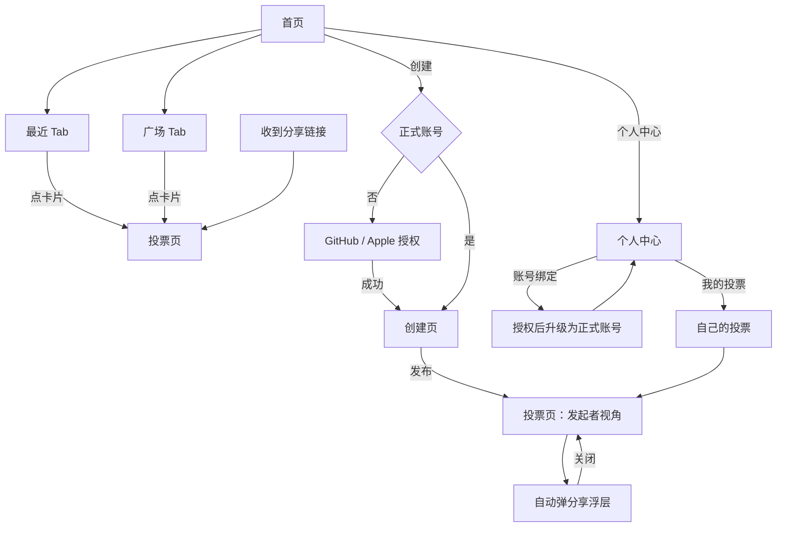
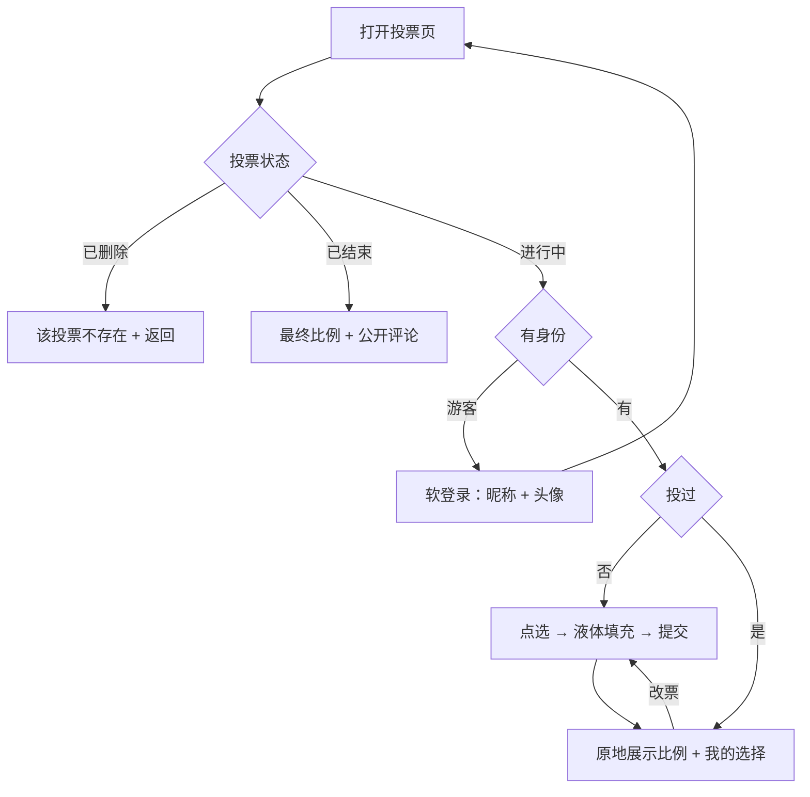
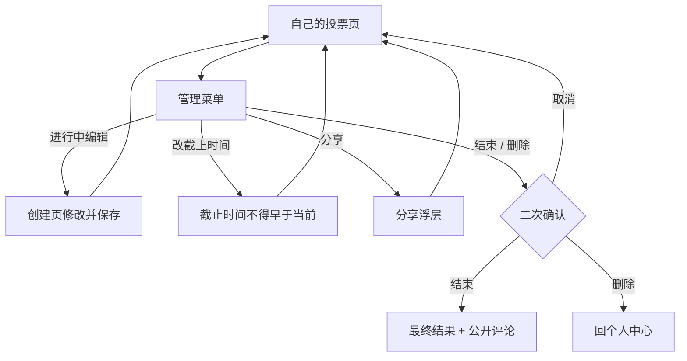

# BothPls 产品需求文档（PRD）v1.4

对齐当前实现与 UserFlow。本文只写定稿规则，不保留待确认项。

## 目录

- 1 项目信息
- 2 需求范围
- 3 身份模型
- 4 需求背景
- 5 目标
- 6 功能清单
- 7 关键规则
- 8 用户流程
- 9 异常与边界
- 10 埋点
- 11 演进

## 版本记录

| 版本 | 变更                                                                                                                                                             |
| ---- | ---------------------------------------------------------------------------------------------------------------------------------------------------------------- |
| v1.4 | 结构重写：三层身份、首页双 Tab、发布链路合并、参与与结果合一、评论三权分离；登录确定为 GitHub / Apple 已实现、邮箱密码在下一版；液体填充动画定名；结束后禁止编辑 |
| v1.2 | 取消投票模式选择，固定单选                                                                                                                                       |

## 1. 项目信息

| 标题   | 内容                                   |
| ------ | -------------------------------------- |
| 产品   | BothPls                                |
| 版本   | v1.4 MVP                               |
| 目标   | 发起者用单选投票收集朋友意见，辅助选择 |
| 适配   | 393 × 873 px，Android Chrome           |
| 页面数 | 4：首页 / 个人中心 / 创建 / 投票       |
| 原型   | Figma（README.md）                     |

## 2. 需求范围

**本期做**

- 三层身份：游客、软登录投票者、正式账号，支持绑定升级。
- 首页双 Tab：最近、广场。
- 创建、编辑、分享、结束、删除五类投票操作。
- 单选投票、液体填充动画、两步提交、进行中改票。
- 评论三权分离：所有权、治理权、可见性。
- 结果页 10 秒轮询，页面重新可见与网络恢复即时刷新。

**本期不做**

- 复制投票。
- 多选模式。
- 邮箱 + 密码登录。
- PC 端适配。
- 跨设备身份同步。
- 评论回复与举报。
- AI 推荐。
- 独立投票 info 页。
- 投票提醒通知。

## 3. 身份模型

| 身份         | 获得方式                      | 能力                                             | 持久范围             |
| ------------ | ----------------------------- | ------------------------------------------------ | -------------------- |
| 游客         | 直接打开链接                  | 浏览广场、查看分享链接                           | 无                   |
| 软登录投票者 | 打开进行中投票时填昵称 + 头像 | 投票、改票、管理自己的评论、查看最近投票         | 当前浏览器存储       |
| 正式账号     | GitHub 或 Apple 授权登录      | 创建、编辑、结束、删除自己的投票；查看进行中评论 | 跨会话，不跨设备同步 |

**判定优先级**：能创建 = 正式账号；能投票 = 软登录或正式账号；其余为游客只读。

**登录方式**

| 方式        | 状态       | 规则                           |
| ----------- | ---------- | ------------------------------ |
| GitHub 授权 | 已实现     | 授权成功即创建或进入正式账号   |
| Apple 授权  | 已实现     | 同上，Apple 隐藏邮箱不影响建号 |
| 邮箱 + 密码 | 下一版实现 | 密码必须同时包含英文字母与数字 |

**绑定升级**

- 入口：个人中心 → 账号设置。
- 操作：软登录用户通过 GitHub 或 Apple 授权完成升级；邮箱方式上线后同样支持。
- 方向单向，绑定后该设备进入登录态。
- 软登录期间产生的投票记录与评论全部迁移到账号，按账号去重，同一投票只计一票。
- 正式账号登出后回到游客，不回退为软登录。
- 一个身份对应一个账号，一个设备同时只保留一个身份。

## 4. 需求背景

- 面对差异不大的商品难决定，预算有限又要反复比较。
- 在聊天里刷图、追问、手工数票，信息分散。
- 多数决策是二选一，直接单选最直观。

## 5. 目标

| 目标 | 衡量                             | 目标值         |
| ---- | -------------------------------- | -------------- |
| 闭环 | 创建 → 分享 → 参与 → 结果 → 结束 | 全流程跑通     |
| 参与 | 投票耗时                         | 小于 1 分钟    |
| 规则 | 单选统计、评论权属、结束与删除   | 验收项全部通过 |
| 环境 | Android Chrome                   | 全页面可用     |

## 6. 功能清单（按页面组织，规则唯一出处）

### 6.1 首页

- 双 Tab：`最近` / `广场`，共用同一套投票卡片组件。
- **最近**：只含当前身份创建或参与过的投票，按最近活动时间倒序；卡片带「我投的」「我建的」角标与进行中/已结束状态。
- **广场**：公开投票列表，只收进行中的投票，按最新发布倒序，卡片显示参与人数。
- 广场卡片只提供「去投票」入口，不提供分享入口。
- 快捷创建：游客与软登录点击即跳登录，登录后回到创建。
- 游客的最近 Tab 展示空态。

### 6.2 个人中心

- 免登录可进，按身份展示三种状态：正式资料 / 软登录资料 / 未登录空态。
- 内容：资料、最近投票、我的投票、账号设置。
- 我的投票：全部自己的投票，按最近编辑时间倒序。
- 账号设置：账号绑定、退出登录。

### 6.3 创建页

- 名称必填；背景可选；商品 2–5 个，可上传图片；截止时间可选。
- 创建页草稿按身份隔离保存，发布成功即清除。

### 6.4 投票页（参与与结果合一）

| 状态          | 表现                                                 |
| ------------- | ---------------------------------------------------- |
| 进行中 · 未投 | 展示选项与投票信息，点选触发液体填充动画，再单独提交 |
| 进行中 · 已投 | 原地展示比例、我的选择、改票入口                     |
| 已结束        | 最终人数与比例、公开评论、禁止投票                   |
| 已删除        | 显示「该投票不存在」并提供返回入口                   |

- 顶部展示名称、背景、参与人数、截止时间、选项个数。
- 游客在此页点选后先完成软登录，登录后回到本页。
- 发起者视角比投票者多两块：管理菜单、进行中评论。同页按身份渲染。
- 结果每 10 秒轮询；页面重新可见或网络恢复时立即刷新。

### 6.5 管理菜单（仅所有者，仅自己的投票）

- 编辑：限投票进行中，可改名称、背景、图片、截止时间；截止时间不得早于当前时间。
- 分享：唤起分享浮层，复制链接。
- 结束：二次确认，结束后转入只读。
- 删除：二次确认，软删除，原链接显示不存在。

## 7. 关键规则

1. **单选**：一票一选项，不设模式选择；改票只保留最新一次有效选择。
2. **两步提交**：点选触发液体填充动画，点提交才写入；评论可选，随投票一并提交。
3. **液体填充动画**：点选后选项块内的液体自下向上填充至满，表示「待提交」；未提交不落库，改选时液体回落。
4. **发布**：发布后直接进投票页（发起者视角），自动弹一次分享浮层；关闭浮层留在本页。
5. **截止时间**：可选；不设则持续开放至手动结束；到达即自动结束，以后端时间为准。
6. **结束**：手动或到期；结束后禁止新增投票、禁止改选、禁止编辑投票内容。
7. **删除**：仅所有者，二次确认，软删除。
8. **评论所有权**：评论者可修改、删除自己的评论，入口在投票页「我的评论」。
9. **评论治理权**：发起者可隐藏或删除任意评论，不可编辑他人内容。
10. **评论可见性**：由发起者在创建时设定，默认「结束后公开」，可选「立即公开」；进行中的评论对普通参与者隐藏，发起者始终可见。
11. **广场隐私**：广场来源的投票，评论展示只显示昵称，不显示头像。
12. **草稿**：创建页草稿与参与草稿分开保存，按身份隔离，成功后清除。
13. **权限**：公开链接只能投票与查看结果，不能创建、编辑、结束、删除。

## 8. 用户流程

### 8.1 主流程

### 8.2 投票页状态

### 8.3 管理流程

## 9. 异常与边界

| 场景                             | 处理                                                                         |
| -------------------------------- | ---------------------------------------------------------------------------- |
| 游客点创建                       | 跳 GitHub / Apple 授权页，成功后回到创建                                     |
| 取消授权                         | 留在原页面，提示「已取消授权」                                               |
| 授权失败                         | 提示重试，不创建账号                                                         |
| 邮箱格式非法                     | 阻止提交，提示「请输入有效邮箱」                                             |
| 密码不合规                       | 阻止提交，提示「密码需同时包含字母和数字」                                   |
| 第三方未返回昵称                 | 使用默认昵称，允许后续修改                                                   |
| 昵称留空（软登录）               | 使用默认昵称                                                                 |
| 名称空 / 选项少于 2 / 选项多于 5 | 禁止发布                                                                     |
| 图片上传失败                     | 提示重试，保留已填内容                                                       |
| 网络断开                         | 提示「网络异常，请重试」                                                     |
| 截止时间设为过去                 | 拒绝保存，提示「截止时间不能早于现在」                                       |
| 结束后编辑                       | 管理菜单不显示编辑入口；直接请求返回「投票已结束」                           |
| 进行中看评论（普通参与者）       | 显示「评论将在投票结束后公开」                                               |
| 到期或结束后提交                 | 按后端状态拒绝，提示「投票已结束」                                           |
| 删除后访问链接                   | 显示「该投票不存在」并返回                                                   |
| 加载失败                         | 统一提示「投票加载失败，请稍后重试」，不暴露后台配置错误；最近与广场提供重试 |
| 绑定授权失败                     | 留在账号设置，提示重试；已填资料保留                                         |
| 浏览器禁止关页                   | 提示手动关闭                                                                 |
| 无权限操作                       | 提示无权限并返回                                                             |
| 最近列表为空                     | 空态 + 创建入口                                                              |

## 10. 埋点

| 位置     | 时机               | 指标                             |
| -------- | ------------------ | -------------------------------- |
| 授权页   | 授权返回           | 授权成功率、取消率               |
| 软登录   | 提交昵称头像       | 进入投票页转化率                 |
| 账号绑定 | 绑定成功           | 绑定转化率、升级后创建率         |
| 创建页   | 发布               | 创建成功率、选项数分布、停留时长 |
| 投票页   | 提交 / 改票        | 投票完成率、评论提交率、改票率   |
| 分享浮层 | 打开 / 复制        | 自动弹出关闭率、复制率           |
| 管理菜单 | 编辑 / 结束 / 删除 | 操作分布、删除率                 |
| 广场     | 卡片点击           | 曝光转点击率                     |

## 11. 演进

**版本规则**：主版本号对应投放形态，次版本号在同一形态内迭代。不做跳号。

| 版本 | 形态       | 内容                                                                                                |
| ---- | ---------- | --------------------------------------------------------------------------------------------------- |
| 1.4  | Web        | 当前版本：固定单选闭环、双 Tab、三层身份、GitHub / Apple 登录、绑定升级                             |
| 1.5  | Web        | 动效扩展（液体填充延伸到提交、改票、结果三处）、设置页开发日志窗口、邮箱 + 密码登录、跨设备身份同步 |
| 1.6  | Web        | 多选模式、投票提醒、商品价格与购买链接、分享增强                                                    |
| 2.0  | iOS App    | 功能对齐 1.6，原生端首发；Apple 登录已就位                                                          |
| 2.1  | 微信小程序 | 裁剪版 + 微信登录                                                                                   |
| 2.2  | 多端       | 好友与公开发现、AI 推荐、评论回复                                                                   |

**上线前置依赖**

- iOS：评论举报、屏蔽、拉黑必须在 2.0 交付，App Store 对 UGC 的硬要求。
- 小程序：正式账号支持多渠道绑定（GitHub / Apple / 微信 / 邮箱，按 unionid 合并）；分享链接改为转发卡片或小程序码；广场与评论接入内容安全检测；结果轮询改为 onShow 刷新。
- 开发日志窗口：只展示版本号与更新说明，不放接口地址、环境变量、后台配置名。
