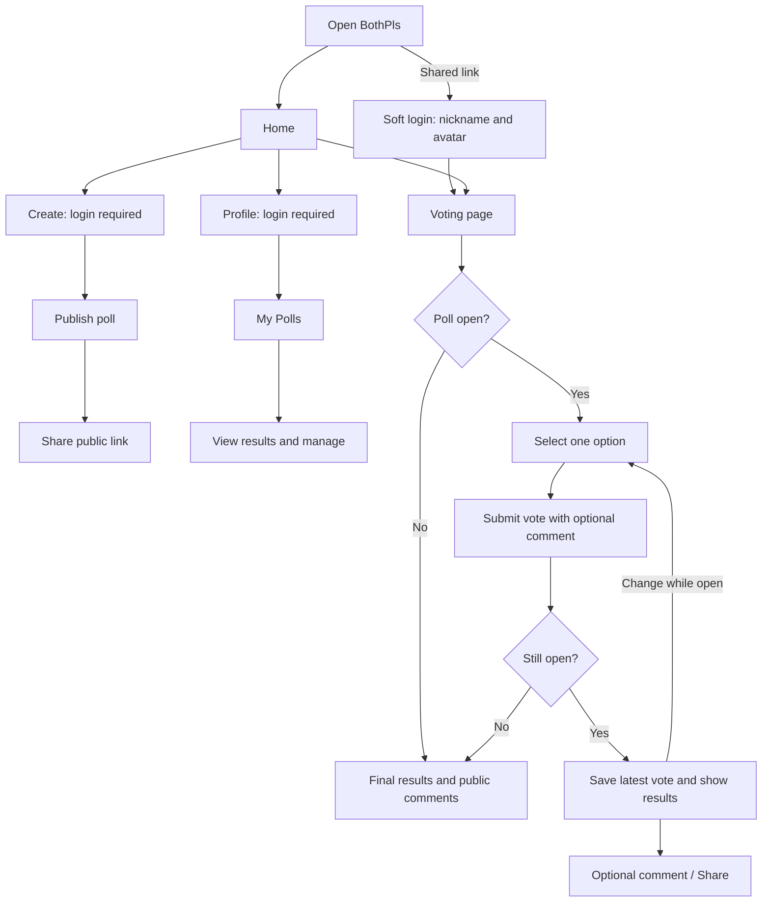
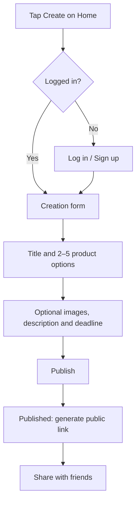
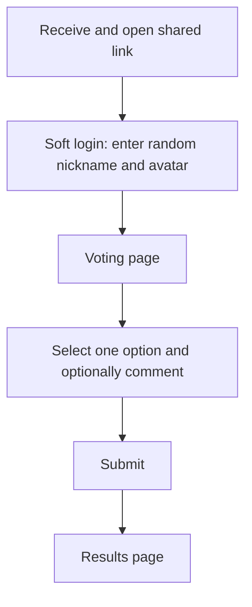
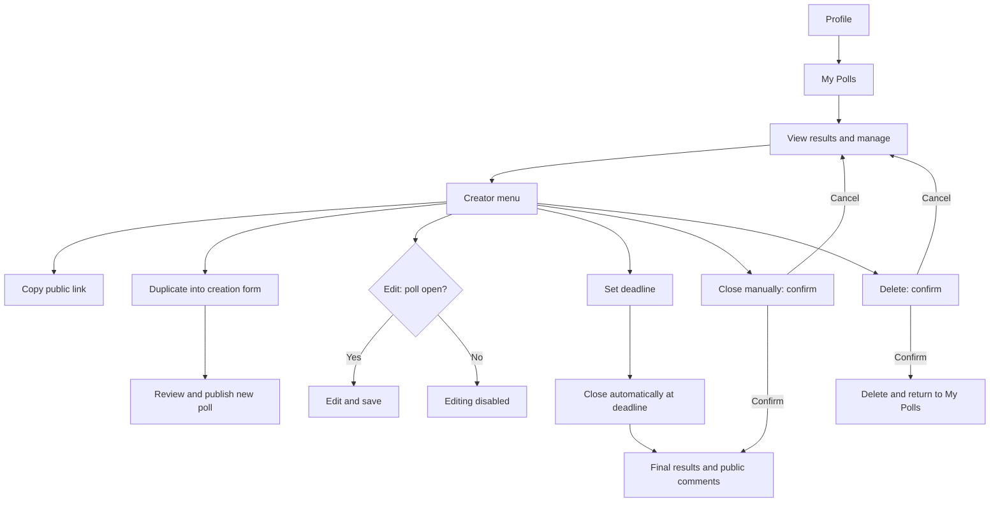
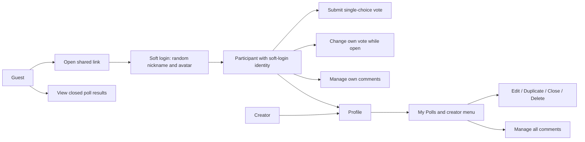
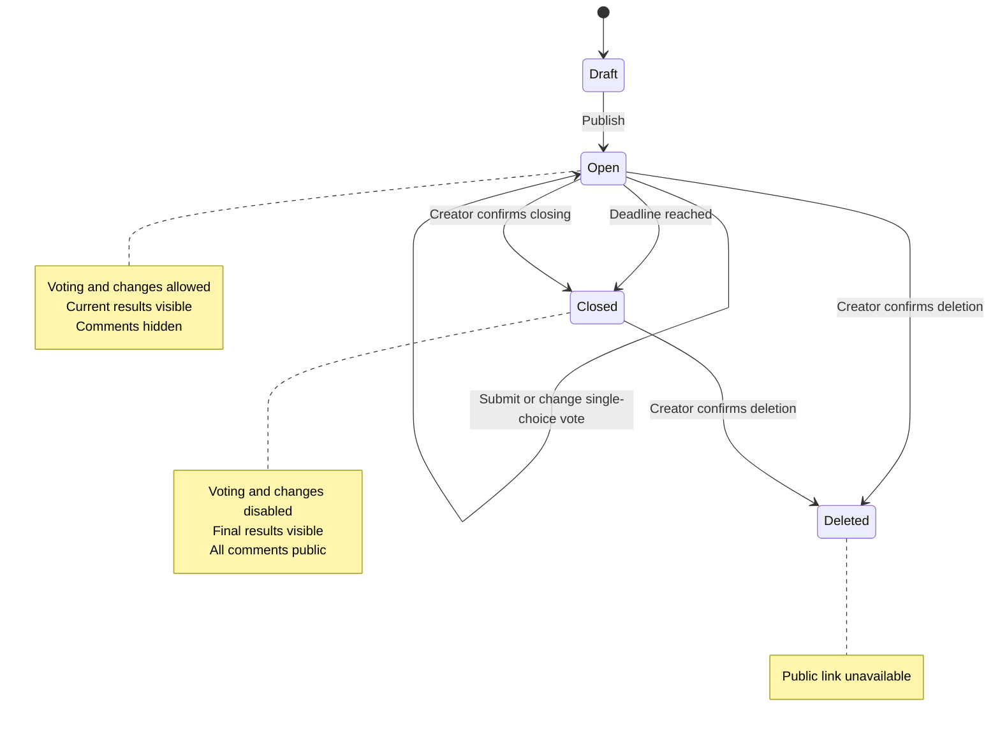
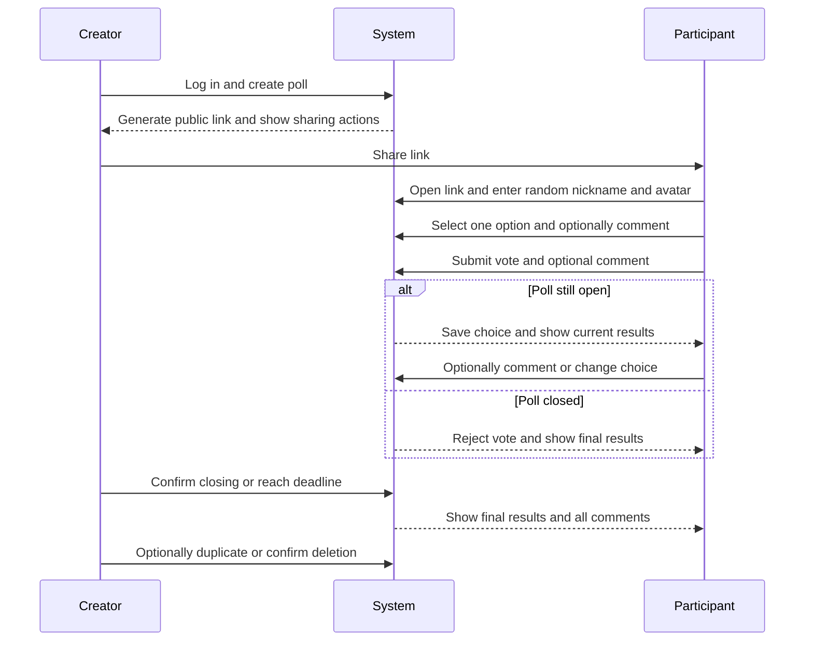

# BothPls User Flows (English)

[中文版](UserFlow.md) · [PRD](PRD.md)

All polls are single-choice. Participants open a shared link and complete soft login with a random nickname and avatar before voting; no account registration is required. Closing disables votes and vote changes and makes comments public. Create and Profile are bottom navigation destinations.

Keep both language versions and the PRD synchronized when rules change.

## 1. Overall User Flow

Creation form: Disable Publish while required fields are incomplete; show validation errors inline.

## 2. Creator Flow

## 3. Participant Flow

## 4. Poll Management

## 5. Pages and Permissions

## 6. Poll Lifecycle

## 7. Business Sequence

Participant identity: Soft login does not require an account. Nickname and avatar identify the participant; repeat-vote protection must also rely on a persistent participant identity. Comments are optional on the voting page and submitted with the vote. Closed polls show final results and reject votes. Creator account login is unchanged.

