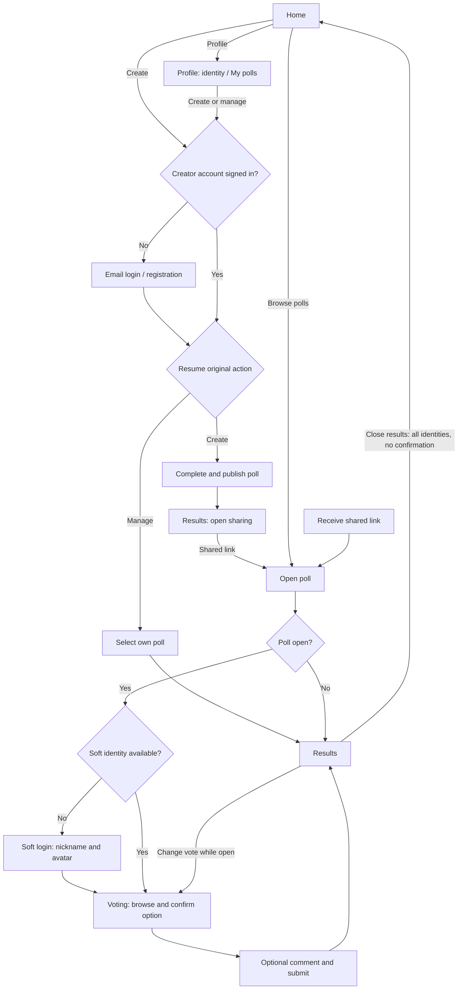
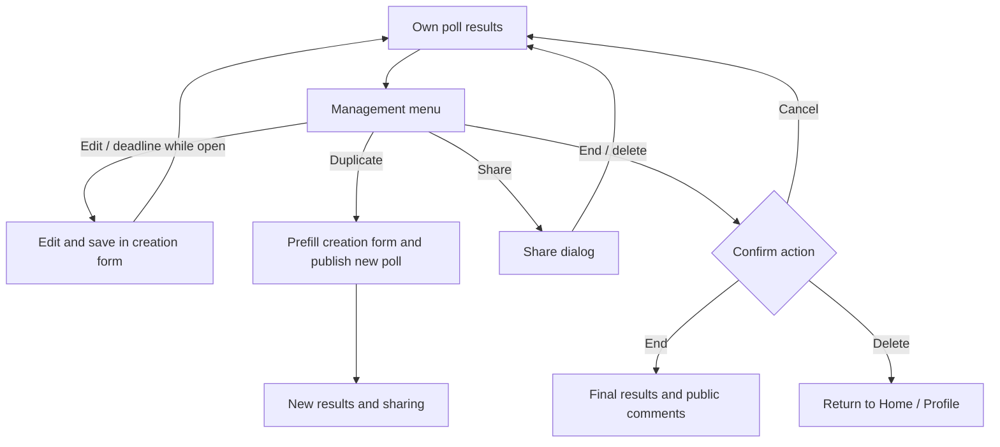

# BothPls User Flows

[中文版](UserFlow.md) · [PRD](PRD.md)

Based on the current implementation. Repeated entry points and login checks are merged. Profile is public; creating and managing own polls share account authentication.

## 1. Main flow

Profile shows account details, soft identity, or an unsigned empty state without forcing login. Creator accounts and soft identities are separate.

## 2. Management flow

Reaching the deadline also produces final results. Duplication excludes original votes, comments, and deadline.

## 3. State and permissions

| Situation | Rule |
| --- | --- |
| Browsing | Home, Profile, and Results allow unsigned access; the Home square shows public polls to visitors and soft-login users; Recent polls contains only polls created or participated in by the current identity, not polls merely viewed |
| Create / manage | Registered accounts create polls; only owners edit, end, or delete their polls |
| Select / submit | Single choice; confirmation triggers pouring, followed by separate submission; optional comment is submitted with the vote |
| Vote changes | Allowed while open; only the current identity's latest valid selection counts |
| Comment visibility | Hidden from ordinary participants while open, visible to creators; public after closing |
| Comment management | Authors edit or delete their own comments; creators may delete; management remains available after closing without changing votes |
| Closed | Final results and comments remain available; new or changed selections are prohibited |
| Deleted | Original links show a missing-poll state with a return action |
| Leaving results | All identities return directly to Home without confirmation or closing the browser tab; identity is retained. Loading, error and missing states use the same exit. |

## 4. Recovery and errors

- Reloads retain browser identities. Clearing browser storage loses the soft identity; automatic cross-device synchronization is unavailable. Account login does not replace soft login.
- Creation and voting drafts are scoped by identity, cleared after successful submission, and retained for retries after failure.
- Submission uses server state and time; expired or closed polls reject submissions.
- Results refresh about every 10 seconds and on visibility or network recovery.
- Poll loading failures for visitors and soft-login users use the generic “Poll loading failed. Please try again later.” message; Home Recent polls and Square provide retry actions instead of exposing Supabase configuration errors.
- Permission errors, loading failures, and missing links provide feedback and safe exits without forcing participants into creator login.
