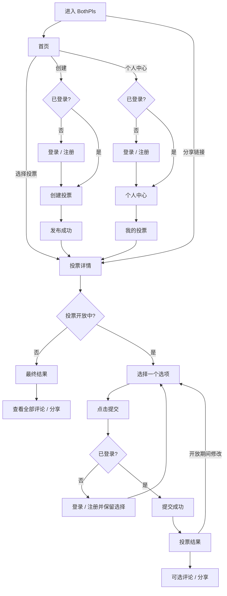
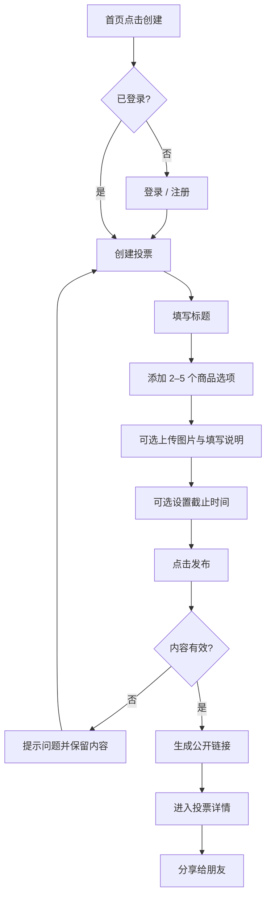
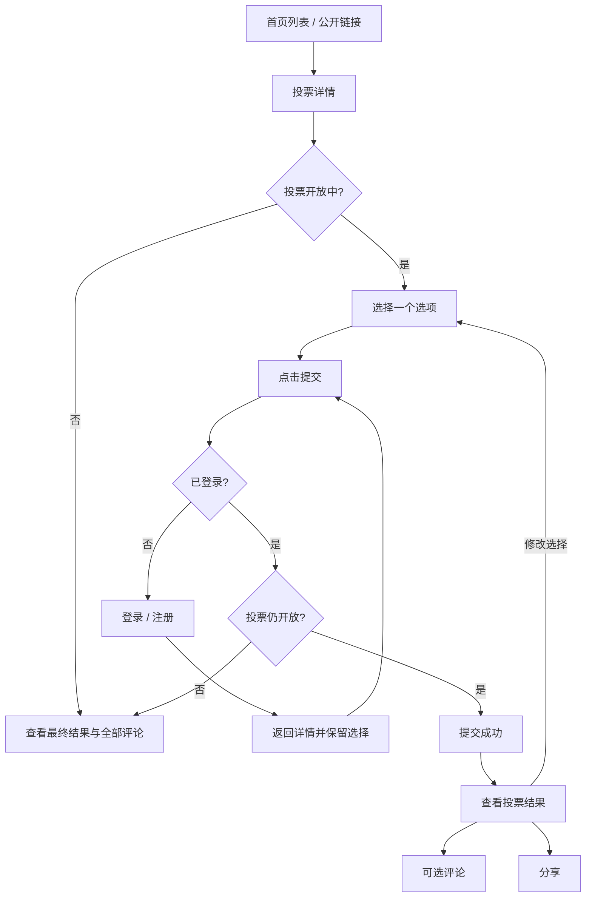
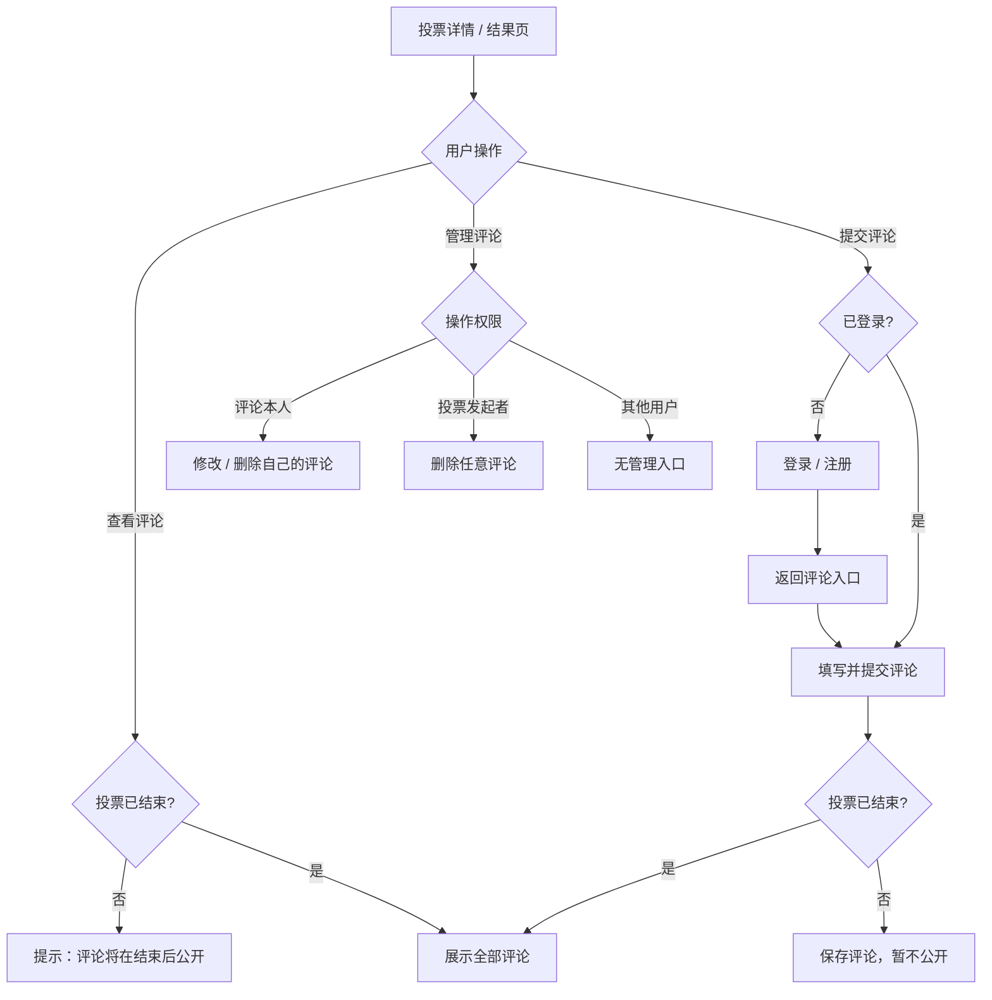
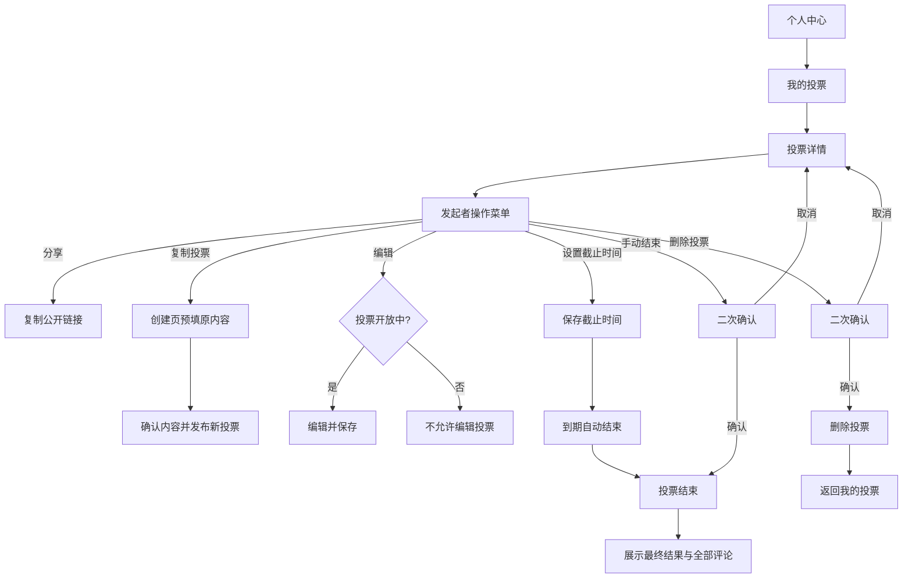
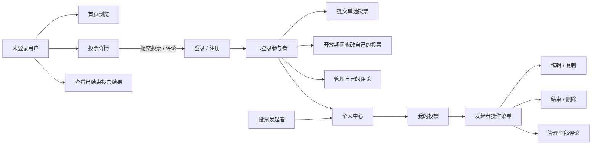
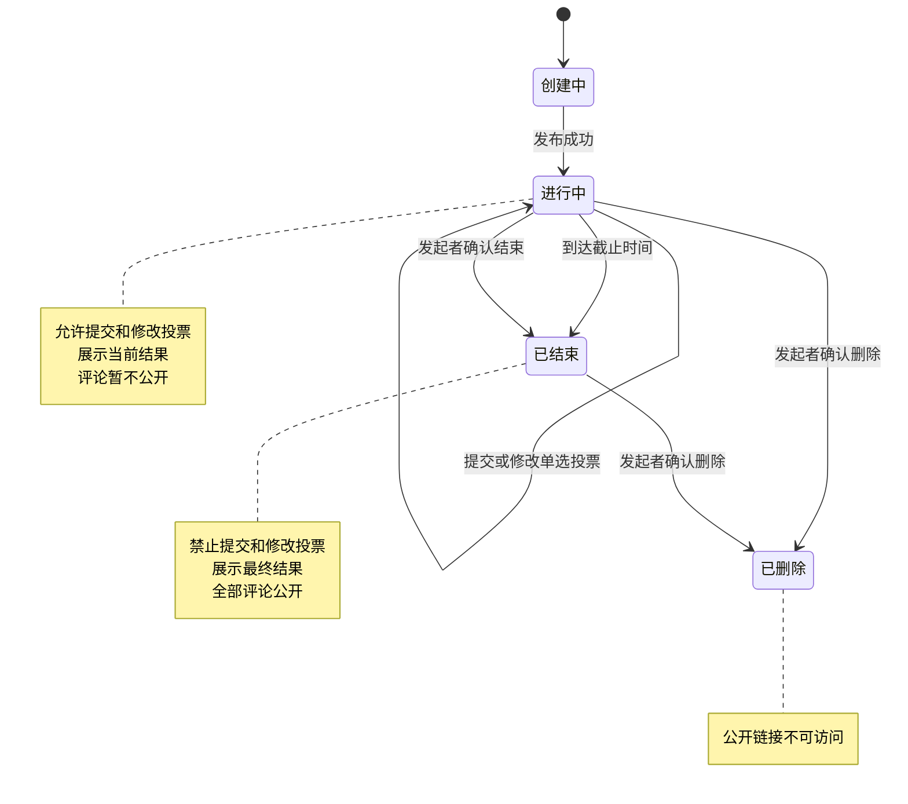
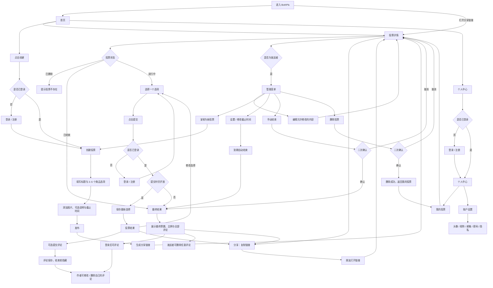

包含：总流程、创建者、参与者、评论、管理、页面权限、投票状态、业务时序。投票全部为单选。
1. 全局 User Flow

2. 创建者视角

3. 参与者视角

4. 评论视角

5. 投票管理视角

6. 页面与权限视角

7. 投票状态视角

8. 全局业务时序
```mermaid
sequenceDiagram
    participant 发起者
    participant 系统
    participant 参与者

    发起者->>系统: 点击创建
    opt 未登录
        系统-->>发起者: 登录 / 注册
    end
    发起者->>系统: 填写标题、2–5 个选项及可选信息
    发起者->>系统: 发布投票
    系统-->>发
```


下面是整合后的完整 User Flow，可直接复制到支持 Mermaid 的文本框中：


统一规则：所有投票均为单选；浏览免登录，提交时登录；投票结束后禁止新增或修改选择；评论在结束后公开；创建、个人管理分别从底部导航进入。