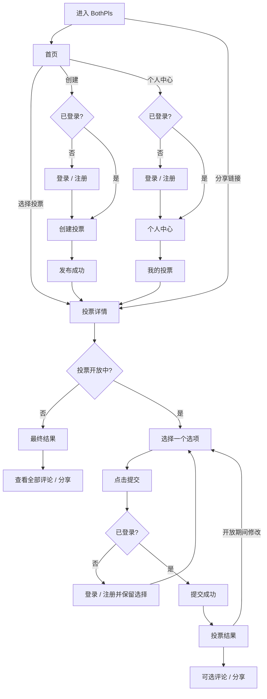
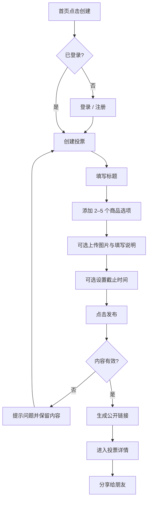
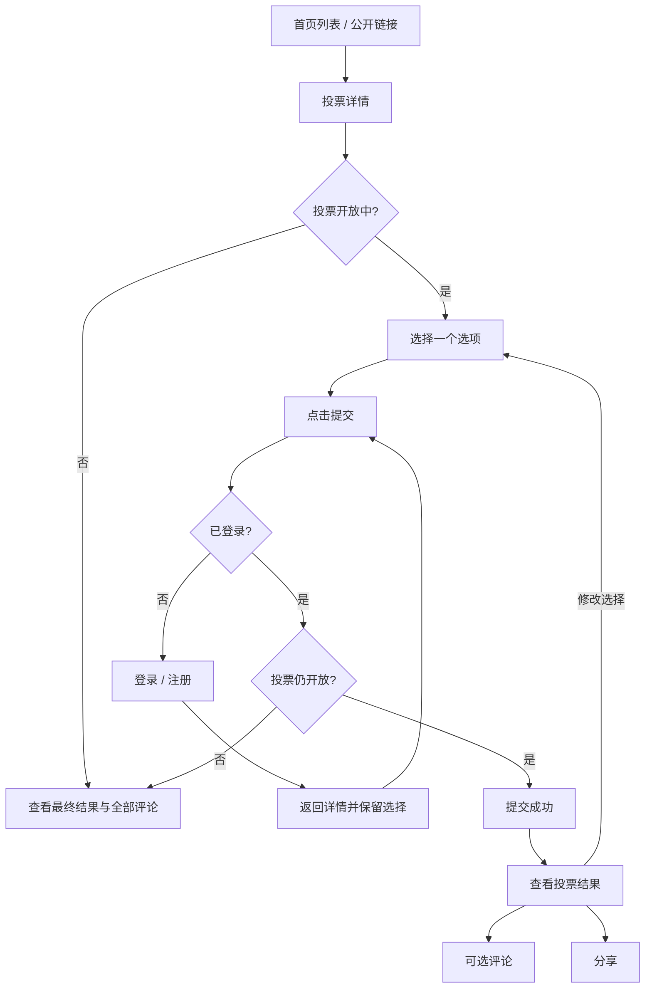
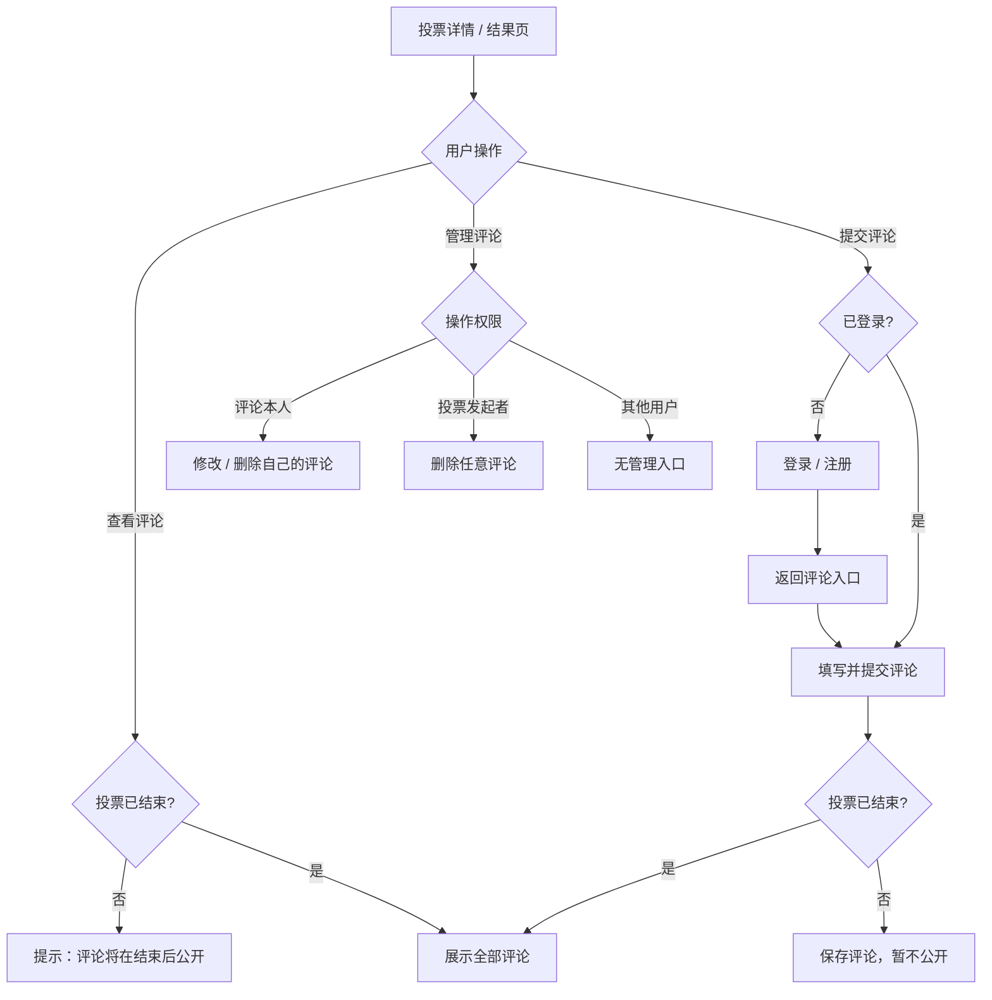
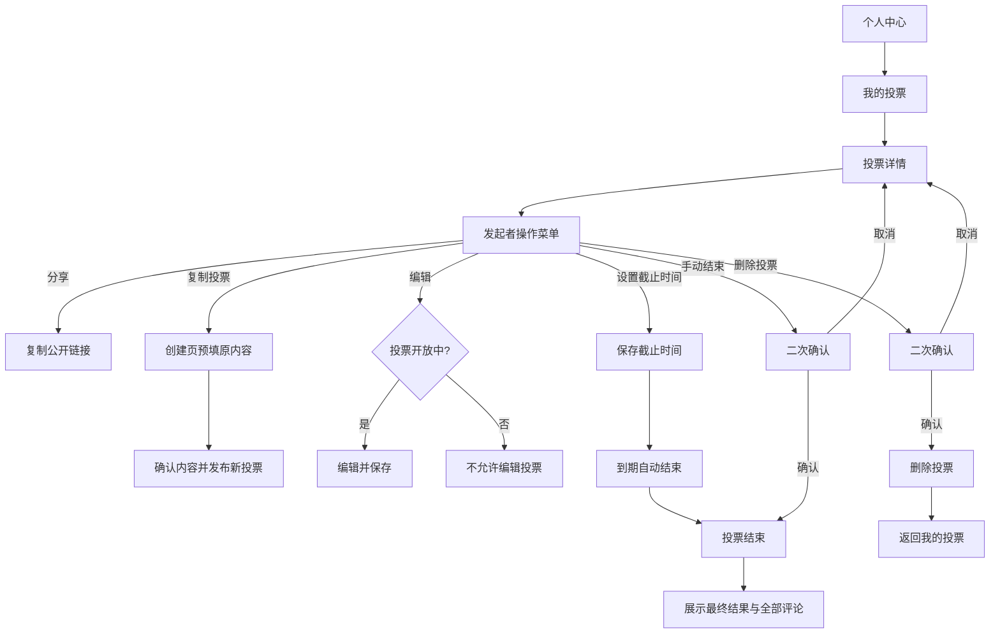
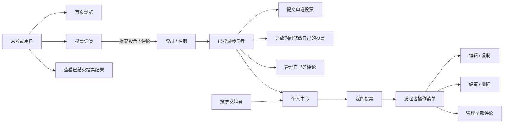
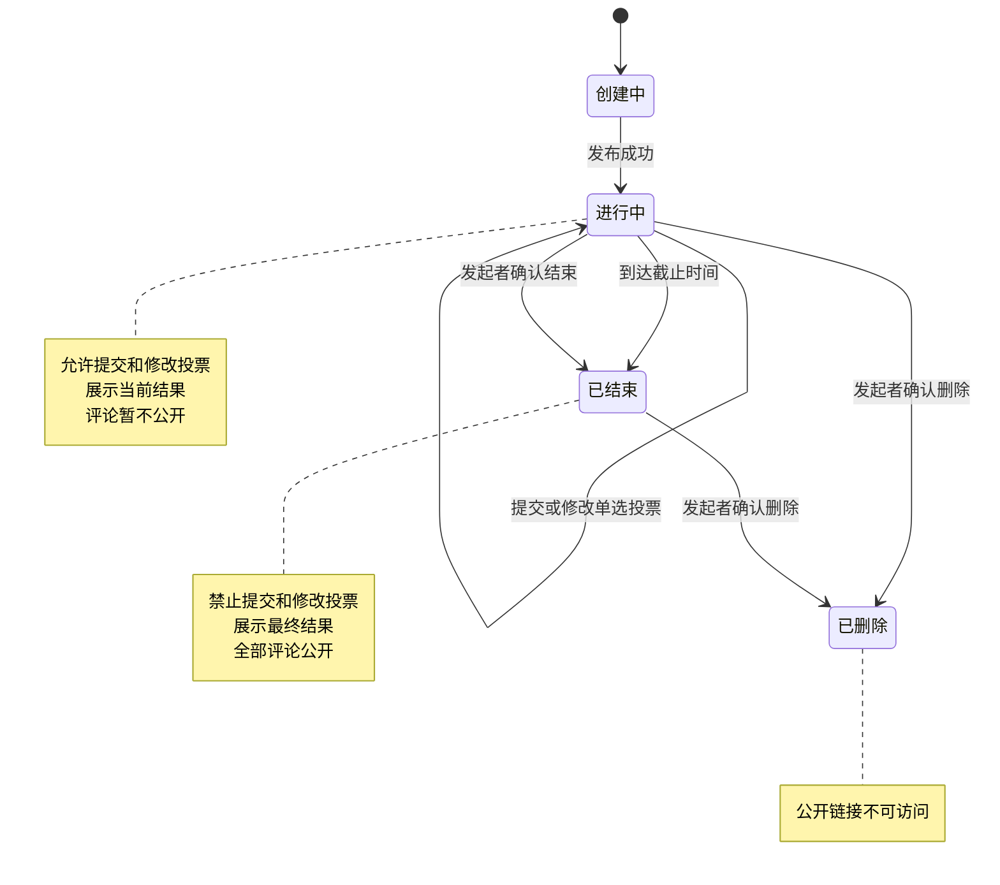
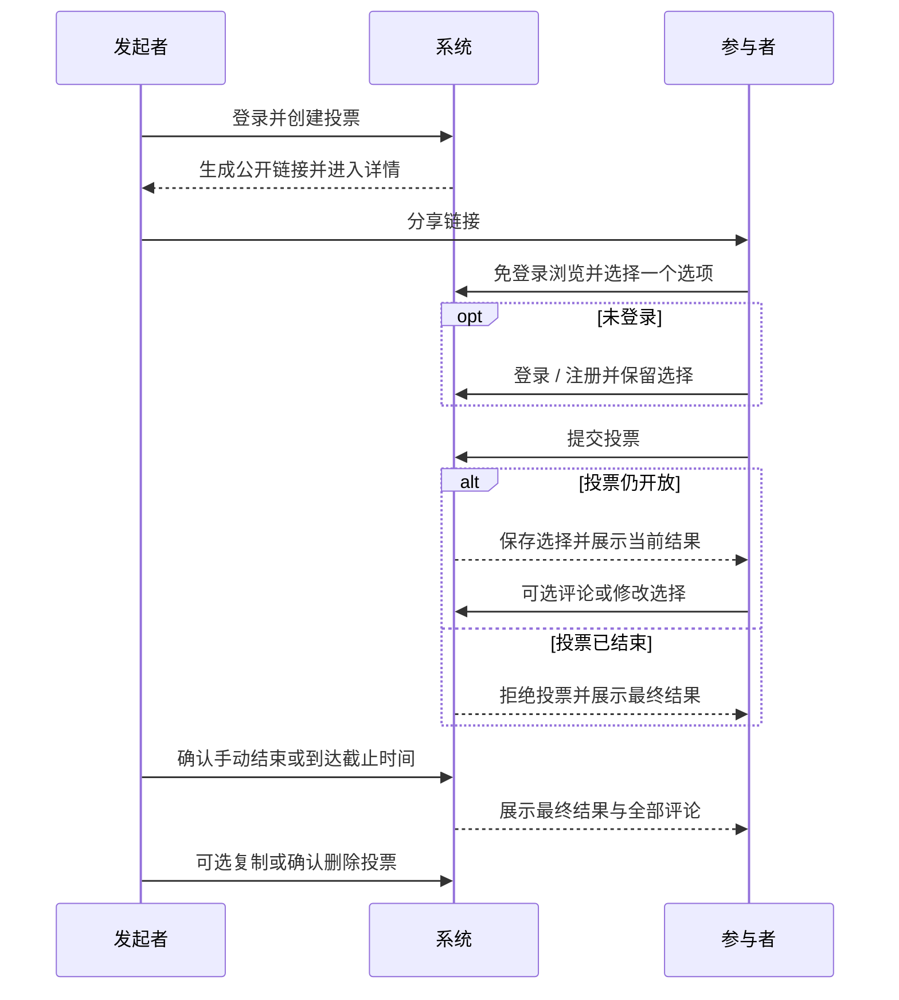

# BothPls 用户流程（中文版）

[English](UserFlow.en.md) · [PRD](PRD.md)

统一规则：所有投票均为单选；浏览免登录，提交投票或评论时登录。投票结束后禁止新增或修改选择，全部评论公开。创建与个人管理从底部导航进入。

本文集中维护八个视角的 Mermaid 流程图。修改规则时，同步更新英文版与 PRD。

## 1. 全局 User Flow

## 2. 创建者视角

## 3. 参与者视角

## 4. 评论视角

## 5. 投票管理视角

## 6. 页面与权限视角

## 7. 投票状态视角

## 8. 全局业务时序

