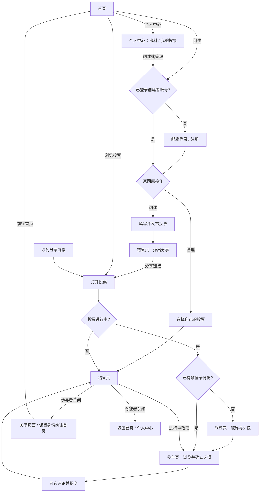
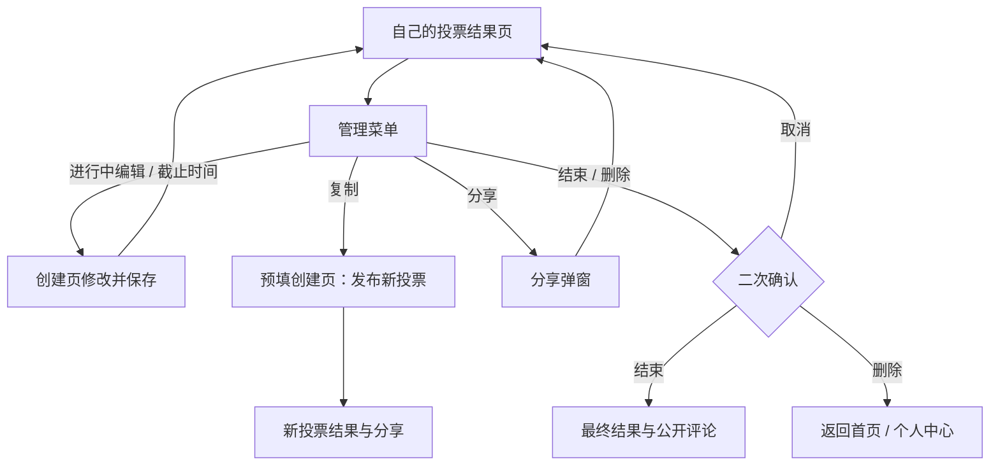

# BothPls 用户流程

[English](UserFlow.en.md) · [PRD](PRD.md)

按当前实现整理，合并重复入口与登录判断。个人中心可直接访问；创建和管理自己的投票共用账号登录流程。

## 1. 主流程

个人中心根据身份展示正式账号资料、软登录资料或未登录空状态；不会在进入时强制登录。创建者账号和软登录是两种独立身份。

## 2. 管理流程

到达截止时间也会进入最终结果。复制不包含原投票的选票、评论及截止时间。

## 3. 状态与权限

| 场景 | 规则 |
| --- | --- |
| 浏览 | 首页、个人中心和结果可免登录访问；首页广场向游客和软登录用户展示公开投票；最近投票仅包含当前身份创建或参与过的投票，不记录仅浏览的投票 |
| 创建 / 管理 | 正式账号才能创建；仅所有者可以编辑、结束或删除自己的投票 |
| 选择 / 提交 | 单选；确认选项触发注液，再单独提交；评论可选并随投票提交 |
| 改票 | 进行中允许修改，只统计当前身份最新有效选择 |
| 评论可见性 | 进行中对普通参与者隐藏，创建者可查看；结束后公开 |
| 评论管理 | 本人可修改或删除，创建者可删除；结束后仍可管理，不影响票数 |
| 已结束 | 可看最终结果与评论，禁止新增或修改选择 |
| 已删除 | 原链接显示不存在，并提供返回入口 |
| 关闭结果 | 参与者可关闭页面或保留身份前往首页；浏览器禁止关页时提示手动关闭 |

## 4. 恢复与异常

- 刷新保留当前浏览器身份；清除浏览器存储会丢失软登录身份，不支持跨设备自动同步。正式账号登录不替代软登录。
- 创建与投票草稿按身份隔离保存，提交成功后清理；失败保留输入并允许重试。
- 提交以后端状态和时间为准，到期或已结束则拒绝提交。
- 结果约每 10 秒刷新，页面重新可见或网络恢复时也刷新。
- 游客或软登录用户的投票加载失败时统一提示“投票加载失败，请稍后重试”，首页最近投票与广场提供重试操作；不向用户展示 Supabase 配置错误。
- 无权限、加载失败或链接失效时提供提示和返回入口，不强制参与者进入创建者登录。
