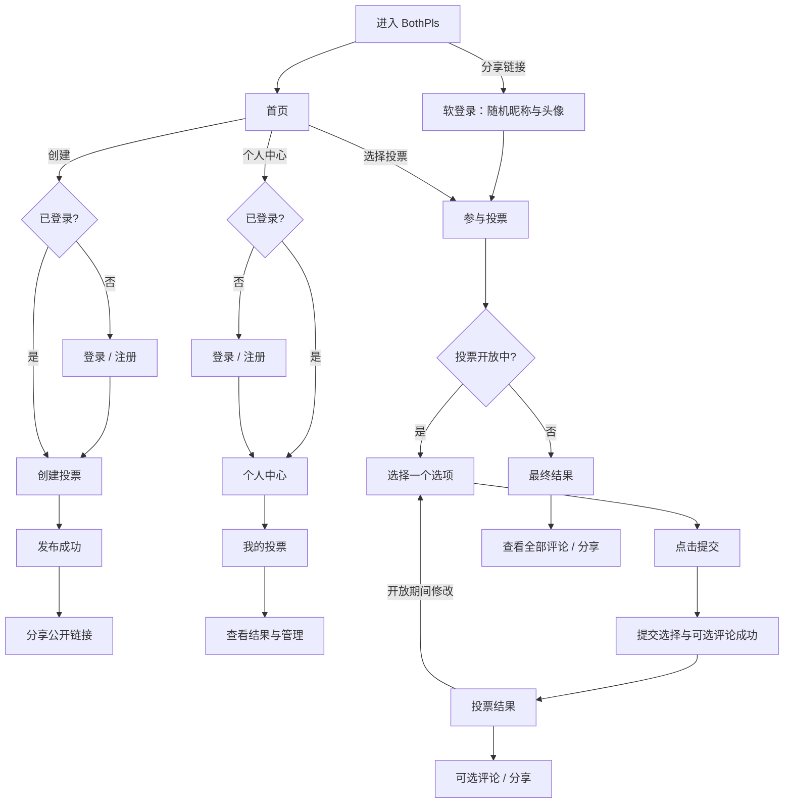
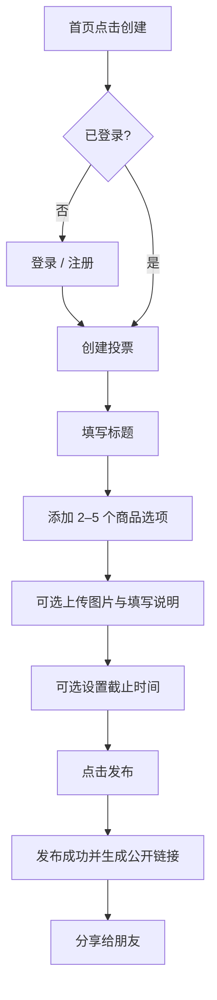
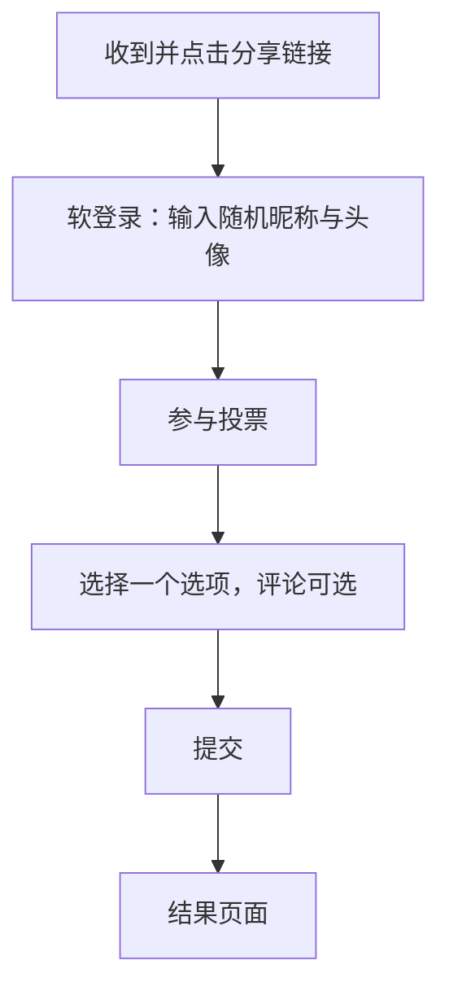
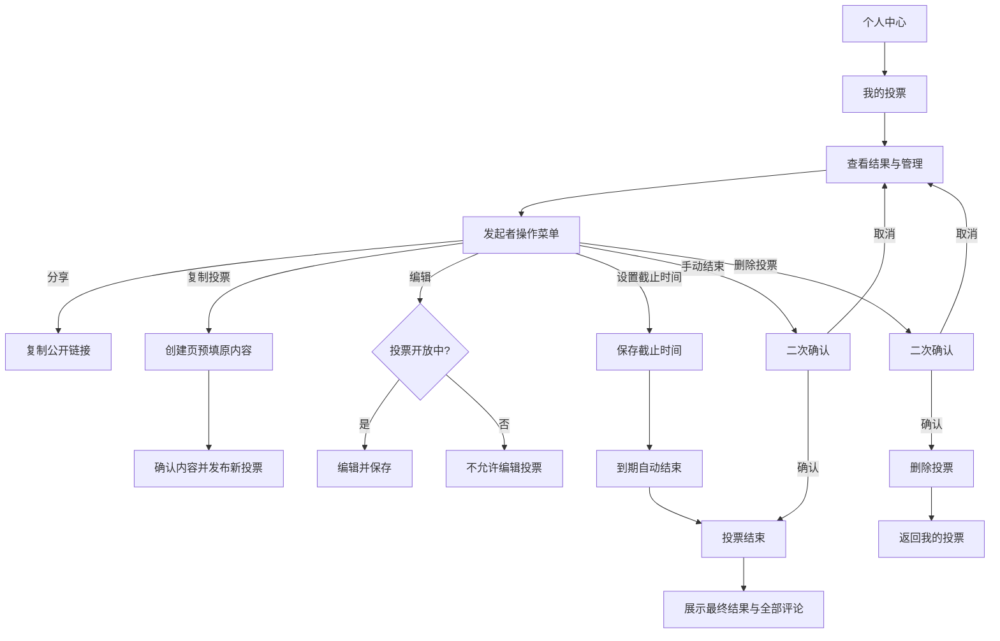
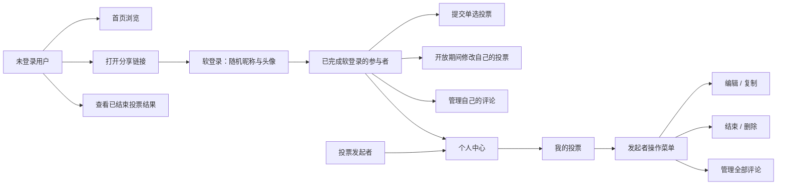
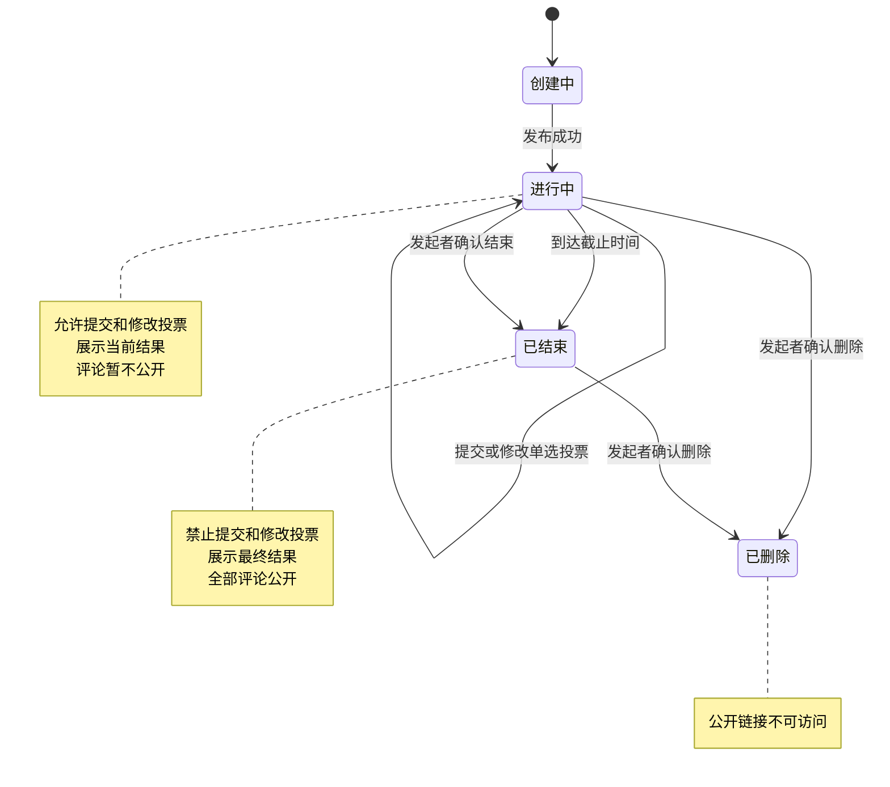
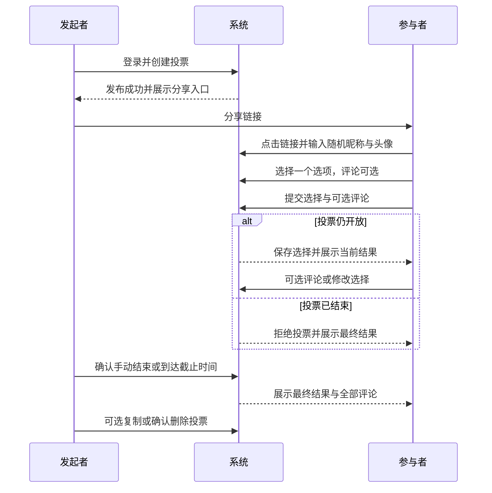

# BothPls 用户流程（中文版）

[English](UserFlow.en.md) · [PRD](PRD.md)

统一规则：所有投票均为单选；参与者点击分享链接后先输入随机昵称与头像完成软登录，无需注册账户。投票结束后禁止新增或修改选择，全部评论公开。创建与个人管理从底部导航进入。

本文集中维护七个视角的 Mermaid 流程图。修改规则时，请同步更新英文版与 PRD。

## 1. 全局 User Flow

创建表单规则：必填项未完成时，发布按钮不可用；填写有误时原位提示。

## 2. 创建者视角

## 3. 参与者视角

## 4. 投票管理视角

## 5. 页面与权限视角

## 6. 投票状态视角

## 7. 全局业务时序

参与者身份规则：软登录无需注册账户。昵称与头像用于标识参与者；防重复投票还需依赖持久的参与者身份，不能仅靠昵称与头像。评论在参与投票时选填，随选择一起提交；已结束投票展示最终结果并禁止提交。发起者创建和管理仍使用账户登录。
