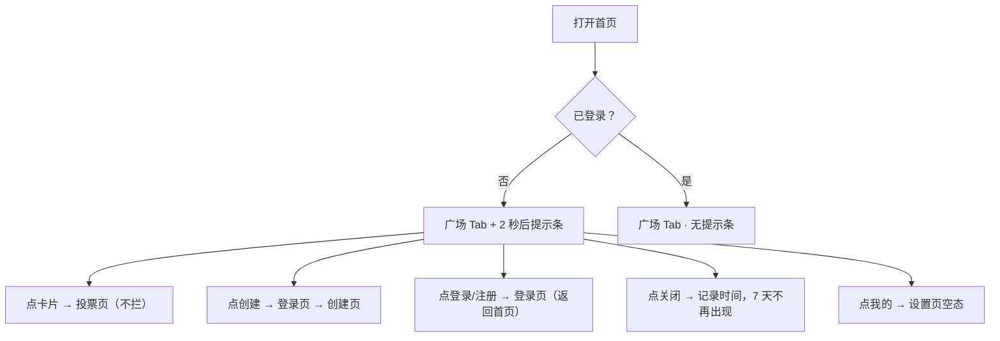
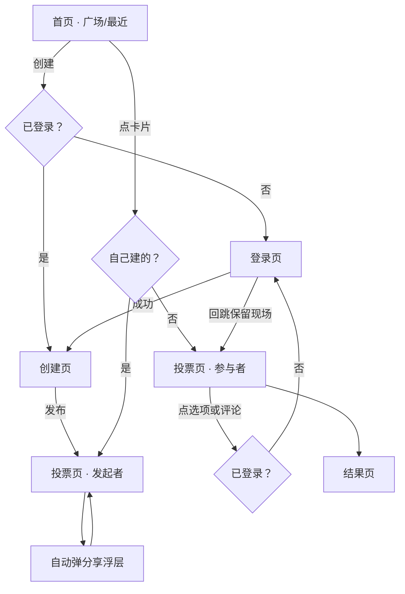
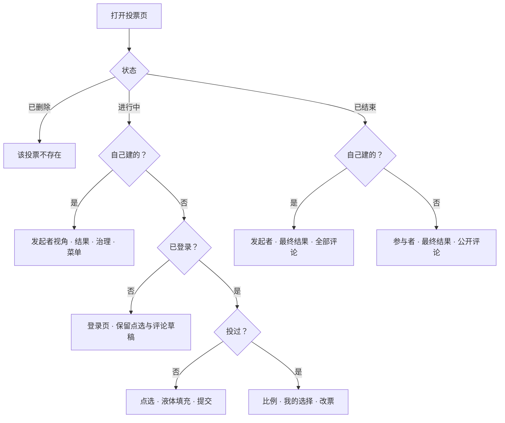
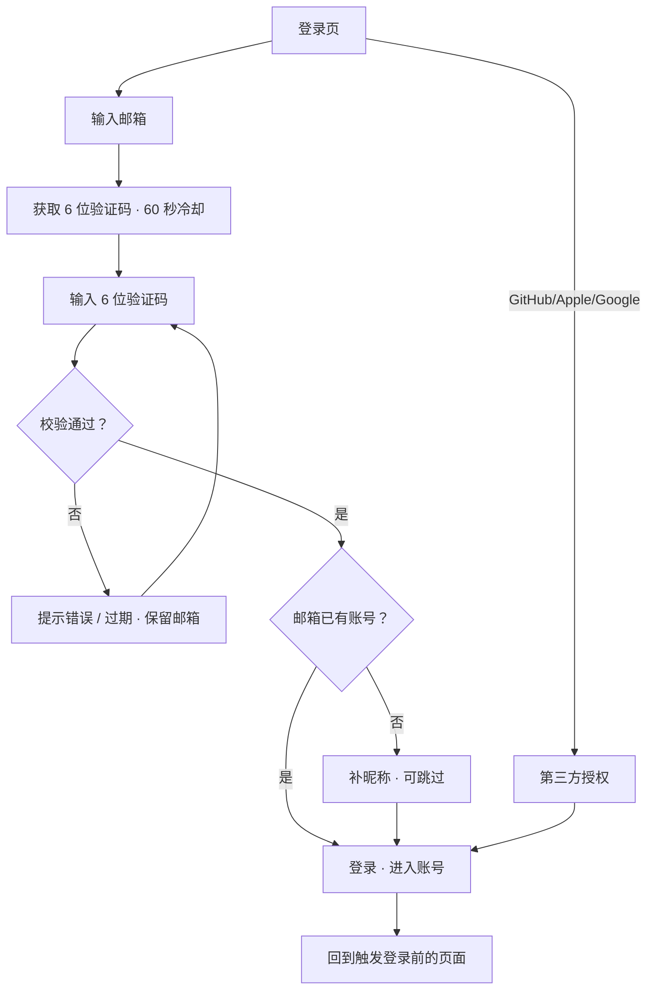

# BothPls PRD v1.6 — Notion 原文快照

归档日期：2026-11-26。来源最后编辑时间：2026-11-23T12:33:05.443Z。

来源：https://app.notion.com/p/421804a7ab24813388d8f7e818f82159

此文件仅供追溯，包含已知不准确的完成状态，不作为当前基准。请使用 [v1.6 校正版](../BothPls%20PRD%20v1.6.md)。

---

对齐当前实现与 v1.5 之后的定稿，只写落地规则，不保留待确认项。

## 版本记录

| 版本 | 变更 |
| --- | --- |
| v1.6 | 登录方式收敛为邮箱验证码 + GitHub / Apple / Google，<b>彻底移除密码</b>（密码登录、设置密码、找回密码全部不做）；登录页简化为邮箱 → 验证码 → 可选昵称；验证码校验通过即建号并登录，注册与登录共用同一表单；补首页首次进入规则（未登录默认广场、提示条 7 天冷却）；游客评论入口改为登录引导并保留草稿；昵称 2–20 字按码点；GitHub / Google 账号绑定纳入本期，Apple 绑定与多身份合并排 1.7；限流改用 Supabase 不自建锁定；版本号与更新日志单点维护；<b>本期做按代码现状收敛为 3 项</b>（登录页收尾、评论三权补全、账号绑定），已完成项转现状基线 |
| v1.5 | 取消软登录，身份收敛为游客与账号两级；新增独立登录页与邮箱注册 / 密码登录；投票、评论、创建前置登录；登录态跨设备；发起者不参与投票 |
| v1.4 | 结构重写：三层身份、首页双 Tab、发布链路合并、参与与结果合一、评论三权分离；液体填充动画定名；结束后禁止编辑 |

## 1. 项目信息

| 字段 | 内容 |
| --- | --- |
| 产品 | BothPls（朋友帮选） |
| 版本 | v1.6 MVP（Web） |
| 目标 | 发起者用单选投票收集朋友意见，辅助购物决策 |
| 适配 | 393 × 873 px，Android Chrome；360 / 412 px 不破版 |
| 页面数 | 7：首页 / 个人主页 / 创建 / 投票 / 编辑资料 / 设置 / 登录（无二级密码面板） |
| 原型 | Figma（附件） |

## 2. 需求范围

<b>已完成（代码已落地，转为现状基线，不再列入本期做）</b>

| 能力 | 现状 | 代码证据 |
| --- | --- | --- |
| 两级身份：游客只读、账号全能力 | 已落地 | <code>AccountProvider</code> 以 <code>!user.is_anonymous</code> 判账号；<code>RequireAccount</code> 只挂 <code>/create</code>、<code>/edit-profile</code> |
| 独立登录页：邮箱验证码 + GitHub / Apple / Google | 已落地（细节见本期做 1） | <code>AuthPage</code> 调 <code>sendEmailCode</code> / <code>verifyEmailCode</code>；三方按钮均走 <code>signInWithOAuth</code> |
| 登录态跨设备 | 已落地 | <code>client.ts</code> 按「记住我」选 localStorage / sessionStorage；数据随账号 uid |
| 首页双 Tab，默认广场，不首屏拦截 | 已落地 | <code>HomePage</code> 初始 <code>tab = "square"</code>，游客可直接浏览 |
| 登录提示条 2 秒出现、常驻、关闭 7 天 | 已落地 | <code>bothpls:home-auth-banner:dismissed-at</code>  • 7 天常量，无自动消失 |
| 创建 / 编辑 / 分享 / 结束 / 删除 | 已落地 | <code>OwnerPollActions</code>、<code>ShareProvider</code>、<code>CreatePollPage</code>、<code>updatePollMeta</code> / <code>deletePollRemote</code> |
| 单选、液体填充、两步提交、进行中改票 | 已落地 | <code>VotingPage</code> 点选只 <code>setSelectedId</code>，提交才写库；杯体动效在 <code>vote-cup-*</code> |
| 游客点选项 / 点评论 → 登录并保留现场 | 已落地 | <code>redirectGuestToLogin</code> 先存 pending 草稿，再跳 <code>/auth?mode=login&returnTo=</code>，回来回填 |
| 发起者不投票、不评论 | 已落地 | 投票页对所有者直接 <code>Navigate</code> 到结果页；DB 迁移 <code>prevent_poll_owner_voting</code> 兜底 |
| 结果 10 秒轮询、可见与联网即时刷新 | 已落地 | <code>usePolls</code> 仅投票详情开 10 秒定时，附 <code>focus</code> / <code>online</code> / <code>visibilitychange</code> |
| 个人主页、编辑资料、设置页 | 已落地 | <code>SettingsPage</code>（资料 + 我的投票）、<code>EditProfilePage</code>、<code>SettingsPreferencesPage</code> |
| 昵称 2–20 字按码点 | 已落地 | 输入 <code>Array.from(...).slice(0, 20)</code>，提交校验 ≥2；DB 迁移放宽到 20 |
| 版本号与更新日志单点维护 | 已落地 | 版本读 <code>public/changelog.json</code> 首条，<code>package.json</code> 同版 1.5.0 |
| 多语言切换 | 已落地 | <code>zh-CN</code> / <code>en</code> / <code>ko-KR</code> 三套 messages，切换即时重载 |
| 创建草稿跨设备 | 已落地 | 草稿 key 含 <code>user.id</code>，<code>readDraft</code> / <code>saveDraft</code> / <code>clearDraft</code> |

<b>本期做（按代码核对后剩余 3 项）</b>

1. <b>登录页收尾：彻底免密码 + 简化表单</b>
   - 现状：主路径已是邮箱验证码，三方登录齐全；但 <code>?mode=reset</code> 仍能进重置密码，<code>auth.ts</code> 仍保留 <code>signUpWithEmailPassword</code> / <code>signInWithEmailPassword</code> / <code>sendPasswordRecoveryEmail</code> / <code>updatePassword</code>，三语仍有 12 条密码文案；重发验证码没有 60 秒冷却，6 位填满不自动校验，昵称仍强制不少于 2 字。
   - 要做：删除 reset 模式与全部密码分支、密码服务与密码文案；补 60 秒重发冷却与倒计时、填满 6 位自动校验；昵称改为可跳过，留空取邮箱 @ 前部分。
   - 验收：<code>src</code> 内 <code>password</code> 零命中（配置文件说明除外）；<code>?mode=reset</code> 回落到验证码表单、不出现密码框；冷却期内重发按钮禁用并显示秒数；输入第 6 位自动提交；昵称留空可完成注册。
2. <b>评论三权分离补全</b>
   - 现状：已能编辑自己的评论、删除自己或发起者的评论；缺「我的评论」入口与发起者隐藏；创建页没有「结束后公开 / 立即公开」选择，<code>commentsPublic</code> 只有类型定义、库里无列，结果页一律按「结束后才可见」处理。
   - 要做：补「我的评论」入口（投票页与个人主页）、发起者隐藏单条评论；创建页加可见性选择并落库，结果页按 <code>commentsPublic</code> 判断。
   - 验收：进行中且 <code>commentsPublic=false</code> 时未投用户看不到评论；发起者可隐藏且自己仍可见；评论者能在「我的评论」里改删。
3. <b>GitHub / Google 账号绑定与解绑</b>
   - 现状：设置页只显示 GitHub 与 Apple 的状态行，Google 未列出；已登录用户没有绑定动作，代码里没有 <code>linkIdentity</code>，本地 <code>enable_manual_linking=false</code>。
   - 要做：设置页补 Google 行；GitHub / Google 提供绑定与解绑；线上开 Manual Linking；至少保留一种登录方式。
   - 验收：绑定后 <code>identities</code> 增加对应 provider；解绑最后一种被拒；身份已属其他账号时报错且原账号状态不变。

<b>本期不做</b>

- Apple 账号绑定（排 1.7）。
- 多身份合并、Apple 隐藏邮箱隔离、账号不统一提醒（排 1.7）。
- 密码登录、设置密码、修改密码、找回密码、密码强度条。
- 二次验证（2FA）、自建登录失败锁定。
- 手机号登录、微信登录。
- 软登录或匿名投票。
- 复制投票、多选模式、PC 端适配。
- 评论回复与举报、AI 推荐、投票提醒。
- 发起者备注或补充说明区。
- 账号数据导出。

## 3. 身份模型

| 身份 | 获得方式 | 能力 | 持久范围 |
| --- | --- | --- | --- |
| 游客 | 未登录直接打开 | 浏览首页广场、打开分享链接、查看进行中投票、查看已结束结果 | 无，不产生记录 |
| 账号 | 邮箱验证码（自动建号），或 GitHub / Apple / Google 授权 | 创建、编辑、分享、结束、删除自己的投票；投他人的票并改票；评论；个人主页与设置全功能 | 账号，跨设备 |

<b>判定</b>：能创建 = 已登录；能投票 = 已登录且不是该投票的发起者；其余为游客只读。

<b>登录方式</b>

| 方式 | 状态 | 规则 |
| --- | --- | --- |
| 邮箱验证码 | 主路径，唯一邮箱方式 | 6 位一次性验证码，10 分钟有效，60 秒重发冷却；校验通过即登录，邮箱未注册时自动建号 |
| GitHub 授权 | 已实现，可绑定 | 登录即进入或创建账号；已登录时走绑定 |
| Apple 授权 | 支持登录，不支持绑定 | 登录可用；绑定与多身份合并排 1.7 |
| Google 授权 | 已实现，可绑定 | 同 GitHub |

- <b>没有密码</b>：账号不持有密码，系统不存密码字段，页面不出现任何密码输入、显示或找回入口。
- 不再使用 Magic Link；邮件只承担验证码，不做链接登录、不做密码重置。
- 验证码校验通过即进入该邮箱账号；邮箱未注册时自动建号，注册与登录不做事前区分。
- 历史密码账号不迁移：同一邮箱继续用验证码登录即可，旧密码失效且不再校验。
- 一个账号至少保留一种登录方式，最后一种不可解绑；邮箱验证码对邮箱账号恒定可用，不计入可解绑项。
- 被绑定的身份已属于其他账号时拒绝，提示先登录原账号解绑。
- Apple 隐藏邮箱不写入账号资料，也不作为账号邮箱，账号邮箱以首次验证的邮箱为准。

<b>账号与登录态</b>

- 一个邮箱只对应一个账号；退出登录即回游客，本地不保留身份信息。
- 同一账号可多设备同时登录，记录一致；换设备登录只需再收一次验证码。
- 同一账号对同一投票只计一票，跨设备改票以最后一次提交为准。
- 登录限制交给 Supabase Auth 限流：命中后提示「尝试次数过多，请稍后再试」，不自建锁定。

## 4. 需求背景

- 面对差异不大的商品难决定，预算有限又要反复比较。
- 在聊天里刷图、追问、手工数票，信息分散。
- 多数决策是二选一，直接单选最直观。
- 匿名参与换设备后找不到自己的投票，发起者也追溯不到谁投了什么。
- 手机上记密码、找回密码是摩擦点；社交账号登录本身无密码，统一走验证码与授权最轻。

## 5. 目标

| 目标 | 衡量 | 目标值 |
| --- | --- | --- |
| 闭环 | 创建 → 分享 → 参与 → 结果 → 结束 | 全流程跑通 |
| 参与 | 投票耗时（含登录） | 小于 1 分钟 |
| 首屏 | 首页到首次有效动作（看卡片 / 创建 / 登录）的转化 | 不因登录拦截下降 |
| 登录 | 触发登录到登录成功的成功率 | 大于 80% |
| 注册 | 登录页从打开到进入账号的字段数 | 不超过 3 个输入框 |
| 规则 | 单选统计、评论权属、结束与删除 | 验收项全部通过 |
| 环境 | Android Chrome | 全页面可用 |

## 6. 功能清单

### 6.1 首页

<b>首次进入规则</b>

| 身份 | 判定 | 默认 Tab | 登录提示条 |
| --- | --- | --- | --- |
| 真首次 | 无 session，无 <code>bothpls:*</code> 痕迹 | 广场 | 2 秒后出现，常驻至手动关闭 |
| 复访未登录 | 无 session，有关闭记录 / 语言 / 草稿 | 广场 | 不出现（7 天冷却） |
| 已登录 | 有非匿名 session | 广场 | 不出现 |

- <b>默认永远落广场</b>，不落「最近」：游客的最近必为空态，不能当首屏。
- 登录提示条为顶部条状，不遮挡卡片点击，2 秒后出现，不自动消失；关闭写本地记录，7 天内不再出现。
- 双 Tab：<code>最近</code> / <code>广场</code>，共用同一套投票卡片组件。
- <b>最近</b>：当前账号创建或参与过的投票，按最近活动时间倒序；带「我建的」「我投的」角标与状态。
- <b>广场</b>：公开到广场且进行中的投票，按最新发布倒序，显示参与人数。
- 广场卡片只提供「去投票」入口；自己创建的卡片改为「我建的」与「查看结果」。
- 快捷创建：游客点创建跳登录页，成功后回创建页。
- 广场无进行中投票时给两个出口：发起投票、登录后查看我的投票。
- 加载失败提示重试，不把失败渲染成空态。

### 6.2 个人主页

- 顶部只读资料：头像、昵称、账号标识；头像可看大图，文字不可点。
- 右上角两个入口：编辑资料、设置。
- 投票区三 Tab：<code>全部</code> / <code>进行中</code> / <code>已结束</code>，按创建时间倒序。
- 全部 = 自己创建的与参与过的合集；软删除投票不出现在任何 Tab。
- 游客进入显示空态与登录入口。

<b>编辑资料页</b>：头像、昵称（2–20 字）、简介可选；保存回个人主页，返回不保存则丢弃。

### 6.3 创建页

- 名称必填；背景可选；商品 2–5 个可上传图片；截止时间可选。
- 评论可见性默认「结束后公开」，可选「立即公开」；公开到广场默认开启。
- 草稿绑定账号，跨设备可续；发布成功即清除；编辑态不产生草稿。

### 6.4 投票页（参与与结果合一）

| 状态 | 表现 |
| --- | --- |
| 进行中 · 游客 | 可看可点选；点选项与点评论均先登录，登录后回本页并保留点选与草稿 |
| 进行中 · 参与者未投 | 点选触发液体填充，单独提交 |
| 进行中 · 参与者已投 | 原地展示比例、我的选择、改票 |
| 进行中 · 发起者 | 只展示结果、评论治理、管理菜单；无选项交互、无提交、无评论输入 |
| 已结束 · 参与者 | 最终比例、公开评论、禁止投票 |
| 已结束 · 发起者 | 最终比例、全部评论、只剩分享与删除 |
| 已删除 | 「该投票不存在」+ 返回 |

- 顶部展示名称、背景、参与人数、截止时间、选项个数；参与人数只计参与者。
- 游客点评论输入：保存评论草稿后跳登录，回来可继续输入并提交，不允许出现无反馈的死路。
- 游客点提交同样跳登录，登录后需再确认一次提交。
- 发起者不能投票、不能评论自己的投票，直接请求由后端拒绝。
- 结果 10 秒轮询；页面可见或网络恢复立即刷新；结束后停止。

### 6.5 管理菜单（仅所有者）

- 入口：投票页右上角，参与者不可见。
- 五项权限：编辑、分享、结束、删除、查看结果。
- 编辑限进行中，可改名称、背景、选项图片、截止时间；不可增删选项或改选项文案顺序。
- 分享唤起浮层复制链接；结束与删除需二次确认，删除为软删除。
- 结束后只剩分享与删除。

### 6.6 设置页

| 分组 | 条目 | 行为 |
| --- | --- | --- |
| 账号 | 个人资料 | 跳编辑资料页 |
| 账号 | 登录方式 | 展示当前邮箱与已绑定的第三方；GitHub / Google 可绑定与解绑；Apple 仅显示状态、不提供绑定（1.7）；邮箱验证码恒定可用、不可解绑；至少保留一种 |
| 账号 | 隐私与账号 | 注销账号，二次确认并输入昵称 |
| 通用 | 语言 | 切换后立即重载界面 |
| 通用 | 通知权限 | 仅 iOS 显示，Web 版不出现 |
| 关于 | 版本号 + 更新日志 | 版本号与日志条目统一读 <code>public/changelog.json</code>，不在页面内硬编码 |
| 底部 | 退出登录 | 退出后回游客 |

- 游客可进，只显示登录入口、通用与关于。
- 设置页不出现密码相关条目，也不出现「修改密码」占位。
- 更新日志只含版本号与说明，不含接口地址、环境变量、后台配置名；加载失败只显示版本号。

### 6.7 登录页（注册与登录同一页）

- 独立路由页，不是弹窗；右上角「先逛逛」返回首页。
- 保留登录 / 注册两个 Tab：字段与验证码流程相同，唯一差异是注册才出现昵称；不切页面。
- 邮箱验证码是唯一邮箱方式；第三方为 GitHub、Apple、Google 三个按钮。
- 页面不出现密码、确认密码、显示隐藏、忘记密码、模式切换链接。

<b>表单字段（顺序即页面顺序）</b>

| 顺序 | 字段 / 控件 | 必填 | 规则 |
| --- | --- | --- | --- |
| 1 | 邮箱 | 是 | 邮箱格式校验；输入即清除上一次错误；失焦与提交时校验，错误提示在框下方 |
| 2 | 获取验证码 | — | 位于验证码框右侧；点击发送 6 位验证码；发送中显示 loading；成功后按钮进入 60 秒冷却，显示「重新获取（58s）」并禁用 |
| 3 | 验证码 | 是 | 6 位数字；单框输入，<code>inputmode=numeric</code>、<code>autocomplete=one-time-code</code>；填满 6 位自动校验并提交；10 分钟内有效、单次使用；错误提示在框下方，保留已填邮箱 |
| 4 | 昵称 | 否 | 仅新邮箱首次建号时出现；2–20 字按码点；留空取邮箱 @ 前部分，超 20 截断，非法字符替换为下划线；可跳过 |
| 5 | 主按钮 | — | 未填合法邮箱或未填满 6 位码时置灰；校验中显示 loading 并禁用，防重复提交；成功后进入账号 |
| 6 | 换个邮箱 | — | 验证码已发送后出现；点击清空验证码与倒计时，回到第 1 步，昵称已填内容保留 |

- 昵称步骤不阻塞：不填直接点主按钮即可完成，默认昵称可在编辑资料页改。
- 提交顺序：校验验证码 → 建号或登录 → 写昵称（如有）→ 进入账号；任一步失败停在当前步骤并保留邮箱与昵称。
- 第三方按钮：GitHub / Apple / Google 直接跳转授权；取消或失败回本页并提示，不清空已填邮箱。

<b>通用</b>

- 登录或注册成功后回到触发登录前的页面，被中断的表单、点选与草稿全部保留。
- 登录页不展示广场与个人主页内容，只有返回入口。
- 所有文案三语齐备；不出现任何密码相关文案。

### 6.8 邮件模板（支撑 6.7）

- 只发一种邮件：登录 / 注册验证码，正文含 6 位 <code>{{ .Token }}</code>，不依赖点击链接。
- 文案说明：验证码 10 分钟内有效、仅本人使用、非本人操作可忽略；不索要密码、不索要个人信息。
- 发件人名称与主题固定，避免被判为推广邮件；发送频率受 Supabase 项目额度与限流约束。

## 7. 关键规则

1. <b>单选</b>：一票一选项，改票只保留最新一次。
2. <b>两步提交</b>：点选触发液体填充，点提交才写入；评论随投票一并提交。
3. <b>液体填充</b>：点选后自下向上填满表示「待提交」；未提交不落库，改选回落。
4. <b>发布</b>：发布后进投票页（发起者视角），自动弹一次分享浮层。
5. <b>广场收录</b>：默认公开，关闭后不进广场但链接可访问；结束、删除后自动移出。
6. <b>截止时间</b>：可选；不设则持续开放至手动结束；到达自动结束，以后端时间为准。
7. <b>结束</b>：结束后禁止投票、改选、编辑；仍可分享与删除。
8. <b>删除</b>：仅所有者，二次确认，软删除，全端不再出现。
9. <b>评论所有权</b>：评论者可改删自己的评论，入口「我的评论」。
10. <b>评论治理权</b>：发起者可隐藏或删除任意评论，不可编辑他人内容。
11. <b>评论可见性</b>：创建时设定，默认「结束后公开」；可选「立即公开」，未投用户不可见。
12. <b>广场隐私</b>：广场内打开的投票，评论只显示昵称，不显示头像。
13. <b>草稿</b>：创建草稿绑定账号；投票与评论草稿按投票隔离，成功后清除。
14. <b>游客边界</b>：可浏览与看结果，不可投票、评论、创建、编辑、结束、删除。
15. <b>登录前置</b>：投票、评论、创建一律要求登录；登录引导必须保留现场（点选、评论文本、表单）。
16. <b>首屏不拦登录</b>：首页对游客完全开放，登录只在动作点出现；提示条不遮挡、不自动消失。
17. <b>昵称</b>：2–20 字，按码点计数（emoji 算 1 字），注册与编辑资料同规则。
18. <b>免密码</b>：全站不设密码、不存密码、不校验密码；不提供设置、修改、找回密码入口。
19. <b>邮箱验证码</b>：6 位、10 分钟有效、单次使用、60 秒重发冷却；发送与校验都走同一入口，失败保留邮箱与昵称。
20. <b>验证码建号</b>：校验通过即进入该邮箱账号；邮箱未注册时自动建号，注册与登录共用同一表单，只改文案。
21. <b>昵称不阻塞</b>：昵称可留空，留空即用邮箱 @ 前部分生成默认昵称，登录不被昵称卡住。
22. <b>限流</b>：使用 Supabase Auth 限流，不自建计数锁定；提示统一为「尝试次数过多，请稍后再试」。
23. <b>版本</b>：版本号唯一来源 <code>public/changelog.json</code>，页面与 <code>package.json</code> 同步读取，不三处手写。
24. <b>登录态</b>：一次登录长期有效；勾「记住我」持久保存，不勾仅当前会话；退出即游客。
25. <b>一票一账号</b>：跨设备改票以最后一次提交为准。
26. <b>发起者不投票</b>：不计入参与人数，后端拒绝自投与自评。
27. <b>无发起者备注</b>：不设留言或公告区，补充信息写进名称、背景或选项。
28. <b>多语言</b>：默认跟随系统，切换重载；只译界面文案，不译投票内容；语言缺失回落中文。
29. <b>账号绑定</b>：GitHub / Google 可在设置内绑定与解绑；身份已属其他账号时拒绝；至少保留一种登录方式，最后一种不可解绑；Apple 绑定排 1.7。
30. <b>Apple 隐藏邮箱</b>：不作为账号邮箱，也不写入账号资料；账号邮箱以首次验证的邮箱为准。

## 8. 用户流程

### 8.1 首次进入首页

### 8.2 主流程

### 8.3 投票页状态

### 8.4 登录与注册

## 9. 异常与边界

| 场景 | 处理 |
| --- | --- |
| 游客点选项 | 存草稿跳登录，回本页保留点选，需再确认提交 |
| 游客点评论输入 | 存评论草稿跳登录，回来可继续输入并提交 |
| 验证码错误 | 提示后保留邮箱与昵称，可修改重试；连续错误需重新获取 |
| 验证码过期 | 提示重新获取，旧码立即失效 |
| 验证码重发过频 | 60 秒冷却内禁用重发并显示倒计时 |
| 验证码发送失败（额度 / 网络） | 提示「发送失败，请稍后再试」，按钮退出 loading，可重试 |
| 换邮箱 | 清空验证码与倒计时，回到输入邮箱，昵称保留 |
| 绑定身份已属其他账号 | 提示「该登录方式已绑定其他账号，请先登录原账号解绑」，账号状态不变 |
| 解绑最后一种方式 | 拒绝并提示「至少保留一种登录方式」；邮箱验证码不计入可解绑项 |
| 绑定授权失败或取消 | 留在设置页提示重试，已有资料不变 |
| 游客点创建 | 跳登录，成功后回创建页 |
| 游客进个人主页 / 设置 | 只读空态与登录入口，设置只显示通用与关于 |
| 发起者自投或自评 | 前端不展示入口，后端拒绝并提示「发起者不能投票」 |
| 取消授权 | 留登录页，提示「已取消授权」，已填邮箱保留 |
| 授权失败 | 留登录页提示重试，不创建账号 |
| 第三方未返回昵称 | 用默认昵称，可在编辑资料修改 |
| 邮箱格式非法 | 阻止提交，提示「请输入有效邮箱」 |
| 昵称不足 2 字 | 阻止提交，提示「昵称至少需要 2 个字符」 |
| 昵称超 20 字 | 输入即截断，按码点计数 |
| 昵称留空 | 不报错，用邮箱 @ 前部分生成默认昵称 |
| 头像超 5 MB 或格式不支持 | 提示重选，其他字段保留 |
| 登录中网络中断 | 停留登录页提示重试，邮箱保留 |
| 会话过期 | 跳登录页，成功后回原页 |
| 历史密码账号登录 | 用同一邮箱验证码登录即可，不提示密码错误、不引导改密 |
| 首页提示条已关闭 | 写入时间戳，7 天内不再出现；已登录不出现 |
| 广场无数据 | 空态给创建与登录两个出口 |
| 加载失败 | 统一提示重试，不暴露后台配置 |
| 截止时间设为过去 | 拒绝保存 |
| 结束后编辑或提交 | 菜单不显示编辑；请求返回「投票已结束」 |
| 重复点击提交 | 幂等，只记一票，按钮提交中禁用 |
| 删除后访问链接 | 「该投票不存在」并返回 |
| 更新日志加载失败 | 只显示当前版本号 |
| 注销账号 | 二次确认并输入昵称，成功后回游客 |

## 10. 埋点

| 位置 | 时机 | 指标 |
| --- | --- | --- |
| 首页 | 首屏加载 | 游客占比、默认 Tab、2 秒内离开率 |
| 首页提示条 | 曝光 / 关闭 / 点击 | 曝光率、关闭率、点击转化 |
| 首页 | 点创建 / 点卡片 | 首屏动作转化、登录拦截次数 |
| 登录页 | 打开 / 提交 | 各方式占比、登录成功率、放弃率 |
| 邮箱验证码 | 发送 / 校验 | 发送成功率、到达率、校验成功率、重发率、换邮箱率 |
| 邮箱建号 | 首次校验通过 | 新建账号数、补昵称率、跳过昵称率 |
| 账号绑定 | 绑定 / 解绑 | 绑定转化率、失败原因分布、解绑率 |
| 创建页 | 发布 | 创建成功率、停留时长、广场开关关闭率 |
| 投票页 | 提交 / 改票 | 投票完成率、评论提交率、改票率 |
| 游客登录引导 | 点选项 / 点评论 | 引导触发次数、引导后登录率、回跳后提交率 |
| 分享浮层 | 打开 / 复制 | 自动弹出关闭率、复制率 |
| 管理菜单 | 编辑 / 结束 / 删除 | 操作分布、删除率 |
| 广场 | 卡片点击 | 曝光转点击率 |

## 11. 演进

| 版本 | 形态 | 内容 |
| --- | --- | --- |
| 1.6 | Web | 当前版本：邮箱验证码登录与注册、GitHub / Apple / Google 登录、首页双 Tab 与登录提示条、游客登录引导、投票与评论主链路、昵称与版本口径统一；剩余待补项见 §2（登录页免密收尾、评论三权、账号绑定） |
| 1.7 | Web | Apple 账号绑定、Apple 隐藏邮箱隔离、账号不统一提醒、多身份合并方案 |
| 1.8 | Web | 动效扩展、商品价格与购买链接、分享增强、多选模式、投票提醒 |
| 2.0 | iOS App | 功能对齐，原生端首发；评论举报与拉黑必须随版本交付 |
| 2.1 | 微信小程序 | 裁剪版 + 微信登录；多渠绑定按 unionid 合并；内容安全检测 |

<b>1.6 前置依赖</b>

- 线上 Supabase 开启 Manual Linking，用于 GitHub / Google 绑定。
- Redirect URLs 加入 <code>/auth</code> 与绑定回跳地址。
- 邮箱验证码使用 <code>{{ .Token }}</code> 模板，且注册发送时开启 <code>shouldCreateUser</code>，否则新邮箱无法建号。
- 代码层移除密码能力：删除 <code>signUpWithEmailPassword</code> / <code>signInWithPassword</code> / <code>resetPasswordForEmail</code> 调用与相关页面分支，统一走 <code>signInWithOtp</code> 与 <code>verifyOtp</code>。
- 邮件发送额度与频率受 Supabase 限流约束；超限时页面按「发送失败，请稍后再试」处理。
- 历史密码账号无需迁移：同一邮箱走验证码即可登录，旧密码不再校验。
